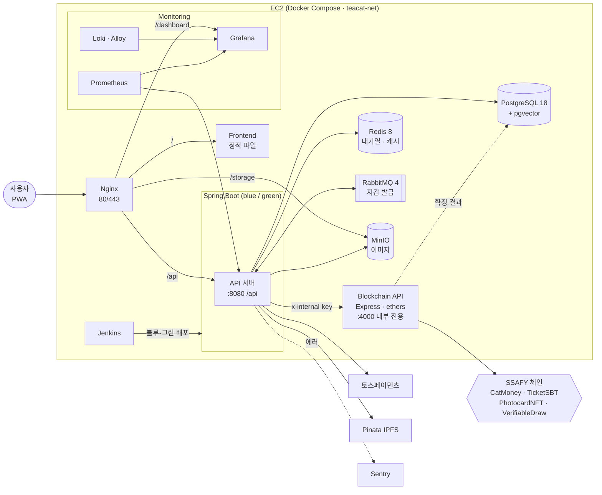

# 티캣 (teacat)

얼굴 인증과 블록체인으로 암표를 막는 티켓 예매 서비스.

| 환경 | 주소 |
|---|---|
| 운영 | https://teacat.site |
| 개발 | https://dev.teacat.site |

## 아키텍처



- 얼굴 인식은 **브라우저에서** 수행하며, 서버에는 임베딩만 전송됩니다.
- 블록체인 API만 니모닉을 보유하며, Spring 서버만 이 API를 호출할 수 있습니다.
- 체인 쓰기는 2단계로 응답합니다. 먼저 `202 {txHash}`를 반환하고 폴링으로 확정합니다.

## 주요 기능

### 얼굴 인증
- 브라우저의 Web Worker에서 onnxruntime-web으로 **YuNet**(검출)과 **SFace**(인식) 모델을 실행하며, 사진은 기기 밖으로 나가지 않습니다.
- 128차원 임베딩을 pgvector 컬럼에 저장하고, 코사인 유사도 **0.65 이상**이면 본인으로 판정합니다.
- 얼굴을 등록해야 좌석을 선점하고 결제할 수 있으며, 티켓이 발급될 때 얼굴이 티켓에 복사됩니다.

### 예매
- 대기실 → 좌석 선택 → 선점 → 결제 순서의 선착순 예매입니다.
- 선점은 DB 조건부 UPDATE로 처리하며, 기본 10분 유지됩니다. 부분 유니크 인덱스로 **회차당 1인 1매**를 강제합니다.
- 중복 요청은 Idempotency-Key로 막습니다.

### 가상 대기실
- 회차별 대기열을 Redis Sorted Set으로 관리하며, 부하테스트로 측정한 정원(기본 5,000명)만 좌석 페이지에 입장시킵니다.
- 1초마다 Lua 스크립트 하나로 만료자 정리 → 빈자리 계산 → 입장 처리를 원자적으로 수행합니다(틱당 최대 200명).
- 인터셉터가 좌석·선점 API의 입장 여부를 검사합니다. 관리자가 회차별로 켜고 끕니다.

### 티켓 (SBT)
- 결제가 끝나면 양도할 수 없는 ERC-721 티켓을 발급합니다. 발행과 소각 외의 이동과 approve는 차단됩니다.
- 입장은 **QR 스캔**(서명 토큰 검증) 후 **얼굴 대조**로 진행하며, 두 단계를 모두 통과해야 입장 처리됩니다.

### 취소표 추첨
- 매진된 구역에는 취소표 대기를 걸 수 있습니다. 취소표가 나오면 일반 판매로 풀지 않고 **온체인 추첨**을 엽니다.
- VerifiableDraw는 커밋-리빌 방식입니다. 시드 해시를 먼저 체인에 올리고, 시드와 다음 블록 해시로 난수를 확정하므로 누구나 결과를 검증할 수 있습니다.
- 당첨자에게는 12시간의 결제 기한이 주어집니다.

### 결제 · 캣머니
- 토스페이먼츠로 결제하며, 캣머니와 카드를 섞어 낼 수 있습니다. 캣머니 사용분은 즉시 홀드됩니다.
- 캣머니(TCAT)는 ERC-20 토큰으로, 충전·보상 시 mint되고 결제 시 burn됩니다. operationKey로 멱등성을 보장합니다.

### 지갑
- 커스터디 HD 지갑입니다. 마스터 니모닉에서 사용자별 주소를 파생하며, 개인키는 저장하지 않습니다.
- 가입이 커밋된 뒤 RabbitMQ로 지갑 발급을 요청합니다. 소비자가 주소를 파생하고 가입 축하금을 지급합니다.
- 스위퍼가 PENDING 상태를 재전송합니다. 큐는 신호일 뿐이고, 기준이 되는 상태는 DB 행입니다.

### 포토카드 NFT
- ERC-1155 토큰입니다. 도안마다 수량이 한정되며, 메타데이터는 Pinata(IPFS)에 저장합니다.
- 티켓 1장당 카드팩 1개를 받으며, 공연 시작 10분 전부터 개봉할 수 있습니다.
- 경매(입찰·즉시구매)와 고정가 거래를 지원합니다. 캔버스로 꾸민 카드는 꾸밈이 함께 이전됩니다.
- 정산은 캣머니 이전 → 카드 이전의 2단계로 진행하며, 실패하면 보상 처리합니다.

### 이상거래 탐지 (FDS)
- 정산 전에 규칙 8종으로 심사합니다: 동일 단말·전화번호, 반복 거래쌍, 가격 이상, 신규 계정 급행, 거래량 급증, 매집, 계정 탈취 의심.
- `FLAG` 모드(기본)는 심사 기록만 남깁니다. `HOLD` 모드는 관리자 결정까지 정산을 보류하며, 72시간이 지나면 자동 승인합니다.
- 섀도우 모델: `fds/`에서 로지스틱 회귀를 학습하고 서버가 채점합니다. 점수는 기록만 하고 판정에는 쓰지 않습니다.
- 관리자 콘솔에서 규칙 근거와 입찰 타임라인을 확인하고 승인하거나 거절합니다.

### 기타
| 기능 | 설명 |
|---|---|
| 미니게임 | 캣머니를 거는 실시간 멀티플레이 윷놀이·할리갈리 (SSE, 채팅) |
| 스티커 | 낙서로 스티커 생성 (외부 GPU 워커가 처리) |
| 리워드 | 출석 체크, 송편 잡기, 포토카드 짝 맞추기 랭킹 보상 |
| 랭킹 · 검색 | 인기 공연·포토카드 순위, 통합 검색과 인기 검색어(Redis) |
| 공연장 | 엑셀 레이아웃으로 좌석 일괄 생성 |
| 운영 | 알림, 1:1 문의, 배너, 어드민 대시보드(DAU·배포 마커) |
| 인증 | 이메일 가입(JWT + 리프레시 토큰), SSAFY OAuth |

## 기술 스택

| 영역 | 스택 |
|---|---|
| Frontend | React 19, Vite 7, TypeScript, Tailwind v4, TanStack Query, Zustand, onnxruntime-web, PWA |
| Backend | Java 21, Spring Boot 4.1, JPA, Flyway, Spring Security(JWT), Spring AMQP |
| Blockchain | Solidity 0.8.28, Hardhat, Express, ethers v6 (SSAFY 체인, Besu) |
| Data | PostgreSQL 18 + pgvector, Redis 8, RabbitMQ 4, MinIO |
| Infra | Docker Compose, Nginx(블루-그린), Jenkins |
| Observability | Prometheus, Alertmanager, Grafana, Loki, Alloy, Sentry, Clarity |
| FDS | Python (학습), Java (채점) |

## 구조

```
client/      프론트엔드
server/      API 서버
blockchain/  컨트랙트(contracts/) + 체인 API(api/)
fds/         이상거래 탐지 모델 학습
docker/      compose, nginx, 모니터링, .env 예시
loadtest/    k6 부하 테스트
exec/        포팅 매뉴얼, DB 덤프
```

## 로컬 실행

요구 사항: Docker, JDK 21, Node.js 20.19+

```bash
docker compose -f docker/docker-compose.yml up -d
```

```bash
cd blockchain && npm install && npm run dev
```

```bash
cd server && ./gradlew bootRun
```

```bash
cd client && npm install && npm run dev
```

| 서비스 | 주소 |
|---|---|
| Frontend | http://localhost:5173 |
| API / Swagger | http://localhost:8080/api/swagger-ui.html |
| Blockchain API 문서 | http://localhost:4000/docs |

## 문서

- 배포: [exec/포팅매뉴얼.md](exec/포팅매뉴얼.md)
- 프론트: [client/README.md](client/README.md), [client/DESIGN.md](client/DESIGN.md)
- 백엔드 규칙: [server/CLAUDE.md](server/CLAUDE.md)
- 대기열 설계: [server/QUEUE_DESIGN.md](server/QUEUE_DESIGN.md)
- 이상거래 심사 설계: [server/AUCTION_FRAUD_DESIGN.md](server/AUCTION_FRAUD_DESIGN.md)
- 블록체인: [blockchain/README.md](blockchain/README.md), [blockchain/DESIGN.md](blockchain/DESIGN.md)
- 지갑 발급: [docs/rabbitmq-wallet-provisioning.md](docs/rabbitmq-wallet-provisioning.md)
- FDS: [fds/README.md](fds/README.md)
