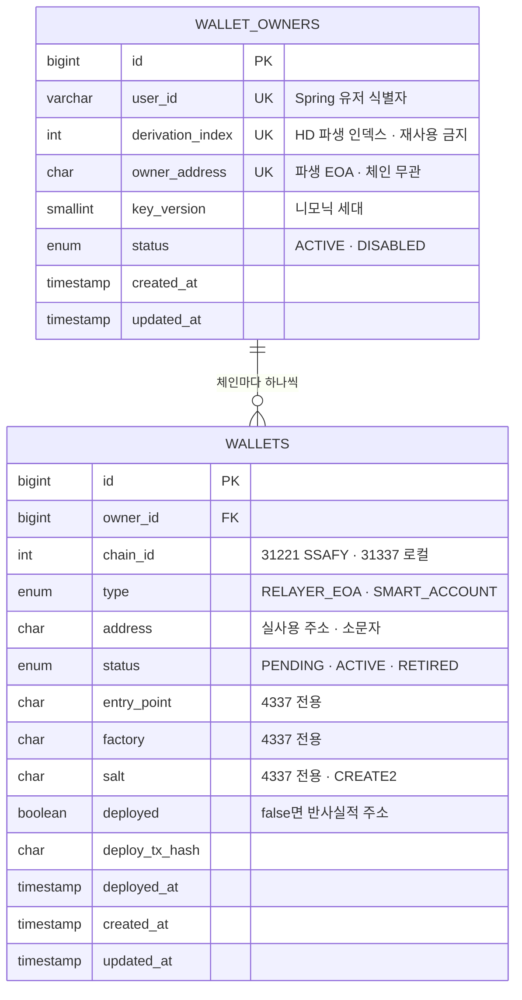

# 티캣 블록체인 서비스 — 설계

> 이 폴더는 티캣의 **온체인 로직**을 담당합니다.
> 작업을 시작하기 전에 이 문서를 읽어주세요. 무엇을 어떻게 만들지와 **왜 그렇게 정했는지**가 전부 여기 있습니다.
> 여기 적힌 규칙을 바꿔야 한다면 팀에 먼저 공유하고, **이 문서를 같은 커밋에서 갱신**하세요.
> 규칙과 코드가 어긋나면 다음 사람이 헤맵니다.

---

## 0. 30초 요약

| | |
|---|---|
| 언어·런타임 | Node.js 20+ · TypeScript · Express |
| 컨트랙트 | Solidity · Hardhat · OpenZeppelin |
| 체인 | **SSAFY 체인 (Besu, chainId 31221)** · 가스 무료 · 블록 10초 · EVM Constantinople |
| 지갑 | 서버 커스터디. **릴레이어로 시작 → ERC-4337로 전환** |
| 배포된 컨트랙트 | `TicketSBT`(양도불가 티켓) · `CatMoney`(캣머니 · `TCAT`) · `PhotocardNFT`(포카 · ERC-1155) · `VerifiableDraw`(검증 가능한 추첨) |
| 프론트와의 관계 | **직접 통신하지 않습니다.** Spring 백엔드를 거칩니다 |
| DB | **우리 테이블은 없습니다.** 상태는 Spring 이 소유하고, 우리는 확정 결과 컬럼만 갱신합니다 (1장 예외) |

블록체인이 처음이라면 **[11장 용어집](#11-용어집)** 을 먼저 보세요.

---

## 1. 이 서비스의 경계

```
[frontend]  ──/api──▶  [server (Spring)]  ──내부 S2S──▶  [blockchain]  ──▶  [EVM 체인]
```

프론트는 이 서비스를 **직접 부르지 않습니다.** 이유 셋입니다.

1. 이 프로세스는 **오퍼레이터 개인키를 쥐고 있습니다.** 공개 인터페이스는 좁을수록 좋습니다.
2. 프론트 규칙(`frontend/CLAUDE.md` 3장)상 프론트는 `shared/api/client.ts` 한 통로만 씁니다.
3. 인증·세션·**금액 확정은 Spring이 진실의 원천**입니다. 두 군데로 갈라지면 사고가 납니다.

### 하는 일 / 하지 않는 일

| 한다 | 하지 않는다 |
|---|---|
| 컨트랙트 쓰기 요청에 서명·전송 | 유저 인증·세션 |
| 체인에서 트랜잭션 상태 조회, 재시도·가스 상향 | 결제 승인(토스) |
| 파생 인덱스 → 지갑 주소 계산 | 좌석 락·예매 상태 |
| 체인 값을 Spring이 쓰기 좋은 형태로 변환 | **금액/수량 확정** |
| 검증 가능한 난수(NRF) 발급과 증명 노출 | **데이터 저장** — DB는 Spring 것 |

> **이 서비스는 시키는 대로 실행합니다.** "얼마를 차감할지"는 Spring이 정합니다.
> 프론트 문서에 이미 "금액의 출처는 항상 서버"가 박혀 있습니다. 그 서버는 Spring입니다.

### 상태는 Spring이 소유합니다

**이 서비스는 자기 DB를 갖지 않습니다.** Spring이 요청하면 체인에 쓰고 결과를 돌려줍니다.

| 남겨야 할 것 | 어디에 |
|---|---|
| 지갑 주소 · 파생 인덱스 | **Spring DB** (5-3) |
| 티켓 ↔ `tokenId` 매핑 | **Spring DB** |
| 진행 중인 트랜잭션(`txHash`) | **Spring DB** (7장) |
| "이 요청을 이미 처리했나" | **컨트랙트** (4-3) |
| 논스 | **체인에서 읽음** |

DB가 하나라 두 DB 사이 동기화 문제가 없고, 티켓 발행과 지갑 기록이
**Spring의 한 트랜잭션 안**에서 끝납니다.

#### 예외 하나 — 확정 결과는 우리가 씁니다 (2026-09-04)

블록이 10초라 쓰기는 `202` 로 먼저 끝나고, 확정은 나중에 옵니다. 그걸 누가 확인하느냐를
두고, **Spring이 폴링하는 대신 우리가 Spring DB의 `tickets` 몇 컬럼을 직접 갱신**하기로
했습니다. 결제 직후 발행이 유저에게 실패로 보이면 안 된다는 요구에서 나온 결정입니다.

그래서 이 서비스는 **Spring DB에 붙습니다.** 다만 소유권은 컬럼 단위로 갈라 둡니다.

| | 쓰는 쪽 |
|---|---|
| `tickets.transfer_status` · `token_id` · `mint_tx_hash` · `burn_tx_hash` | **이 서비스** |
| `tickets` 의 나머지 전부 | **Spring** |

지켜야 할 규칙 넷입니다.

- **SQL은 `db/` 안에서만.** `chain/` 밖에서 `ethers`를 안 쓰는 것(4-1)과 같은 이유입니다
- **조건부 UPDATE.** `WHERE ... AND transfer_status='PENDING'` — 무조건 덮으면 취소된 행이 되살아납니다
- **`updated_at`을 직접 갱신.** Hibernate의 `@UpdateTimestamp`를 우회하므로 그 컬럼이 안 움직입니다
- **전용 계정.** 그 테이블의 그 컬럼만 UPDATE 되는 권한

Spring 쪽에서는 해당 컬럼을 엔티티에 `updatable = false`로 두어야 합니다. 안 그러면
로드해 둔 엔티티가 나중에 flush 되면서 우리 UPDATE를 덮어씁니다.

**여전히 안 하는 것**: 우리 소유의 테이블을 만들지 않고, 스키마를 마이그레이션하지 않으며,
비즈니스 판단을 DB에서 읽지 않습니다. 확정 결과를 받아 적는 것뿐입니다.

대신 **멱등성이 컨트랙트로 올라갑니다.** 이게 이 설계의 유일한 트레이드오프인데,
체인은 롤백되지 않으므로 DB 멱등키보다 오히려 강합니다. 손해 보는 거래가 아닙니다.

한 가지 실제로 잃는 것은 **감사 로그**입니다. "언제 무슨 요청이 와서 어떤 tx가 나갔는지"가
이 서비스에는 로그 파일로만 남습니다. 불편해지면 append-only 로그를 나중에 추가합니다.

---

## 2. 기술 스택

| 영역 | 선택 | 쓰지 말 것 |
|---|---|---|
| 런타임 | Node.js 20.19+ | |
| 웹 | Express + TypeScript | |
| 컨트랙트 | Solidity 0.8.28 (evmVersion `constantinople`) + **OpenZeppelin 5.1.0 고정** | 체인 EVM 이 Constantinople (8장) |
| 개발 프레임워크 | Hardhat 2.x + `@nomicfoundation/hardhat-toolbox` | |
| 체인 라이브러리 | ethers v6 + typechain | 여러 라이브러리 혼용 |
| DB | **없음** | 이 서비스에 DB·ORM을 붙이는 것 |
| 검증 | zod (환경변수·요청 본문) | |


---

## 3. 폴더 구조

`contracts`(Hardhat)와 `api`(Express)는 **npm workspaces로 분리**합니다.
한 package에 합치면 tsconfig 타깃과 의존성이 계속 충돌합니다.

```
괄호 안의 M1~M5 는 아직 없고 그 단계에서 생기는 것입니다 (9장).

```
blockchain/
├─ package.json                       # workspaces 루트, 스크립트만
├─ tsconfig.base.json
├─ .env.example                       # 변수 설명서 (값 없음, 커밋됨)
├─ .env                               # 실제 값 (커밋 안 함, 자동 생성)
├─ DESIGN.md                          # 이 문서 — 설계와 규칙
├─ README.md                          # 실행 방법
│
├─ contracts/                                  ── Hardhat 워크스페이스
│  ├─ contracts/                              .sol — 체인에 올라가는 코드
│  │   ├─ TicketSBT.sol                       양도불가 ERC721
│  │   ├─ CatMoney.sol                        ERC20 · decimals 0 · TCAT
│  │   ├─ PhotocardNFT.sol                    ERC1155 · tokenId 는 도안
│  │   └─ VerifiableDraw.sol                  커밋-리빌 + 블록해시
│  ├─ test/                                   컨트랙트 테스트는 여기만
│  ├─ scripts/
│  │   ├─ deploy.ts                           배포 + 주소 파일 기록
│  │   └─ setupEnv.ts                         .env 생성 (npm install 이 부름)
│  ├─ lib/deployments.ts                      배포 주소 읽기·쓰기
│  ├─ deployments/<network>.json               배포 주소 (localhost 는 커밋 제외)
│  ├─ hardhat.config.ts                       solidity 버전 · 네트워크
│  └─ index.ts                                api 가 쓰는 공개 창구
│
└─ api/                                        ── Express 워크스페이스
   └─ src/
      ├─ main.ts                    서버 기동 · 종료 처리
      ├─ app.ts                     Express 조립 (미들웨어 순서)
      ├─ config/                    env(zod) · 네트워크 이름
      ├─ routes/                    주소 → 컨트롤러 연결만 (얇게)
      ├─ controllers/               요청 검증 · 응답 변환
      ├─ services/                  유스케이스 — ethers 를 모름
      ├─ db/                        Spring DB 의 확정 결과 컬럼만 (1장 예외)
      ├─ chain/                     여기만 ethers 를 앎
      │   ├─ provider.ts                체인 연결 · 릴레이어/오퍼레이터 지갑
      │   ├─ hash.ts                    Spring 키 → 온체인 키 (정의는 여기 하나뿐)
      │   ├─ keys/hdWallet.ts           니모닉에서 유저 지갑 파생
      │   ├─ contracts/                 타입드 컨트랙트 인스턴스
      │   ├─ nonce.ts                   논스 직렬화 (주소별, 메모리 큐)
      │   ├─ receipt.ts          (M1)   체인에서 tx 상태 조회
      │   ├─ sender/             (M1)   전송 방식 추상화 (5-2)
      │   │   ├─ TxSender.ts                인터페이스
      │   │   ├─ RelayerSender.ts           M1
      │   │   ├─ DirectEntryPointSender.ts  M4 · 번들러 없이
      │   │   └─ BundlerSender.ts           M5
      │   └─ aa/                 (M4)   ERC-4337
      ├─ middlewares/               내부인증 · 에러 · 로깅
      └─ shared/                    에러 타입 · 로거 · 공통 유틸
```

`repositories/` · `prisma/` · `indexer/` · `jobs/` 가 **없습니다.**
상태를 갖지 않으니 저장할 곳도, 저장한 것을 감시할 워커도 필요 없습니다 (1장).

---

## 4. 절대 규칙

### 4-1. `chain/` 밖에서 `ethers` 를 import 하지 않는다

`services/` 는 "티켓을 발행한다"만 알고, "그게 트랜잭션이다"는 모릅니다.
프론트가 PG SDK를 `features/payment` 안에만 가둔 것과 같은 이유입니다.
체인이 바뀌거나 라이브러리를 갈아탈 때 `services/` 를 건드리지 않습니다.

### 4-2. 쓰기 요청은 **절대 동기로 응답하지 않는다**

```ts
// 이러면 안 됩니다 — 로컬에서는 되지만 실제 체인에서 무너집니다
await ticketSBT.mint(to, ticketKey, seatHash);
const ticket = await ticketSBT.getTicket(tokenId);   // 아직 반영 전
return ticket;

// 이렇게 — 전송까지만 하고 txHash 를 즉시 돌려줍니다
const txHash = await ticketService.sendMint({ to, ticketKey, seatHash });
return res.status(202).json({ txHash, status: 'PENDING' });
```

로컬 체인은 즉시 확정되지만 실제 체인은 12초 이상 걸립니다.
동기로 짜두면 나중에 **Spring 연동 규격과 프론트 화면까지 같이 바뀝니다.**
로컬에서 즉시 확정되더라도 **무조건 `202 + txHash`** 로 통일하고, 확인은 Spring이 폴링합니다 (7장).

### 4-3. 멱등성은 **컨트랙트**가 보장한다

이 서비스는 DB가 없어서 "이 요청을 이미 처리했다"를 기억할 수 없습니다. 그래서 멱등을 온체인으로 올립니다.

```solidity
mapping(bytes32 => uint256) public ticketOf;   // ticketKey → tokenId
error AlreadyIssued(uint256 tokenId);

function mint(address to, bytes32 ticketKey, bytes32 seatHash)
    external onlyRole(MINTER_ROLE)
{
    uint256 existing = ticketOf[ticketKey];
    if (existing != 0) revert AlreadyIssued(existing);
    ...
}
```

`ticketKey` 는 **Spring이 정하는 유일 키**입니다 (주문번호나 티켓 PK의 해시).
같은 키가 두 번 오면 컨트랙트가 revert하고, 이 서비스는 그것을 **성공으로 변환**합니다.

```
재시도 → revert AlreadyIssued(12) → 200 { status: 'ALREADY_ISSUED', tokenId: 12 }
```

**왜 DB 멱등키로는 안 되나** — tx를 보낸 직후 응답 전에 프로세스가 죽으면,
Spring은 실패로 판단해 재시도하고 이 서비스는 아무것도 기억하지 못해 **또 보냅니다.**
"tx가 나갔는지"는 보낸 쪽만 알 수 있는데 그 쪽이 죽었기 때문입니다.
체인은 롤백되지 않으므로 온체인 멱등이 DB 멱등보다 강합니다.

> 상태를 바꾸는 컨트랙트 함수에는 **전부** 이런 유일 키를 둡니다.
> 티켓 발행뿐 아니라 캣머니 지급·차감, 포카 발행도 마찬가지입니다.
> 메모리 `Map` 으로 대신하지 마세요 — 재시작하면 사라져서 중복 발행이 납니다.

> **Spring DB에 붙은 뒤에도 이 규칙은 그대로입니다** (1장 예외). 그 연결은 확정 결과를
> 받아 적는 용도지 멱등 판단에 쓰지 않습니다. 멱등을 DB로 내리면 `ticketKey` 가 필요
> 없어 보이는데, 그러면 메시지 큐가 재전달할 때(at-least-once 는 정상 동작입니다)
> 한 결제에 티켓이 두 장 나갑니다. 체인은 롤백되지 않으므로 방어는 체인에 둡니다.

### 4-4. 논스는 한 프로세스·한 서명자에서 직렬화한다

인스턴스를 2개 띄우면 `replacement transaction underpriced` 로 전부 막힙니다.
스케일아웃은 서명자를 분리한 뒤에 논의합니다.

### 4-5. 화면용 조회는 이 서비스가 하지 않는다

"내 티켓 목록" 같은 조회는 **Spring이 자기 DB에서** 내려줍니다.
체인은 *"그게 진짜다"* 를 증명하는 레이어지 조회 소스가 아닙니다.

이 서비스가 제공하는 조회는 둘뿐입니다.

| 조회 | 방법 |
|---|---|
| 트랜잭션 상태 | `getTransactionReceipt(txHash)` |
| 온체인 실제 값 (대사용) | 컨트랙트 view 함수 |

두 번째는 **Spring DB와 체인이 어긋났는지 확인**할 때만 씁니다.
화면이 매 요청마다 타는 경로가 아닙니다 — 그렇게 쓰면 RPC 레이트리밋에 걸립니다.

### 4-6. 개인키를 DB에 저장하지 않는다

니모닉 + 파생 인덱스로 언제든 재생성됩니다. **DB가 통째로 유출돼도 니모닉 없이는 무의미**해야 합니다.

### 4-7. 주소는 소문자로 정규화해 저장한다

이더리움 주소는 EIP-55 체크섬 때문에 대소문자가 섞입니다.
정규화하지 않으면 같은 주소가 두 행이 되고 UNIQUE 제약이 무력화됩니다.
저장·조회 양쪽에서 `toLowerCase()`, 화면 표시용으로만 체크섬 형식으로 변환합니다.

---

## 5. 지갑 설계

### 5-1. 왜 커스터디인가

티캣 유저는 아이디/비번으로 가입합니다. 지갑도 없고 가스로 쓸 ETH도 없습니다.
그래서 **서버가 키를 보관하고 대신 서명**합니다.

**키는 두 개이고, 서로 분리합니다.**

```
마스터 니모닉 (유저 자산)              오퍼레이터 개인키 (가스)
  └─ m/44'/60'/1'/0/{index}             └─ 단독 EOA
       → 유저별 owner EOA                    → 모든 트랜잭션의 가스를 지불
          └─ CREATE2 → 스마트 계정 (M4~)

  ↑ api 프로세스만 읽음                  ↑ api + Hardhat 배포 스크립트
```

니모닉에서 오퍼레이터까지 파생하면 **배포 스크립트에 니모닉을 넘겨야 합니다.**
배포 스크립트는 가스만 낼 줄 알면 되지 유저 자산의 마스터키를 알 필요가 없습니다.
시크릿이 하나 늘어나는 대신 니모닉이 닿는 범위가 절반이 됩니다.

| | 마스터 니모닉 | 오퍼레이터 키 |
|---|---|---|
| 무엇을 통제하나 | **전 유저 자산** | 가스 지갑 하나 |
| 누가 읽나 | `api` 프로세스만 | `api` + Hardhat 배포 |
| 교체 비용 | 전 유저 주소가 바뀜 (5-4 이관) | 그냥 갈아끼우면 끝 |

유저 파생 경로는 account 레벨을 `1'` 로 둡니다. `0'` 을 비워두면 나중에 다른 용도의 키를
넣을 자리가 남고, 오퍼레이터를 니모닉으로 되돌리더라도 인덱스가 겹치지 않습니다.

**인덱스 할당은 Spring 책임입니다.** 이 서비스는 `derivationIndex → 주소` 를 계산만 하는 순수 함수입니다.

```
POST /internal/wallets  { derivationIndex: 42 }  →  200 { address: "0x…" }
```

주의: **인덱스를 절대 재사용하지 마세요.** 재사용되면 다른 사람에게 이전 유저의 주소가 배정되고,
그 주소에 남아 있던 자산까지 딸려 갑니다. auto-increment로 뽑고, 탈퇴해도 행을 지우지 않습니다.

#### 키는 어디에 저장되나

**개인키는 어디에도 저장하지 않습니다.** 니모닉 + 인덱스로 매번 파생하고 서명 후 버립니다 (4-6).
그래서 남는 질문은 "니모닉과 오퍼레이터 키를 어디에 두느냐" 하나뿐입니다.

| 환경 | 위치 |
|---|---|
| 로컬 개발 | `blockchain/.env` — **커밋 안 함.** `npm install` 이 만들어줍니다 |
| 테스트넷 시연 | `blockchain/.env` 또는 서버 환경변수 |
| 실서비스 | KMS · Secrets Manager · Vault |

**커밋되는 파일에는 키 형태의 값을 하나도 두지 않습니다.** 공개 테스트 키라도 마찬가지입니다 —
한 번 그런 줄이 생기면 그 자리에 진짜 키를 넣는 사람이 반드시 나옵니다.

| 파일 | 커밋 | 역할 |
|---|---|---|
| `.env.example` | 함 | **설명서.** 각 변수가 무엇이고 틀리면 무슨 일이 나는지. **값 없음** |
| `.env` | 안 함 | 실제 값. `scripts/setupEnv.ts` 가 생성 |

그럼 값은 어디서 오나 — **각자 로컬에서 무작위로 만듭니다.** `npm install` 의 postinstall 이
니모닉을 새로 뽑고, 오퍼레이터 키를 `m/44'/60'/0'/0/0` 에서 파생하고, 내부 API 키를 랜덤 생성합니다.
`.env` 가 이미 있으면 건드리지 않고, `NODE_ENV=production` 이나 CI 에서는 아예 건너뜁니다.

로컬 체인은 그 니모닉으로 계정을 만들어 자금을 채웁니다.

```ts
// hardhat.config.ts — 로컬 전용
hardhat: { accounts: { mnemonic: MASTER_MNEMONIC } }
```

오퍼레이터가 Hardhat 의 Account #0 자리에 오므로 **가스가 자동으로 채워집니다.**
니모닉이 사람마다 다르니 유저 주소도 팀원마다 다릅니다 — 각자 자기 체인을 쓰므로 무방합니다.

> 주의: 니모닉을 Hardhat 이 읽는 건 **로컬 네트워크뿐**입니다. 테스트넷·운영은
> `accounts: [OPERATOR_PRIVATE_KEY]` 로 오퍼레이터 키만 씁니다. 위 표의 분리 원칙은 그대로입니다.

그리고 `config/env.ts` 가 운영에서 **로컬 흔적을 감지하면 기동을 거부**합니다 —
Hardhat 공개 니모닉·공개 테스트 키·`CHAIN_ID=31337`. 튜토리얼에서 복사한 값이
운영까지 흘러가는 사고가 흔해서 한 번 막아둡니다.

주의: **그 공개 니모닉을 테스트넷에 쓰지 마세요.** 누구나 개인키를 파생할 수 있어서
faucet으로 받은 ETH가 몇 초 안에 봇에게 털립니다. 상시 감시하는 봇이 실제로 있습니다.

**로그 유출 주의** — 사고는 대개 간접적으로 납니다.

- `console.log(wallet)` — ethers `Wallet` 객체는 개인키를 포함합니다
- 에러 객체를 통째로 직렬화하거나, 요청/응답 전체를 로깅하는 미들웨어

→ `chain/keys/` 밖으로는 **주소만** 내보냅니다. `Wallet` 객체 자체를 반환하지 않습니다.
파생 결과를 캐시하지도 않습니다 — BIP32 파생은 충분히 빨라서 메모리에 키를 오래 남길 이유가 없습니다.

### 5-2. 릴레이어 → ERC-4337, 두 단계로 갑니다

| | M1 릴레이어 | M4 ERC-4337 |
|---|---|---|
| 유저 주소 | 파생 EOA | CREATE2 스마트 계정 |
| 누가 보내나 | 오퍼레이터 EOA가 직접 | UserOperation → EntryPoint |
| 가스 | 오퍼레이터가 지불 | Paymaster가 대납 |
| 구현 난이도 | `hardhat-example` 수준 | 부품 5개를 동시에 맞춰야 함 |

**왜 릴레이어부터 하나** — 4337은 실패해도 `AA24 signature error` 같은 코드만 나오고
어디가 틀렸는지 알려주지 않습니다. 릴레이어로 서비스를 먼저 끝까지 돌려두면
4337을 붙였을 때 의심 범위가 **후보 9개에서 4337 하나로 좁혀집니다.**

```ts
// .env 의 TX_SENDER 한 줄로 갈아끼웁니다. services/ 코드는 셋 다 동일합니다.
interface TxSender {
  send(call: ContractCall, userId: string): Promise<TxRequest>;
}
```

문제가 생기면 `TX_SENDER=relayer` 로 되돌려 1분 만에 원인을 가릅니다.
릴레이어로도 실패하면 컨트랙트/서버 로직, 릴레이어로는 성공하면 원인은 100% 4337입니다.

### 5-3. 지갑 ERD — **Spring이 소유하는 테이블**

주의: 이 테이블들은 **Spring DB에 있습니다.** 이 서비스는 DB를 갖지 않습니다 (1장).
설계와 근거를 여기 두는 이유는 컬럼 하나하나가 **체인의 동작에서 나왔기** 때문입니다.
Spring 팀이 스키마를 만들 때 이 문서를 근거로 삼으세요.

파생 키는 **체인과 무관하게 유저당 하나**지만, 실제 계정 주소는 **체인마다 달라집니다.**
그래서 두 테이블로 나눕니다.



#### 컬럼별 의미

**wallet_owners** — 유저당 1행, 체인 무관

| 컬럼 | 설명 |
|---|---|
| `user_id` | Spring이 발급한 유저 식별자. DB가 다르므로 FK가 아니라 값 복사본 |
| `derivation_index` | 니모닉에서 몇 번째로 파생했는지. **이 숫자가 유저의 개인키를 결정합니다** |
| `owner_address` | 파생된 EOA 주소. 체인이 달라도 항상 같습니다 |
| `key_version` | 몇 번째 니모닉에서 나왔는지. 니모닉 교체 시 +1 |
| `status` | 탈퇴해도 삭제하지 않고 `DISABLED` 로만 내립니다 |

**wallets** — (owner × 체인 × 타입) 당 1행

| 컬럼 | 설명 |
|---|---|
| `chain_id` | 어느 체인의 지갑인지. **유니크 키에 포함됩니다** |
| `type` | `RELAYER_EOA`(M1) / `SMART_ACCOUNT`(M4~) |
| `address` | 실제로 자산을 담는 주소. 소문자 정규화 |
| `status` | `PENDING` 만들어만 둠 / `ACTIVE` 사용 중 / `RETIRED` 이관 완료 |
| `entry_point` · `factory` · `salt` | **계정 주소가 이 값들에서 파생됩니다.** 재계산하려면 전부 필요 |
| `deployed` | `false` 면 **주소만 존재**하고 컨트랙트는 아직 체인에 없는 상태 |

#### 설계 근거

- **`chain_id` 를 키에 넣은 이유** — EOA는 체인이 달라도 주소가 같지만, 스마트 계정 주소는
  `CREATE2(factory, salt, initCodeHash)` 라서 factory 배포 주소가 다르면 계정 주소도 달라집니다.
  SSAFY 체인 지갑과 로컬 지갑은 **다른 주소**입니다.
- **`entry_point`·`factory`·`salt` 를 저장하는 이유** — 주소는 이 값들의 결정론적 함수입니다.
  하나라도 코드에 하드코딩하면 코드가 바뀐 뒤 과거 주소를 재현할 수 없습니다.
  `salt` 는 실전에서 거의 항상 `0` 이지만, **입력값은 통째로 남긴다**는 원칙으로 저장합니다.
- **`deployed` 가 필요한 이유** — 4337 계정은 첫 트랜잭션 때 `initCode` 로 배포되고
  그 다음부터는 `initCode` 를 빼야 합니다. 이 플래그를 안 보면 `AA10 sender already constructed` 가 납니다.
- **`derivation_index` 를 owner 테이블에 둔 이유** — 체인이 여러 개여도 유저의 owner EOA는 하나여야 합니다.
  `wallets` 에 넣고 체인마다 반복하면 값이 어긋나는 순간 주소가 갈라집니다.

#### 저장하지 않는 것

| 안 넣음 | 이유 |
|---|---|
| `private_key` · `mnemonic` | 니모닉 + 인덱스로 재생성됩니다 (4-6) |
| `balance` | 체인이 진실입니다. 캐시하면 반드시 어긋납니다 |
| `nonce` | 온체인에서 읽습니다. DB에 두면 실패한 tx 이후 조용히 틀어집니다 |

#### 예시 데이터

**wallet_owners**

| id | user_id | derivation_index | owner_address | key_version | status |
|---|---|---|---|---|---|
| 1 | `usr_10024` | 0 | `0xf39fd6e5…fffb92266` | 1 | ACTIVE |
| 2 | `usr_10025` | 1 | `0x70997970…d17dc79c8` | 1 | ACTIVE |
| 3 | `usr_10026` | 2 | `0x3c44cddd…12fa4293bc` | 1 | ACTIVE |

**wallets**

| id | owner | chain_id | type | address | status | entry_point | factory | salt | deployed |
|---|---|---|---|---|---|---|---|---|---|
| 1 | 1 | 31221 | RELAYER_EOA | `0xf39fd6e5…92266` | RETIRED | — | — | — | — |
| 2 | 1 | 31221 | SMART_ACCOUNT | `0x8464a1b2…c1a2` | ACTIVE | `0x00000000…da032` | `0x5fbdb231…80aa3` | `0x00…00` | true |
| 3 | 2 | 31221 | SMART_ACCOUNT | `0x2f9ae413…77e5` | PENDING | `0x00000000…da032` | `0x5fbdb231…80aa3` | `0x00…00` | false |
| 4 | 1 | 31337 | SMART_ACCOUNT | `0xd1c7f9e0…4b09` | ACTIVE | `0x00000000…da032` | `0xa1b2c3d4…9f10` | `0x00…00` | true |

> 이 표는 `SMART_ACCOUNT`(ERC-4337) 를 전제로 그린 것입니다. **M4 가 보류되어
> 당분간 실제로 생기는 행은 1번 같은 `RELAYER_EOA` 뿐입니다** (9장). 스키마는
> 4337 로 갈 수 있는 체인으로 옮길 때를 위해 그대로 둡니다.

이 네 행이 설계의 핵심을 보여줍니다.

- **1번 ↔ 2번 — 마이그레이션.** 같은 유저가 릴레이어에서 4337로 넘어갔습니다.
  1번은 지우지 않고 `RETIRED` 로 내립니다. 그 주소는 과거 트랜잭션의 소유자로 체인에 영원히 남습니다.
- **3번 — 반사실적 주소.** 가입만 하고 아직 거래한 적 없는 유저.
  주소는 확정됐지만 컨트랙트는 체인에 없습니다. 첫 티켓을 받는 순간 배포됩니다.
- **2번 ↔ 4번 — `chain_id` 가 필요한 이유.** owner가 같은데 **주소가 다릅니다.**
  `factory` 가 체인마다 다르게 배포돼서 CREATE2 결과도 달라집니다.
  한편 `wallet_owners` 에는 이 유저가 **한 행뿐**입니다. 두 테이블로 나눈 이유가 이 대비에 있습니다.

#### ERD로 표현되지 않는 규칙

```sql
-- 한 유저·한 체인에 ACTIVE 는 하나뿐
CREATE UNIQUE INDEX wallets_active_uk ON wallets (owner_id, chain_id) WHERE status = 'ACTIVE';
```

- `type = RELAYER_EOA` 인 행은 4337 컬럼 6개가 **전부 NULL** 입니다. 깨지면 데이터 오염입니다.
- **`derivation_index` 는 절대 재사용하지 않습니다.** 유저가 탈퇴해도 행을 지우지 마세요 —
  인덱스가 재사용되면 다른 사람에게 이전 유저의 주소가 배정되고, 남아 있던 자산까지 딸려 갑니다.

### 5-4. 이관 (자산을 새 주소로 옮기기)

주소가 바뀌면 옛 주소의 자산은 **따라오지 않습니다.** 그 간극을 메우는 작업입니다.

| 이관이 필요한 상황 | 이관이 아닌 것 |
|---|---|
| 릴레이어 → 4337 전환 (계획된 것) | 로컬 → 테스트넷 배포 (그냥 새로 만듦) |
| factory 재배포 · EntryPoint 업그레이드 | 유저에게 키 넘기기 (4337은 owner만 교체, 주소 유지) |
| 니모닉 유출로 교체 | |

**티켓은 "옮길" 수 없습니다.** SBT라 전송이 막혀 있어서 `burn` 후 새 주소로 **재발행**해야 하고,
그 과정에서 `tokenId` 가 바뀝니다. Spring DB의 매핑도 함께 갱신해야 하므로
**유저 한 명씩 잠그고** 처리합니다.

> 현실적으로 M1→M4 전환은 로컬 체인에서 일어나므로 `chain:reset` 후 재생성이 더 빠릅니다.
> **스키마는 이관을 표현할 수 있게 해두되, 이관 로직은 필요해질 때 만듭니다.**

---

## 6. 컨트랙트 설계

### 공통

- OpenZeppelin `AccessControl` 로 `MINTER_ROLE` / `OPERATOR_ROLE` 분리.
  `Ownable` 단독은 키 하나가 털리면 전부 끝납니다.
- `Pausable` — 사고 시 정지 스위치.
- 업그레이드 프록시(UUPS)는 이번 규모에 과합니다. 주소를 config로 관리하고 재배포합니다.

### ① TicketSBT — 양도불가 티켓 (1순위)

"암표를 막는다"는 서사가 코드로 증명되는 자리입니다.

```solidity
function _update(address to, uint256 tokenId, address auth)
    internal override returns (address)
{
    address from = _ownerOf(tokenId);
    if (from != address(0) && to != address(0)) revert TicketNotTransferable();
    return super._update(to, tokenId, auth);
}
```

| 항목 | 설계 |
|---|---|
| **온체인에 두는 것** | **`tokenId` 와 `owner` 뿐입니다** (+ 발행 여부 플래그) |
| 좌석·공연·입장 여부 | **Spring 의 티켓 DB 가 소유합니다.** 체인에 두지 않습니다 |
| 발행 | 결제 **완료 후** Spring이 호출 (`MINTER_ROLE`). 캣머니 소각이 확정된 다음입니다 |
| **멱등** | **`ticketKey` 로 중복 발행 차단 (4-3). 키는 Spring이 정합니다** |
| tokenId | **`uint256(keccak256(ticketKey))`.** 순번이 아니라 키에서 계산됩니다 |
| 취소 | `burnTicket(tokenId)` — **소각**. tokenId 는 영구 소멸합니다 |
| 취소표 재판매 | 당첨자에게 **새 `ticketKey` 로 새 tokenId**. 옛 키는 풀리지 않습니다 |
| 정지 | `issuePaused` 하나. **소각에는 걸지 않습니다** (환불 경로) |
| QR | `tokenId + nonce + 서버서명`. 체인=소유 증명, 서명=위조 방지, 얼굴=본인 확인 |

**왜 이것만 두는가** — 티켓 DB 가 따로 있고 거기가 원본입니다. 같은 값을 체인에
또 두면 두 벌이 되고, 어긋나는 순간 어느 쪽이 맞는지 판단할 근거가 사라집니다.
체인이 답하는 질문은 하나입니다: **"이 티켓을 지금 누가 갖고 있는가."**

**`tokenId` 가 곧 `ticketKey` 입니다.** 순번을 버리고 키의 해시로 정한 이유는 둘입니다.

1. **번호가 트랜잭션보다 먼저 정해집니다.** 그래서 확정을 기다리지 않고 발행 응답에
   담아 줄 수 있습니다. 순번이면 블록이 실릴 때까지(약 10초) 알 수 없습니다 (4-2).
2. **저장할 것이 줄어듭니다.** 번호가 키라서 `키 → 번호` 도 `번호 → 키` 도 필요 없습니다.

남는 것은 `everIssued` 플래그 하나인데, 이건 티켓 정보가 아니라 **중복 발행 방지
장치**입니다. 이게 없으면 tx 를 보낸 직후 응답 전에 죽었을 때 Spring 이 재시도해
한 결제에 티켓이 두 장 나가고, "이 예매가 발행됐나" 를 되물을 방법조차 없습니다 (4-3).
소각 후에도 지우지 않아서 **"소각된 번호" 와 "없는 번호" 를 구분**하는 일도 겸합니다.

대가는 번호가 **77자리 숫자**가 된다는 것입니다. Spring 은 `VARCHAR(78)` 로 받습니다.

**존재 자체가 유효성입니다.** 소각하면 `ownerOf` 가 revert 합니다. 소각 이력은 상태에서
사라지지만 `Transfer(owner → 0x0)` 이벤트 로그에는 영구히 남습니다 — 다만 로그는 조회
가능한 상태가 아니라, 꺼내려면 인덱서가 필요합니다.

**좌석 중복은 여기서 막지 않습니다.** 그건 결제 전 **좌석 선점**이 끝내는 문제입니다.
발행 시점에는 그 좌석이 이미 그 사람 것으로 확정돼 있습니다.

양도 금지는 `_update` **한 군데**에서 막습니다. ERC-721 의 모든 이동이 거기를 지나므로
우회로가 없습니다 — 함수마다 막으면 하나 빠뜨리는 순간 뚫립니다. `approve` 와
`setApprovalForAll` 도 막습니다. 열어두면 마켓이 티켓을 팔 수 있는 물건으로 표시하고,
사는 사람이 결제까지 하고 나서야 전송이 revert 됩니다.

### ② CatMoney — 캣머니 (2순위) · `TCAT`

프론트의 `PayMethod = 'POINT'` 가 이 토큰입니다. 티켓 결제와 포카 마켓 정산에 씁니다.

> 예전 이름은 `GrapeToken`(포도알)이었습니다. 프론트가 이미 전부 "캣머니" 라서 맞췄습니다.
> 내부 API 명세서의 경로(`/internal/tokens/grape/…`)에도 옛 이름이 남아 있습니다.

**캣머니는 발행과 소각으로만 움직입니다. 트레저리로 모으지 않습니다.**

| 사건 | 온체인 |
|---|---|
| 회원가입 — 지갑 생성 시드 | `mint` (`POST /internal/wallets` 의 `seedAmount`) |
| 원화 입금이 Spring 에서 확인됨 | `mint` (`DEPOSIT`) |
| 이벤트·보상 지급 | `mint` (`REWARD`) |
| 티켓 결제 — 캣머니는 **일부만** 낼 수 있습니다 | `burn` (`PAYMENT`) |
| 예매 취소 환급 | `mint` (`REFUND`) |
| 원화 출금이 Spring 에서 확인됨 | `burn` (`WITHDRAWAL`) |
| 포카 마켓 정산 (유저 ↔ 유저) | 표준 `transfer` |

그래서 **`totalSupply` 가 곧 유저들이 아직 안 쓴 캣머니 총량**입니다 — 회계에서 말하는
미상환 포인트 부채가 온체인 숫자 하나로 떨어집니다. 트레저리에 모으면 "서비스 것"과
"유저 것"이 한 숫자에 섞여 이 값이 의미를 잃습니다.

- **`decimals = 0`.** 정수로 세는 포인트입니다. 18로 두면 서버·프론트 양쪽에
  환산 로직이 생겨 반드시 어긋납니다.
- 주의: **온체인 잔액을 결제 판정 근거로 쓰지 마세요.** Spring이 확정하고 체인은 결과를 기록합니다.

| 함수 | 권한 | 하는 일 |
|---|---|---|
| `mint(to, amount, operationKey)` | `MINTER_ROLE` | 가입 시드·입금·보상·환급 |
| `burn(amount, operationKey)` | **유저 본인** | 결제·출금 |
| `pause()` / `unpause()` | `OPERATOR_ROLE` | 사고 시 정지 |

**`operationKey` 는 그대로 쓰지 않습니다.** mint 와 burn 이 실행 기록을 나눠 갖습니다.

| | 실행 기록의 키 | 왜 |
|---|---|---|
| `mint` | `hash(MINT, operationKey)` — **전역** | `MINTER_ROLE` 만 부를 수 있어 외부인이 소비할 수 없습니다. 전역으로 둬야 Spring 이 키를 재사용해도 막힙니다 |
| `burn` | `hash(BURN, msg.sender, operationKey)` — **호출자별** | 누구나 부를 수 있는 함수라, 전역이면 아무나 남의 결제 키를 미리 태워 막을 수 있습니다 |

하나로 합쳐두면 **토큰 1개를 가진 아무나** 예정된 민트 키로 `burn(1, 그키)` 를 먼저 실행해
남의 지급을 영구히 막을 수 있습니다. Spring 키는 순번이라 예측 가능하고 이 체인은 공용이라
실제로 노출됩니다. 회귀 테스트가 있습니다.

**역할은 셋으로 나눠 배포합니다.** `admin`(권한 관리) · `minter`(발행, api 키) ·
`operator`(정지). admin 을 API 프로세스에 올리지 마세요 — 그 키가 털리면
무제한 발행과 권한 조작이 한꺼번에 가능해집니다.

**왜 표준 `transfer`·`burn` 만으로 안 되나** — 멱등 키를 걸 자리가 없습니다.
Spring 이 tx 를 보낸 직후 응답 전에 죽으면 다시 보내고, 그러면 두 번 나갑니다.
그래서 상태를 바꾸는 경로마다 `operationKey` 를 둡니다 (4-3). `transfer`·`approve` 는
표준 그대로 남겨서 지갑·탐색기 호환을 지킵니다.

**캣머니는 파생 지갑에만 발행합니다.** 외부 지갑(개인 MetaMask 등)에 넣으면
**영원히 회수할 수 없습니다** — 소각은 유저 본인의 서명이 필요한데 서버는 니모닉에서
파생한 지갑의 키만 갖고 있고, `burnFrom` 도 없어서 admin 이라도 못 태웁니다.
결제에 쓸 수 없는 캣머니가 됩니다. 서비스가 검사하지는 못하므로(인덱스를 전부 훑을 수
없습니다) Spring 이 자기 DB 의 주소만 보내야 합니다.

**왜 `burnFrom` 이 없나** — 남의 잔액을 태우는 함수가 있으면 키 하나로 전 유저의
포인트를 지울 수 있습니다. 서버가 유저의 파생 키로 서명해 **유저 본인이** 태웁니다.
온체인에 "누가 썼는지" 가 그대로 남습니다. (명세서 12장의 "캣머니 결제 서명" 항목을
파생 키 직접 서명으로 확정한 것입니다)

**정지는 나가는 것만 막습니다.**

| | 정지 중 |
|---|---|
| `burn` · `transfer` · `transferFrom` (유저 잔액에서 **나감**) | 막힘 |
| `mint` (유저 잔액으로 **들어옴**) | 안 막힘 |

사고로 멈춰도 환불 경로는 살아 있어야 합니다. 이 모델에서 환급은 `mint` 이므로
mint 를 막으면 환불이 함께 멈춥니다 (TicketSBT 의 취소와 같은 이유).
발행 키가 털린 경우는 정지가 아니라 **`MINTER_ROLE` 회수**로 막습니다 —
두 사고에 같은 도구를 쓰면 둘 다 어설프게 막습니다.

**원화 출금(캐시아웃)은 2단계 커밋 문제입니다.** 토큰을 먼저 태우면 원화 지급 실패 시
유저만 손해이고, 원화를 먼저 주면 소각 실패 시 유저가 둘 다 갖습니다. escrow 를 둬도
문제는 사라지지 않고 옮겨갈 뿐입니다(잠금 실패·해제 실패가 새로 생깁니다).

**소각 확정 → 원화 지급 → 실패 시 별도 키로 `mint` 복구** 순서로 갑니다.
Spring 이 이 상태 전이를 소유합니다. 소각도 복구도 멱등이라 재시도가 안전합니다.

주의: **`ERC20Permit`(EIP-2612)은 붙일 수 없습니다.** EIP-712 가 `block.chainid` 를
쓰는데 이 체인에는 그 옵코드가 없습니다 (8장).

### ③ PhotocardNFT — 포토카드 (3순위) · **ERC-1155**

> 옛 이름은 `PocaNFT`(ERC-721)였습니다. Spring 도메인이 `nft_photocards` 이고 API 경로도
> `/photocards` 라 맞췄습니다. 자세한 설계와 근거는 **`PHOTOCARD_PLAN.md`** 에 있습니다.

티켓과 반대로 **팔라고 만든 물건입니다.** 양도를 막지 않고 마켓에서 캣머니로 거래됩니다.
대신 체인이 두 가지를 약속합니다 — **한정 수량**과 **그림**.

| 항목 | 설계 |
|---|---|
| **`tokenId`** | **카드 한 장이 아니라 도안입니다.** `nft_photocard_designs.id` 를 그대로 씁니다 |
| 체인이 답하는 질문 | **"이 사람이 이 도안을 몇 장 갖고 있나"** — `balanceOf(user, 도안)` |
| 카드 한 장의 정체성 | `nft_photocards` 행이 갖습니다. **체인에 없습니다** |
| 발행 | `issueBatch(to[], designIds[], keys[])` — 공연당 한 번, 200건씩 |
| **멱등** | `photocardKey`(= `nft_photocards.id`). **중복은 revert 가 아니라 skip** |
| 한정 수량 | `registerDesign` 으로 온체인 등록. 초과 발행을 컨트랙트가 거부 |
| 메타데이터 | **도안마다 IPFS CID 하나.** `setURI` 를 두지 않습니다 |
| 수정 가능 시점 | `totalSupply(id) == 0` 인 동안만. **첫 장이 나가면 동결** |
| 정지 | `issuePaused`. **이동에는 걸지 않습니다** |

**왜 ERC-721 이 아닌가** — 같은 도안의 두 장은 실제로 구별되지 않습니다. 이름도 그림도
같고, 다른 건 "몇 번 좌석에서 나왔는가" 뿐인데 그건 `nft_photocards` 가 갖고 있습니다.
카드마다 번호를 매기면 1155 에는 `ownerOf` 가 없어 정작 "이 카드 누구 것" 을 못 묻고,
결국 721 을 손으로 다시 만들게 됩니다.

**그림을 못 바꾸게 하는 것은 세 가지가 겹쳐야 성립합니다.** 도안마다 CID · `setURI` 없음 ·
첫 발행 후 동결. 하나라도 빠지면 불변이 아닙니다 — 전역 URI 레버가 남아 있으면 운영자가
모든 도안을 한 번에 갈아끼울 수 있습니다.

**중복을 skip 하는 이유** — 배치가 200건이라 중복 하나로 전체를 revert 시키면 안 됩니다.
건너뛰면 **같은 배치를 그대로 재전송하는 것**이 안전해집니다. 티켓의 `AlreadyIssued` revert
는 한 건짜리라 성립했던 것입니다.

### ④ VerifiableDraw — 검증 가능한 추첨

**"어떤 도안을 받을지가 조작이 아니다" 를 증명합니다.** 토큰을 전혀 모르는 순수 난수
컨트랙트라, 나중의 취소표 추첨도 그대로 씁니다.

**NRF(검증 가능한 난수)** — 커밋 시점에 `keccak256(서버시드)` 와 **입력 해시**를 함께
올림 → 한 블록 뒤 시드 공개 + `blockhash(커밋+1)` 과 혼합 → `randomness` 확정.
프론트 `DrawResult.randomness` 에 그 값과 txHash 를 실으면 "검증 가능" 이 성립합니다.

```
randomness = keccak256(시드, blockhash(커밋 다음 블록))
inputsHash = keccak256(performanceId, ticketIds, designIds, quantities)
```

| 조각 | 막는 것 |
|---|---|
| 시드 커밋 | 결과를 보고 **시드를 바꾸는 것** |
| 미래 블록해시 | 유리한 시드를 **미리 골라내는 것**(grinding) |
| **입력 해시** | 결과를 보고 **참여자 순서를 바꾸는 것** |

**세 번째가 없으면 나머지가 무의미합니다.** 난수는 진짜인데 배정은 조작인 상태가 됩니다.

**배정은 온체인에 두지 않습니다.** 난수가 고정되면 배정은 `f(randomness, 참여자, 수량)` 인
**순수 함수**라 누가 계산하든 같습니다 — 그래서 Spring 이 계산해도 검증이 성립하고,
셔플을 어디서 돌리는지가 중요하지 않습니다. **셔플을 이 서비스로 옮기는 것은 아무것도
증명하지 않으면서** 멱등(재시도하면 다시 섞임)과 원자성만 깨뜨립니다.

**막지 못하는 것** — 서버는 리빌을 포기하는 방식으로 다시 뽑을 수 있습니다. 커밋 다음
블록이 생기면 결과를 미리 계산할 수 있기 때문입니다. 이 설계가 주는 것은 둘입니다:
결과를 **조용히 바꿀 수는 없고**, 다시 뽑으면 **체인에 영구히 남습니다.** 완전한 방어는
VRF 나 다자 시드가 필요한데 이 체인에는 둘 다 없습니다.

**리빌은 서버가 자동으로 합니다.** `blockhash` 가 256블록(약 42분)만 남아서 사람 손에
맡기면 시한을 놓친 추첨이 죽습니다. 훑기는 **최근 256블록의 로그**만 보면 되므로 DB 가
필요 없습니다 — 창이 곧 봐야 할 범위입니다.

### ⑤ 추후 — 포카 마켓

| | 설계 |
|---|---|
| 정산 | **순차 2단계 + 보상.** 캣머니 전송 확정 → 카드 이전, 실패하면 캣머니 되돌림 |
| 이전 | `transferWithKey` — **판매자 본인의 파생 키로 서명** |
| 에스크로 | 두지 않습니다. 잠금 실패·해제 실패라는 새 실패 경로가 생길 뿐입니다 |

카드 이전과 캣머니 전송은 **원자적이지 않습니다.** 서로 다른 컨트랙트의 서로 다른
트랜잭션이고, 이 체인에는 EIP-712 가 없어 서명 기반 주문서도 못 만듭니다.
되돌릴 수 있는 쪽을 나중에 둡니다 — 카드가 먼저 넘어가면 구매자가 되팔았을 때 끝입니다.

---

## 7. 트랜잭션 처리 — 2단계 응답

이 서비스는 상태를 갖지 않으므로 **Spring이 `txHash` 를 들고 추적**합니다.

```
① 전송
   Spring ──▶ POST /internal/tickets/issue { ticketKey, to, seatHash }
          ◀── 202 { txHash, status: "PENDING" }         ← 전송 직후 즉시
   Spring: txHash 를 DB에 저장하고 커밋                   ← 여기가 중요

② 확인
   Spring ──▶ GET /internal/tx/{txHash}                  ← 폴링
          ◀── 200 { status: "CONFIRMED", tokenId: 12 }
   Spring: tokenId 저장
```

**왜 컨펌까지 기다렸다 한 번에 응답하지 않나** — 실제 체인은 12초 이상 걸립니다.
그동안 Spring 스레드가 묶이고, 타임아웃이 나면 "돈은 빠졌는데 티켓이 없는" 상태가 됩니다.
로컬 체인이 즉시 확정되더라도 **무조건 2단계**로 갑니다 (4-2).

**`txHash` 를 먼저 저장하고 커밋**해야 Spring이 재시작해도 추적을 이어갑니다.
저장 전에 죽으면? 재시도했을 때 컨트랙트가 `AlreadyIssued` 를 던지고 이 서비스가
`ALREADY_ISSUED + tokenId` 로 변환해 돌려줍니다 (4-3). **어느 쪽으로 죽어도 복구됩니다.**

### 내부 API 규격 (M1 계획)

아직 구현 전입니다. 지금 열려 있는 건 `/health` 와 `POST /internal/wallets` 둘뿐입니다.
전부 `x-internal-key` 헤더가 필요합니다. `/health` 만 예외입니다.

| | 응답 | 설명 |
|---|---|---|
| `POST /internal/wallets` | 200 | 파생 인덱스 → 주소 (저장하지 않음) |
| `POST /internal/tickets/issue` | **202** `{txHash}` / 200 `{ALREADY_ISSUED, tokenId}` | 발행 |
| `POST /internal/tickets/:id/use` | **202** / 200 `{ALREADY_DONE}` | 입장 |
| `POST /internal/tickets/:id/void` | **202** / 200 `{ALREADY_DONE}` | 취소 |
| `GET /internal/tx/:txHash` | 200 | 확정 여부 폴링 |
| `GET /internal/tickets/:id` | 200 | 온체인 값 (대사용) |
| `GET /internal/tickets/by-key?key=` | 200 | 발행 여부 되짚기 |

`ticketKey` 와 `seatInfo` 는 **문자열로 받아 서버가 keccak256** 합니다.
Spring 에 keccak 의존성을 만들지 않기 위해서입니다. 정규화 책임은 Spring 에 있습니다 —
`"A-3-12"` 와 `"A 3 12"` 는 다른 해시가 됩니다.

`ticketKey` 를 경로가 아니라 쿼리로 받는 이유는, 주문번호가 Spring 이 정하는 자유 문자열이라
`/` 나 `#` 이 들어가면 경로가 깨지기 때문입니다.

### 상태 코드

| status | 뜻 | Spring이 할 일 |
|---|---|---|
| `PENDING` | 전송됨, 아직 미확정 | 계속 폴링 |
| `CONFIRMED` | 확정 | `tokenId` 저장 |
| `ALREADY_ISSUED` | 이미 발행된 키 | **성공으로 처리** + `tokenId` 저장 |
| `FAILED` | revert 됨 | 도메인 에러 코드로 분기 |
| `NOT_FOUND` | 체인이 이 txHash를 모름 (드롭됨) | 재전송 |

- **재시도** — pending이 길어지면 `getTransaction(txHash).nonce` 를 읽어
  **같은 논스에 가스를 올려** 재전송합니다. 논스도 체인에서 읽으므로 DB가 필요 없습니다.
- **실패는 정상 경로** — `revert` 를 500으로 던지지 말고 도메인 에러 코드로 변환합니다.
- **인스턴스는 하나** — 논스 직렬화 때문입니다 (4-4).

---

## 8. 체인 운영

**SSAFY 체인**에 붙습니다. 이미 돌고 있는 공용 체인이라 띄울 것이 없습니다.

| | 값 | 확인 방법 |
|---|---|---|
| RPC | `https://rpc.ssafy-blockchain.com` | |
| chainId | `31221` | `eth_chainId` → `0x79f5` |
| 클라이언트 | Besu v22.7.2 · PoA · 블록 약 10초 | `web3_clientVersion` |
| 가스 | **무료** (`gasPrice = 0`) | `eth_gasPrice` → `0x0` |
| EVM | **Constantinople** | 아래 |

```bash
npm run dev            # Express
npm run deploy:ssafy   # 컨트랙트 배포 + deployments/ssafy.json 갱신
```

### 이 체인에서 달라지는 것

- **가스가 무료입니다.** 오퍼레이터 잔고가 0 이어도 트랜잭션이 나갑니다.
  faucet 도, 잔고 모니터링도 필요 없습니다. `/health` 는 `gasIsFree` 를 보고
  가스가 유료인 체인에서만 잔고를 경고합니다.
- **EIP-1559 가 없습니다.** London 이전이라 블록에 `baseFeePerGas` 자체가 없습니다.
  트랜잭션은 legacy(type 0)로 나갑니다. `gasPrice: 0` 을 명시해 둔 이유입니다.
- **블록이 10초입니다.** 로컬처럼 즉시 확정되지 않습니다.
  4-2의 2단계 응답이 **선택이 아니라 필수**가 됩니다.
- **되돌릴 수 없습니다.** 체인을 껐다 켜는 개념이 없습니다. 배포한 컨트랙트는 남고,
  잘못 발행한 티켓도 남습니다. 컨트랙트가 확정되기 전에는 `npm run test`(메모리 체인)나
  로컬 체인에서 먼저 돌려봅니다.
- **공용입니다.** **배포한 계정이 그 컨트랙트의 admin** 입니다. 팀원이 각자 다른
  오퍼레이터 키를 쓰면 남이 배포한 컨트랙트의 `onlyOwner` 가 막힙니다.
  `/health` 가 배포 계정과 현재 오퍼레이터를 비교해 경고합니다.
  배포 주소는 공유해야 하므로 `deployments/ssafy.json` 은 **커밋합니다.**

### EVM 이 Constantinople 에서 멈춰 있습니다

노드에 직접 물어서 확인한 것입니다. 아래 옵코드가 전부 invalid 로 죽습니다.

| 옵코드 | 도입 | 못 쓰게 되는 것 |
|---|---|---|
| `CHAINID`(0x46) · `SELFBALANCE`(0x47) | Istanbul | `block.chainid` → **EIP-712 서명 · ERC-4337** |
| `BASEFEE`(0x48) | London | `block.basefee` |
| `PUSH0`(0x5f) | Shanghai | **solc 0.8.20+ 가 기본으로 넣습니다** |
| `MCOPY`(0x5e) · `TSTORE`(0x5d) | Cancun | OpenZeppelin 5.2+ |

그래서 두 가지가 고정되어 있습니다. **둘 다 올리면 안 됩니다.**

- `hardhat.config.ts` 의 `evmVersion: 'constantinople'`
  올리면 **컴파일은 통과하는데 배포가 실패합니다.** solc 가 `0` 을 `PUSH0` 으로 넣어
  생성자 첫 줄(`575f5ffd`)에서 죽습니다. 낮춰두면 solc 가 컴파일 단계에서 막아줍니다.
- `@openzeppelin/contracts` 를 `5.1.0` 으로 **고정** (`^` 없이)
  5.2 부터 `Strings.sol` 이 `mcopy` 를 쓰는 `Bytes.sol` 을 끌고 옵니다.
  `ERC721 → Strings → Bytes` 라 ERC721 만 써도 걸립니다.

메모리 체인(`hardhat`)과 로컬 체인도 같은 `hardfork` 로 맞춰뒀습니다.
여기만 최신 EVM 이면 **테스트는 다 통과하는데 배포가 실패합니다.**

### 로컬 체인은 그대로 쓸 수 있습니다

10초 블록이 답답할 때, 또는 공용 체인을 더럽히지 않고 반복할 때 씁니다.

```bash
npm run chain          # 터미널 1: npx hardhat node (127.0.0.1:8545)
npm run chain:reset    # 체인 초기화 + 재배포 + 주소 파일 갱신
```

- **시간을 앞으로 돌릴 수 있습니다.** 취소표 12시간 결제 기한, 좌석 선점 만료 같은 걸
  테스트에서 1초에 검증합니다. SSAFY 체인에서는 못 합니다.
  ```ts
  await time.increase(12 * 60 * 60);
  ```
- **일부러 느리게 만들어 테스트합니다.** `npm run chain:slow` 가 SSAFY 체인과 같은
  10초 간격을 줍니다.
  ```ts
  hardhat: { mining: { auto: false, interval: 10_000 } }
  ```
  이 스위치 하나가 "보내고 바로 읽기" 사고의 대부분을 미리 잡아줍니다.

---

## 9. 구현 순서

| | 내용 | 완료 기준 |
|---|---|---|
| **M0** | workspaces · Hardhat · Express 뼈대, SSAFY 체인 연결, `/health` | 서버가 뜨고 체인에 붙음 |
| **M1** | `TicketSBT` + 릴레이어 + 발행/취소 API + 멱등·tx큐 | **완료** — SSAFY 배포됨 |
| **M2** | 대사·복구 — 체인 조회 API, 드롭된 tx 재전송, 가스 상향 | Spring DB와 체인의 불일치를 찾아낼 수 있음 |
| **M3** | `CatMoney`(캣머니) — 잔액·발행·소각 + 가입 시드 + `tx` 확정 조회 | **완료** — SSAFY 배포됨 |
| **M4** | ~~ERC-4337~~ | **보류 — 이 체인에서는 불가** |
| **M5** | ~~번들러 전환~~ | **보류 — 위와 같음** |
| **M6** | `PhotocardNFT` + `VerifiableDraw` — 도안 등록·추첨·배치 발행 | **컨트랙트·API 완료, SSAFY 배포됨** (2026-09-08). 백엔드 마이그레이션과 DB 경로 검증이 남음 |
| **M7** | 포카 마켓 정산 (캣머니 ↔ 카드) | 6장 ⑤. `nft_photocard_trades` 스키마부터 |

> **표준 EntryPoint 를 SSAFY 체인에 올릴 수 없습니다.** 소스에서 확인한 지점입니다
> (v0.6·v0.7 동일).
>
> | 위치 | 쓰는 것 | 도입 |
> |---|---|---|
> | `EntryPoint.sol` `getUserOpHash()` | `block.chainid` | Istanbul |
> | `EntryPoint.sol` · `UserOperationLib.sol` 가스 계산 | `block.basefee` | London |
>
> 둘 다 이 체인에 없는 옵코드라 **컴파일 단계에서** 막힙니다. 런타임 분기로는 못 피합니다.
>
> **포크하면 컴파일 자체는 됩니다.** `block.chainid` 를 상수로, `block.basefee` 분기를
> 제거하면 됩니다 (AA 컨트랙트는 `mcopy`·`tstore` 를 쓰지 않아 그 외 장애물은 없습니다).
> 하지만 권하지 않습니다.
>
> - **표준 EntryPoint 주소를 못 씁니다.** SDK·번들러가 주소를 하드코딩합니다
> - **감사받은 보안 핵심을 수정하게 됩니다**
> - **번들러가 없습니다.** M5 는 어차피 불가
> - **EIP-1559 가 없어** 가스 로직의 전제가 깨집니다
>
> 포크한 EntryPoint 를 디버깅하는 건 원래 4337 보다 더 어렵습니다 — 5-2 에서
> "4337 디버깅 중 기능 개발이 멈추는 것을 방지" 라고 판단한 이유가 그대로 적용됩니다.
> 학습용으로 UserOp 를 한 번 왕복시켜보는 것까지가 현실적인 선입니다.
>
> 지갑은 M1 릴레이어(`RELAYER_EOA`)로 갑니다. 5-2 의 전환 설계는 그대로 두되 실행은
> 보류합니다. `TX_SENDER` 로 갈아끼우는 구조라 서비스 코드는 영향받지 않습니다.
>
> 깨끗한 해결책은 하나입니다 — **SSAFY 에 제네시스를 Istanbul 이상으로 올릴 수 있는지
> 문의.** 공용 체인 하드포크라 현실성은 낮습니다. (미결 항목)

가장 위험한 구간이던 M4 가 빠졌습니다. **M1~M3 로 서비스를 완성**하는 데 집중합니다.

---

## 10. 환경변수

`.env` 는 **절대 커밋하지 않습니다.** `.env.example` 만 커밋합니다.

`.env` 는 `blockchain/` 루트에 **하나만** 두고 `contracts` 와 `api` 가 함께 읽습니다.
커밋되지 않으며 `npm install` 이 만들어줍니다. 각 변수의 설명은 `.env.example`(값 없음)에 있고,
보관 정책은 [5-1 키는 어디에 저장되나](#키는-어디에-저장되나)에 있습니다.

| 키 | 설명 |
|---|---|
| `PORT` | Express 포트 (기본 4000) |
| `CHAIN_ID` | `31221` SSAFY 체인 / `31337` 로컬 |
| `RPC_URL` | `https://rpc.ssafy-blockchain.com` (로컬은 `http://127.0.0.1:8545`) |
| `TX_SENDER` | `relayer` \| `direct-4337` \| `bundler` (5-2) |
| `MASTER_MNEMONIC` | 주의: 유출 = 전 유저 자산 유출. `api` 만 읽습니다 |
| `USER_ACCOUNT_PATH` | 유저 파생 경로 접두사. 기본 `m/44'/60'/1'/0` |
| `OPERATOR_PRIVATE_KEY` | **팀 공용.** 전송·배포 지갑. 온체인에서는 `MINTER_ROLE` 입니다 |
| `CONTRACT_OPERATOR_PRIVATE_KEY` | **팀 공용 · 선택.** `OPERATOR_ROLE`(도안 등록·정지·추첨) 서명자. 배포 스크립트의 `CONTRACT_OPERATOR_ADDRESS` 와 짝입니다. 없으면 위 키로 떨어집니다 |
| `DRAW_SEED_SECRET` | **팀 공용 · 선택.** 추첨 시드를 파생하는 비밀. 사람마다 다르면 남이 연 추첨을 공개하지 못해 42분 뒤 죽습니다. **한 번 정하면 못 바꿉니다** |
| `INTERNAL_API_KEY` | Spring ↔ 이 서비스 간 S2S 인증 |
| `SLOW_CHAIN` | `true` 면 로컬 체인이 10초마다 블록 생성 (8장). SSAFY 체인에서는 무의미 |
| `DATABASE_URL` | Spring DB (PostgreSQL). 확정 결과를 기록할 때만 씁니다 (1장 예외) |
| ~~`ENTRY_POINT_ADDRESS`~~ | M4 보류 — 이 체인에는 EntryPoint 를 올릴 수 없습니다 (8장) |

`DATABASE_URL` 이 **없으면 서버는 뜨지만 확정 기록이 돌지 않습니다.** 체인만 있으면
개발할 수 있게 하기 위해서인데, 운영에서 빠뜨리면 티켓이 영원히 `PENDING` 으로 남으므로
`/health` 가 경고로 알려줍니다.

> **프론트에는 체인 관련 키를 어떤 것도 노출하지 않습니다.** `VITE_` 값은 번들에 그대로 박힙니다.

---

## 11. 용어집

블록체인이 처음이라면 여기부터 보세요.

### 기본

| 용어 | 뜻 |
|---|---|
| **EOA** | 개인키로 제어하는 일반 주소. 사람이 쓰는 지갑 |
| **컨트랙트 주소** | 코드가 배포된 주소. 개인키가 없고 코드가 정한 대로만 동작 |
| **가스** | 트랜잭션 수수료. 계산량에 비례해 ETH로 지불 |
| **트랜잭션** | 체인 상태를 바꾸는 요청. 보낸다고 즉시 반영되지 않음 |
| **컨펌** | 트랜잭션이 블록에 담겨 확정되는 것. 실제 체인은 12초 이상 |
| **논스(nonce)** | 한 주소가 보낸 트랜잭션의 순번. 건너뛰면 뒤가 전부 막힘 |
| **revert** | 컨트랙트가 조건 위반으로 실행을 되돌리는 것. 가스는 소모됨 |
| **ABI** | 컨트랙트 함수 목록. 이게 있어야 밖에서 호출 가능 |
| **이벤트** | 컨트랙트가 남기는 로그. 외부가 상태 변화를 읽는 유일한 통로 |
| **인덱서** | 이벤트를 구독해 DB로 옮겨 담는 것. **이 프로젝트에서는 쓰지 않습니다** (4-5) |
| **대사(reconcile)** | Spring DB의 값과 체인의 값이 같은지 맞춰보는 것 |

### 표준

| 용어 | 뜻 |
|---|---|
| **ERC-20** | 대체 가능 토큰 표준. 캣머니 |
| **ERC-721** | NFT 표준. 하나하나가 구별됨. 포토카드 |
| **SBT** | 전송 불가능한 NFT. 티켓 |

### 커스터디

| 용어 | 뜻 |
|---|---|
| **니모닉** | 12~24개 영단어. 여기서 무한히 많은 개인키를 파생 |
| **HD 지갑** | 니모닉 하나에서 경로별로 키를 파생하는 방식 |
| **파생 경로** | `m/44'/60'/0'/0/5` 같은 주소. 마지막 숫자가 인덱스 |
| **릴레이어** | 유저 대신 트랜잭션을 보내고 가스를 내주는 서버 지갑 |

### ERC-4337 (M4~)

| 용어 | 뜻 |
|---|---|
| **계정 추상화(AA)** | 개인키 EOA 없이 컨트랙트가 계정 역할을 하게 하는 것 |
| **스마트 계정** | 유저별로 배포되는 컨트랙트 지갑. 자산이 여기 담김 |
| **UserOperation** | 트랜잭션이 아니라 "하고 싶다"는 의사표시 객체 |
| **EntryPoint** | 모든 UserOp를 검증·실행하는 싱글톤 컨트랙트 |
| **Bundler** | UserOp를 모아 실제 트랜잭션으로 묶어 보내는 **별도 서버** |
| **Paymaster** | 가스를 대신 내주는 컨트랙트 |
| **CREATE2** | 배포 전에 주소를 미리 계산할 수 있는 배포 방식 |
| **반사실적 주소** | 주소는 확정됐지만 컨트랙트는 아직 배포 안 된 상태 |

---

## 12. 자주 하는 실수

아래는 전부 **하지 말아야 할 것**들입니다.

- 컨펌까지 기다렸다 한 번에 응답 → 실제 체인에서 타임아웃 (4-2, 7장)
- **이 서비스에 우리 소유의 테이블을 만들기** → 상태는 Spring이 소유합니다 (1장).
  Spring DB의 확정 결과 컬럼을 갱신하는 것은 예외이고, 그 외에는 붙지 않습니다
- **멱등을 DB로 내리기** → 큐 재전달 때 중복 발행이 납니다. 방어는 컨트랙트에 (4-3)
- **멱등을 메모리 `Map` 으로 처리** → 재시작하면 사라져 중복 발행 (4-3)
- Spring이 `txHash` 저장을 미루고 컨펌부터 기다리기 → 재시작하면 추적 유실 (7장)
- `services/` 에서 `ethers` 직접 사용 (4-1)
- 주소를 대소문자 섞인 채로 저장 → UNIQUE 무력화 (4-7)
- `derivation_index` 재사용 → 남의 자산이 딸려 옵니다 (5-1)
- 컨트랙트 주소를 코드에 하드코딩 → 체인 리셋하면 전부 깨짐. `deployments/` 에서 읽으세요
- 온체인에 문자열·개인정보 저장 → 가스 폭발 + 영구 공개. 해시만 올립니다
- `.env` 커밋 → 니모닉이 git 히스토리에 영구히 남습니다
- 프론트가 이 서비스를 직접 호출 → Spring을 거칩니다 (1장)

---

## 13. 결정 이력

| 날짜 | 결정 | 근거 |
|---|---|---|
| 2026-09-01 | ~~체인은 로컬 Hardhat부터~~ | 2026-09-02 SSAFY 체인으로 대체 |
| 2026-09-01 | 지갑은 커스터디 + ERC-4337 목표 | 유저가 지갑을 모르는 서비스. 나중에 탈중앙화 경로 확보 |
| 2026-09-01 | **릴레이어 먼저, 4337은 M4** | 4337 디버깅 중 기능 개발이 멈추는 것을 방지 |
| 2026-09-01 | 1순위는 TicketSBT | "암표를 막는다"는 서사의 핵심 |
| 2026-09-01 | NRF는 커밋-리빌 + 블록해시 | 무료·체인 무관·서버가 시드를 못 바꿈 |
| 2026-09-01 | 지갑 테이블 2개로 분리 | 파생 키는 체인 무관, 계정 주소는 체인별 |
| 2026-09-01 | ~~이 서비스는 DB를 갖지 않는다~~ | 2026-09-04 부분 철회 — 아래 |
| 2026-09-01 | **멱등성을 컨트랙트로 올린다** | stateless의 유일한 대가. tx 전송 후 응답 전에 죽으면 DB 없이는 중복 발행을 막을 수 없음 |
| 2026-09-01 | **응답은 2단계 (전송 / 확인)** | 컨펌까지 동기 대기하면 Spring 스레드가 12초 묶임 |
| 2026-09-01 | **니모닉과 오퍼레이터 키를 분리** | 배포 스크립트에 니모닉을 넘기지 않기 위해. 니모닉 노출면이 절반 |
| 2026-09-01 | workspaces 2개 유지 (`contracts` + `api`) | ABI를 패키지로 import. 단일 package면 `rootDir` 밖 상대경로가 되어 tsc가 거부 |
| 2026-09-01 | **커밋 파일에 키 값을 두지 않음.** `.env.example` 은 설명만, `.env` 는 `npm install` 이 무작위 생성 | 공개 테스트 키라도 커밋하면 그 자리에 진짜 키를 넣는 사람이 생김. 대신 복사 단계를 없애 DX 손실은 0 |
| 2026-09-02 | ~~evmVersion `cancun`~~ | 아래 항목으로 대체 |
| 2026-09-02 | **체인은 SSAFY 체인 (chainId 31221)** | 가스 무료 · 공용 · faucet 불필요. 로컬 체인은 빠른 반복용으로 유지 |
| 2026-09-02 | **evmVersion `constantinople`** | SSAFY 체인의 EVM 이 거기서 멈춰 있음. 올리면 `PUSH0` 때문에 배포가 실패 (8장) |
| 2026-09-02 | **OpenZeppelin 을 `5.1.0` 으로 고정** | `^5.1.0` 은 5.6 을 끌어옴. 5.2+ 의 `Strings→Bytes` 가 `mcopy` 를 써서 컴파일 불가 |
| 2026-09-02 | **M4·M5(ERC-4337) 보류** | 표준 EntryPoint 가 `block.chainid`·`block.basefee` 를 쓰는데 이 체인엔 두 옵코드가 없음. 포크하면 컴파일은 되지만 표준 주소·감사·번들러를 전부 잃음 (9장) |
| 2026-09-02 | `deployments/ssafy.json` 은 커밋 | 공용 체인이라 팀이 같은 주소를 봐야 함 |
| 2026-09-02 | **오퍼레이터 키는 팀 공용, 니모닉은 개인** | 공용 체인에서 배포 계정이 admin. 키를 맞춰야 팀 누구나 컨트랙트를 운영할 수 있음. 니모닉은 각자 DB가 다르므로 맞출 이유가 없음 |
| 2026-09-02 | **SSF 토큰(`0xe169…48Cd`)은 쓰지 않음** | owner 가 우리가 아니라 발행(mint)이 불가능. 캣머니는 발행·차감이 필요하므로 직접 배포 |
| 2026-09-02 | **`GrapeToken`(포도알) → `CatMoney`(캣머니), 심볼 `TCAT`** | 프론트가 이미 전부 "캣머니". 포도알은 프론트에 한 군데도 없음 |
| 2026-09-02 | **표준 ERC-20 유지 + `operationKey` 함수를 추가** | `transfer` 에는 멱등 키를 걸 자리가 없음. 표준을 지우지 않고 얹어서 지갑·탐색기 호환을 유지 |
| 2026-09-02 | ~~트레저리 주소를 온체인에 저장~~ | 아래에서 트레저리 자체가 없어짐 |
| 2026-09-02 | **캣머니는 발행/소각으로만 움직인다. 트레저리를 두지 않는다** | 원화 입금→mint, 결제·출금→burn, 환급→mint. `totalSupply` 가 곧 미상환 포인트 부채가 되어 회계가 오히려 선명해짐. `pay`·`refund`·`treasury` 를 걷어냄 |
| 2026-09-02 | **`burnFrom` 을 두지 않는다** | 남의 잔액을 태우는 함수가 있으면 키 하나로 전 유저 포인트가 지워짐. 서버가 파생 키로 서명해 유저 본인이 태움 (명세서 12장 "캣머니 결제 서명" 확정) |
| 2026-09-02 | **정지는 나가는 것만 막는다** (`mint` 는 안 막음) | 환급이 `mint` 라서. 발행 키 유출은 정지가 아니라 `MINTER_ROLE` 회수로 대응 |
| 2026-09-02 | **미구현 API 도 Swagger 에 계약만 먼저 공개** | Spring 이 병렬로 붙일 수 있게. `(예정)` 태그와 `[미구현]` 표시로 구현된 것과 갈라둠 |
| 2026-09-02 | `ticketKey`·`seatInfo` 를 **문자열로 받아 서버가 해싱** | Spring 에 keccak256 의존성을 만들지 않기 위해. 정규화 책임은 Spring |
| 2026-09-02 | 취소는 `whenNotPaused` 를 걸지 않음 | 사고로 컨트랙트를 멈춰도 환불 경로는 살아 있어야 함 |
| 2026-09-04 | **Spring DB의 확정 결과 컬럼을 우리가 직접 쓴다** (2026-09-01 부분 철회) | 결제 직후 발행이 유저에게 실패로 보이면 안 됨. Spring이 폴링하는 대신 우리가 갱신. 대안(콜백·큐 이벤트)은 홉이 하나 더 늘고, 팀 규모상 스키마가 흔들릴 일이 적다고 판단. **우리 테이블을 만들지는 않음** — 컬럼 단위로 소유권을 가름 |
| 2026-09-04 | **ORM 을 쓰지 않고 `pg` 드라이버만** | 쿼리가 셋뿐(조건부 UPDATE·훑기·헬스체크)이고, 스키마 주인이 Hibernate 라 마이그레이션을 소유하려는 ORM 과 계속 충돌함. ORM 이 스키마 결합을 막아주지도 않음 — 대신 **기동 시 information_schema 확인**으로 컬럼이 사라지면 첫 발행이 아니라 부팅에서 죽게 함 |
| 2026-09-04 | **온체인에는 `tokenId`·`owner`·`ticketKeyHash` 만 둔다** | 백엔드에 티켓 DB 가 따로 있고 거기가 원본. 좌석·공연·상태를 체인에 또 두면 두 벌이 되고 어긋날 때 판단 근거가 사라짐. 체인이 답할 질문은 "지금 누가 갖고 있는가" 하나 |
| 2026-09-04 | ~~취소는 burn 이 아니라 상태 전이~~ → **취소는 burn** | 2026-09-01 결정을 뒤집음. 상태를 체인에서 걷어내면서 `CANCELED` 자리가 없어졌고, 소각하면 `ownerOf` 실패가 곧 무효라 상태가 필요 없음. 이력이 사라진다는 원래 우려는 절반만 맞았음 — `Transfer(→0x0)` 로그에는 남고, 다만 인덱서가 있어야 꺼냄 |
| 2026-09-04 | **`ticketKeyHash` 는 남긴다** (데이터 최소화의 예외) | 티켓 정보가 아니라 **중복 발행 방지 장치**. 빼면 재시도 시 한 결제에 두 장이 나가고, `by-key` 복구 조회가 통째로 사라져 "이 예매가 발행됐나" 를 물을 방법이 없어짐. 좌석도 상태도 안 담는 32바이트 하나 |
| 2026-09-04 | **소각해도 `ticketKey` 자리는 풀지 않는다** | 취소된 예매가 같은 키로 되살아나면 안 됨. 취소표 재판매는 Spring 이 만든 **새 키**로 들어오고 당첨자는 새 tokenId 를 받음 — 번호를 재사용하지 않음 |
| 2026-09-04 | **좌석 중복은 컨트랙트가 막지 않는다** | 결제 전 **좌석 선점**이 끝내는 문제. 발행 시점에는 그 좌석이 이미 그 사람 것으로 확정돼 있어 컨트랙트 검사는 층이 틀림 |
| 2026-09-04 | ~~tokenId 는 순번~~ → **`uint256(keccak256(ticketKey))`** | 순번은 블록에 실려야 정해져서 발행 응답에 담을 수 없음. 해시면 **보내기 전에** 정해져 즉시 반환 가능. 백엔드가 폴링 대신 메시지 큐로 가면서 "요청 하나에 번호 하나" 가 필요해짐. 대가는 77자리 — `VARCHAR(78)` |
| 2026-09-04 | **`ticketKeyHash` 저장을 없앰** (tokenId 가 곧 해시) | 위 결정의 부수 효과. 매핑 두 개(`키→번호`, `번호→키`)가 `everIssued` 플래그 하나로 줄어듦 |
| 2026-09-04 | **발행에는 정지를 검. 소각에는 안 검** | 늦게 나간 티켓은 나중에 발행하면 되지만 **잘못 나간 티켓은 공용 체인에 영구히 남음.** 소각은 환불 경로라 정지 중에도 살아 있어야 함 |
| 2026-09-04 | **"이미 됨" 과 "없는 번호" 의 에러 이름을 나눔** | revert 된 tx 는 이벤트를 안 남겨서 `GET /internal/tx/…` 가 **에러 이름 말고 볼 수 있는 게 없음.** 취소 재시도는 `ALREADY_DONE`, 엉뚱한 번호는 `FAILED` 라 이름이 겹치면 구분 불가 |
| 2026-09-04 | **배포는 "없는 것만" 배포한다** (전부 아니면 전무 → 증분) | 옛 방식은 컨트랙트를 하나 추가하려면 `FORCE_REDEPLOY` 로 **이미 배포된 것까지 새 주소에 다시 올려야** 했음. 티켓 하나 올리려고 캣머니를 재배포해 유저 잔액을 통째로 버리는 사고가 한 번이면 남 |
| 2026-09-04 | **결제 순서: 캣머니 소각 확정 → 티켓 발행** | 발행 실패는 `REFUND` mint 로 되돌릴 수 있고 그 경로는 정지 중에도 살아 있음. 반대 순서는 소각 실패 시 `void` 로 되돌려야 하는데 그 사이 입장해버리면 `USED` 가 되어 되돌릴 수 없음 |
| 2026-09-07 | **포카는 ERC-1155 · `tokenId` 는 카드가 아니라 도안** | 같은 도안 두 장은 실제로 구별되지 않음(이름·그림 동일). 카드별 id 로 두면 1155 에 `ownerOf` 가 없어 "이 카드 누구 것" 을 못 묻고 721 재구현이 됨. 대가로 `uq_nft_photocards_contract_token` 을 걷어내야 함 |
| 2026-09-07 | **한정 수량을 온체인에서 강제** | "100장 한정" 은 유저에게 하는 약속. 티켓의 양도 금지를 약관이 아니라 `_update` 에 둔 것과 같은 자리 |
| 2026-09-07 | **메타데이터는 IPFS · 도안마다 CID 하나. `setURI` 를 두지 않음** | 도안별 CID + 전역 레버 없음 + 첫 발행 후 동결, 셋이 겹쳐야 진짜 불변. CID 가 내용 주소라 이미지 해시를 대신하고 더 강함. `{id}` hex 함정과 Spring 의 메타데이터 공개 엔드포인트가 함께 사라짐 |
| 2026-09-07 | **수량·URI 는 첫 발행 전까지만 수정 가능** | 등록 즉시 얼리면 개발 중 이미지 교체 때 "체인이 거짓을 주장하는" 상태가 됨 — 해시가 없는 것보다 나쁨. 한 장도 안 나갔으면 바꿔도 다치는 사람이 없음 |
| 2026-09-07 | **배치 발행의 중복은 revert 가 아니라 skip** | 200건 배치에서 중복 하나로 전체를 죽이면 안 됨. 건너뛰면 **같은 배치 재전송**이 안전해져, 응답을 잃은 Spring 이 할 행동이 단순해짐 |
| 2026-09-07 | **추첨은 체인에 무작위성만 올린다. 배정은 Spring 이 계산** | 셔플을 이 서비스로 옮기면 아무것도 증명되지 않으면서(Node 셔플이 `SecureRandom` 보다 신뢰될 이유가 없음) 멱등·원자성·`design_id NOT NULL` 이 깨짐. 난수가 고정되면 배정은 순수 함수라 **누가 계산하든 같음** |
| 2026-09-07 | **커밋에 입력 해시를 함께 올린다** | 난수만 고정하면 서버가 결과를 본 뒤 참여자 순서를 바꿔 원하는 사람에게 원하는 도안을 줄 수 있음. 난수는 진짜인데 배정은 조작인 상태 |
| 2026-09-07 | **리빌은 서버가 자동으로 한다** | `blockhash` 가 256블록(약 42분)만 남아 사람 손에 맡기면 시한을 놓친 추첨이 죽음. 훑기는 최근 256블록 로그만 보면 되어 **DB 가 필요 없음** — 창이 곧 봐야 할 범위 |
| 2026-09-08 | **`OPERATOR_ROLE` 전용 서명자를 분리** | API 는 `OPERATOR_PRIVATE_KEY` 하나로만 서명했는데 배포 스크립트는 그 주소에 `MINTER_ROLE` 만 줌. 역할을 나누는 순간 도안 등록·추첨·**이미 배포된 티켓 소각**이 전부 막히는 구조였음. 추첨의 42분 시한이 결정을 강제함 |
| 2026-09-08 | **`ticketKey` 를 순번에서 UUID 로** | 순번은 개발 중 DB 를 밀면 재사용되는데 공용 체인은 못 밀어 그 키가 영구히 막힘. 훑기도 `hashOf(순번)` 으로 물어보게 되어 **성공한 발행을 FAILED 로 내림** |
| 2026-09-08 | **티켓 확정 기록 대상은 `tickets` 가 아니라 `nft_tickets`** | `tickets` 에는 체인 컬럼이 하나도 없었음(`ticket_transfer_status` ENUM 도 없음). 추측으로 잡아둔 스키마가 틀렸고, 기동 시 `information_schema` 검사가 그것을 잡아냄 |
| 2026-09-18 | **취소표 추첨은 `VerifiableDraw` 를 그대로 쓴다 — 순위는 `designIds = 1…N` 순열로** | 컨트랙트는 난수 하나만 만들고 배정은 순수 함수라 입력 이름만 도안 모양. 참가자(대기 신청 id) N 명에게 순위 N 개를 한 장씩 배정하면 그것이 당첨 순서. 그래서 기한 만료·포기 때 **재추첨 없이 다음 순위**로 넘김. `designIds` 상한만 200 → 5000. 좌석은 추첨 중 SOLD 로 두고 당첨자에게 HELD(결제 기한 12h) 로 넘겨 좌석 상태 enum 을 늘리지 않음. 키는 `resale:p{공연}:d{회차}:s{좌석}:n{회차번호}` |
| 2026-09-08 | **`DRAW_SEED_SECRET` 은 팀 공용** | 시드가 이 비밀에서 파생되므로 사람마다 다르면 남이 연 추첨을 공개하지 못하고 42분 뒤 죽음. **한 번 정하면 못 바꿈** — 바꾸면 이미 커밋된 추첨이 전부 공개 불가능 |

### 미결

- **팀 공용 오퍼레이터 키를 어떻게 나눌지** — 키 자체는 정해졌지만 전달 방법이 남았습니다.
  git 밖으로 전달합니다. `setup:env` 는 일단 개인 키를 넣어두고, 받은 키로 바꾸는 방식입니다.
  누가 만들어 배포할지, 어디에 보관할지 정해야 합니다.
- **포카 마켓의 유저 간 정산** — 방향은 정했습니다(6장 ⑤: 순차 2단계 + 보상, 에스크로
  없음). 남은 것은 `nft_photocard_trades` 에 tx 컬럼과 거래 상태가 없다는 것입니다.
  지금은 한 DB 트랜잭션에서 소유권이 즉시 넘어가고 끝나서 미확정 구간을 표현할 자리가
  없습니다. M6 착수 전에 백엔드와 스키마를 정합니다.
- **`photocardKey` 도 UUID 로 갈지** — 지금은 `nft_photocards.id`(순번)입니다.
  티켓을 UUID 로 옮긴 이유가 그대로 적용되지만, 바꾸려면 `photocard_key uuid` 컬럼이
  필요합니다. **발행이 시작되기 전에** 정해야 합니다.
- **`DRAW_SEED_SECRET` 을 누가 만들어 어떻게 나눌지** — 오퍼레이터 키와 같은 문제입니다.
  아직 아무도 설정하지 않았고, 이 값 없이는 추첨 경로가 돌지 않습니다.
- **트랜잭션 전송 권한(permissioning)** — `eth_estimateGas` 는 임의 주소로도 통과하지만,
  실제 전송이 허용 목록으로 막혀 있는지는 트랜잭션을 보내봐야 확인됩니다. M1 첫 배포 때 확인.
- **제네시스 하드포크를 올릴 수 있는지** — SSAFY 에 문의할 것. Istanbul 이상이면
  ERC-4337 이 다시 열립니다. 클라이언트(Besu v22.7.2)는 이미 지원하므로 제네시스 설정
  문제입니다. 다만 공용 체인 전체의 하드포크라 현실성은 낮습니다. (9장)
- ~~**SSAFY 제공 EVM 체인 여부**~~ — 2026-09-02 확인 완료. 8장에 반영했습니다.
- ~~**SSF 토큰을 쓸지**~~ — 2026-09-02 안 쓰기로. `CatMoney` 직접 배포 (결정 이력).
- ~~**EntryPoint 버전**~~ — M4 보류로 무의미해졌습니다 (9장).
