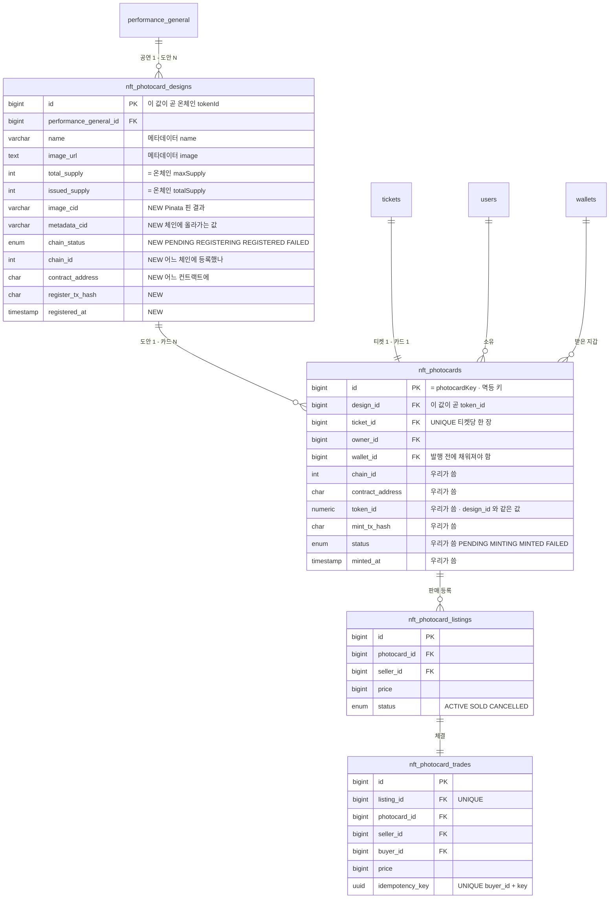

# 포토카드 NFT (ERC-1155) 작업 계획

> **새 세션은 이 문서부터 읽으세요.** 그다음 `DESIGN.md` 6장 ③, 4장(절대 규칙),
> 그리고 `TICKET_PLAN.md` 5장(값비싸게 배운 것들)을 봅니다.
> 작성일 2026-09-07 · 티켓 SBT 완료 직후

---

## 1. 티켓 때와 결정적으로 다른 점

**Spring 의 NFT 도메인이 이미 다 만들어져 있습니다.** 티켓은 우리가 먼저 갔지만
포카는 반대입니다 — 스키마·API·거래 로직이 먼저 서 있고, 우리는 **그 안에 체인을
끼워 넣는** 작업입니다.

| | 상태 |
|---|---|
| `nft_photocard_designs` / `nft_photocards` / `listings` / `trades` | **완료** (V20260903_1332) |
| 발급 · 판매등록 · 구매 · 내역조회 API | **완료** (`NftService`) |
| 프론트 목업 (`features/nft`) | **완료** |
| `nft_photocards.chain_id · contract_address · token_id · mint_tx_hash · status · minted_at` | **컬럼만 있고 전부 NULL** |
| `PhotocardNFT` 컨트랙트 · 발행 API · 확정 감시 | **이번 작업** |
| `VerifiableDraw` — 도안 배정이 조작이 아님을 증명 | **이번 작업** (2026-09-07 추가) — 4장 |
| 마켓 정산 (캣머니 ↔ 카드) | 이번 작업 **아님** — 7장 |

Spring 코드에 우리를 기다리는 자리가 두 군데 표시돼 있습니다.

```java
// NftPhotocard.transferTo()
// TODO(blockchain): 온체인 연동 시 현재 소유자의 지갑으로 transferFrom을 요청하고 walletId를 갱신한다.

// NftService.purchase()
// TODO(cat-money): CAT 도메인 확정 후 이 위치에서 구매자 차감과 판매자 지급을 수행한다.
```

**따라 쓸 본보기**는 티켓입니다. 컨트랙트 → chain → service → controller → route →
docs → 확정 감시까지 전 계층이 한 번 통과한 코드입니다.

```
contracts/contracts/TicketSBT.sol            →  PhotocardNFT.sol
api/src/chain/contracts/ticketSbt.ts         →  photocardNft.ts
api/src/services/ticket.service.ts           →  photocard.service.ts
api/src/services/confirm.service.ts          →  포토카드 감시 추가
api/src/db/ticketRepo.ts                     →  photocardRepo.ts
```

멱등 패턴은 **캣머니**를 봅니다 (`_slot` / `_consume`). 티켓의 `everIssued` 는
tokenId 하나에 발행 하나라서 성립했는데, 포카는 아래 2장 때문에 그렇지 않습니다.

---

## 2. 이번 작업의 진짜 질문 — `tokenId` 를 무엇으로 둘 것인가

**여기서 갈라지면 나머지가 전부 갈라집니다. 코드 쓰기 전에 정하세요.**

ERC-1155 를 고른 이유가 여기 걸려 있습니다. 1155 는 "한 컨트랙트 안에 여러 종류,
종류마다 여러 장" 을 담는 표준입니다. 포카에서 그 "종류" 는 **도안**입니다.

### A. `tokenId` = 도안 (추천)

```
tokenId 11  =  도안 11번  ·  balanceOf(alice, 11) = 3   ← 앨리스가 그 도안 3장 보유
```

| | |
|---|---|
| `balanceOf(user, 도안)` | 그 유저가 그 도안을 몇 장 갖고 있는가 |
| `totalSupply(도안)` | 지금까지 발행된 장수 = `designs.issued_supply` |
| 발행 | `_mint(to, 도안, 1)` |
| 마켓 이동 | `safeTransferFrom(판매자, 구매자, 도안, 1)` |
| 메타데이터 | 도안 하나에 IPFS CID 하나 — 카드 100장이 그 하나를 공유합니다 |

### B. `tokenId` = 카드 한 장 (수량은 항상 1)

DB 의 `nft_photocards.id` 와 1:1 입니다. 지금 스키마를 안 건드려도 됩니다.

**그런데 이러면 1155 를 쓸 이유가 사라집니다.**

- **1155 에는 `ownerOf` 가 없습니다.** 물어볼 수 있는 건 `balanceOf(주소, id)` 뿐입니다.
  카드마다 id 를 매기면 정작 묻고 싶은 "이 카드 지금 누구 것" 을 체인에 못 묻습니다.
  대사(reconciliation)를 하려면 `id → 보유자` 매핑을 직접 들고 있어야 하는데,
  그건 ERC-721 을 손으로 다시 만드는 것입니다.
- **`uri()` 의 `{id}` 도 무용지물입니다.** 메타데이터는 도안 단위라, `카드 → 도안`
  매핑을 온체인에 또 둬야 합니다.

### 판단 — **A 로 확정** (2026-09-07)

근거는 하나입니다 — **같은 도안의 두 장은 실제로 구별되지 않습니다.**
이름도 이미지도 같습니다. 다른 건 "몇 번 좌석에서 나왔는가" 인데 그건
`nft_photocards` 가 갖고 있고 상세 화면이 DB 에서 읽어 보여줍니다
(`NftPhotocardDetailResponse.Origin`). 체인에 또 둘 이유가 없습니다.

이건 티켓에서 이미 한 판단과 같습니다 — **체인이 답할 질문 하나만 남깁니다.**
티켓은 "이 티켓 누구 것", 포카는 **"이 사람이 이 도안을 몇 장 갖고 있나"** 입니다.

### 대가 — 백엔드와 협의가 필요합니다

```sql
CONSTRAINT uq_nft_photocards_contract_token
    UNIQUE (chain_id, contract_address, token_id)
```

**이 제약을 걷어내야 합니다.** 같은 도안 카드가 여러 행이므로 `token_id` 가 겹칩니다.
지금 이 제약은 "한 행 = 한 토큰" 을 전제하는데 A 에서는 성립하지 않습니다.

```sql
ALTER TABLE nft_photocards DROP CONSTRAINT uq_nft_photocards_contract_token;
CREATE INDEX idx_nft_photocards_chain_token
    ON nft_photocards (chain_id, contract_address, token_id);
```

같이 사라지는 것: **"이 카드는 100장 중 7번" 같은 일련번호를 체인이 증명하지 못합니다.**
지금 DB 에도 프론트에도 일련번호가 없으니 잃는 게 없지만, 나중에 넣기로 하면
이 결정을 뒤집어야 합니다. **지금 물어보고 넘어가세요.**

### ⚠️ DB 를 밀면 도안 번호가 충돌합니다

`designId` 를 그대로 `tokenId` 로 쓰는 방식의 유일한 함정입니다.

`nft_photocard_designs.id` 는 `GENERATED ALWAYS AS IDENTITY` 라 **DB 를 다시 만들면
1번부터 시작합니다.** 그런데 **SSAFY 체인은 공용이라 되돌릴 수 없습니다.**

```
개발 중 DB 리셋 → 새 도안이 id 11 을 받음
              → 체인의 maxSupply[11] · totalSupply(11) 은 옛 도안 것이 그대로 남아 있음
              → 새 도안이 이미 87장 발행된 상태로 시작하고, 한정 수량도 옛 값
```

`registerDesign(11, 새 수량)` 은 `409` 로 막히지만 **이미 발행된 87장은 안 사라집니다.**

| 대응 | |
|---|---|
| 개발은 **로컬 체인**에서 (`npm run chain`) | 상태가 같이 날아가므로 애초에 안 겹칩니다. 기본 경로로 삼으세요 |
| SSAFY 체인에서 DB 를 밀었다면 | `ALTER SEQUENCE … RESTART WITH 1000` 처럼 **번호를 띄우거나**, 컨트랙트를 새로 배포합니다 |

운영에서는 DB 를 밀 일이 없으므로 개발 중에만 걸리는 문제입니다. 다만 한 번 밟으면
공용 체인에 흔적이 영구히 남습니다.

### 대사

대사가 **개수 비교**로 떨어집니다.

```sql
SELECT owner_id, design_id, count(*) FROM nft_photocards
 WHERE status = 'MINTED' GROUP BY 1, 2      -- 이 값이
```
```
balanceOf(그 유저 주소, design_id)          -- 이 값과 같아야 합니다
```

---

## 3. 만들 것 — 컨트랙트

`contracts/contracts/PhotocardNFT.sol`

> **ERC-1155 가 이 체인에서 컴파일되는 것은 확인했습니다.**
> `ERC1155` + `ERC1155Supply` + `AccessControl` 을 `constantinople` · OZ `5.1.0` 으로
> 컴파일한 기록이 `artifacts/build-info/62204852….json` 에 남아 있습니다 (에러 0).
> 5.2+ 로 올리지 마세요 — `mcopy` 때문에 컴파일 자체가 안 됩니다.

### 상태

```solidity
contract PhotocardNFT is ERC1155Supply, AccessControl {
    mapping(bytes32 => bool) private _executed;    // 멱등 — 캣머니와 같은 구조
    mapping(uint256 => uint256) public maxSupply;  // 도안별 한정 수량 (0 = 미등록)
    mapping(uint256 => string) private _tokenUri;  // 도안 → "ipfs://<metadataCid>"
    bool public issuePaused;
}
```

`ERC1155Supply` 를 상속하면 `totalSupply(id)` 가 공짜로 붙습니다. 대사에 그대로 씁니다.

### 함수

| 함수 | 권한 | 하는 일 |
|---|---|---|
| `registerDesign(designId, max, metadataUri)` | `OPERATOR_ROLE` | 한정 수량·IPFS URI 등록. **첫 발행 전까지만 다시 등록 가능** |
| `issueBatch(to[], designIds[], keys[])` | `MINTER_ROLE` | 발행. 중복 키는 **건너뜁니다** |
| `transferWithKey(to, designId, amount, key)` | **보유자 본인** | 마켓 정산 (7장) |
| `setIssuePaused(bool)` | `OPERATOR_ROLE` | 발행 정지 |

**`setURI` 를 두지 않습니다.** 전역 레버가 남아 있으면 운영자가 모든 도안의 메타데이터를
한 번에 갈아끼울 수 있어서, 도안별 CID 를 박아둔 의미가 사라집니다.

`approve` / `setApprovalForAll` 은 **표준 그대로 둡니다.** 티켓과 반대입니다 —
포카는 팔라고 만든 물건이고, 나중에 마켓 컨트랙트를 에스크로로 쓰려면 승인이 필요합니다.

### 멱등 — 이름공간을 반드시 나누세요

```solidity
uint8 private constant OP_ISSUE    = 1;
uint8 private constant OP_TRANSFER = 2;

function _slot(uint8 op, address account, bytes32 key) private pure returns (bytes32) {
    return keccak256(abi.encode(op, account, key));
}
```

| | 실행 기록의 키 | 왜 |
|---|---|---|
| `issue` | `hash(ISSUE, address(0), key)` — **전역** | `MINTER_ROLE` 만 부릅니다. 전역이어야 Spring 이 키를 재사용해도 막힙니다 |
| `transfer` | `hash(TRANSFER, msg.sender, key)` — **호출자별** | 누구나 부릅니다. 전역이면 **카드 한 장 가진 아무나** 남의 거래 키를 미리 태워 영구히 막을 수 있습니다 |

> ⚠️ **캣머니에서 실제로 터진 사고입니다.** `mint` 와 `burn` 이 실행 기록을 공유해서
> 토큰 1개 가진 아무나 예정된 키를 선점할 수 있었습니다. Spring 키는 순번이라 예측
> 가능하고 이 체인은 공용이라 실제로 노출됩니다. **회귀 테스트를 반드시 넣으세요.**

`abi.encode` 를 씁니다. `encodePacked` 는 붙여 쓰는 값에 따라 서로 다른 입력이
같은 해시가 됩니다.

**`photocardKey` 는 `nft_photocards.id` 입니다.** 티켓이 `tickets.id` 를 쓴 것과 같습니다 —
영구히 유일하고 Spring 이 소유하는 값. 서버가 `keccak256` 해서 올립니다
(Spring 에 keccak 의존성을 만들지 않습니다 — DESIGN.md 결정 이력 2026-09-02).

### 배치 발행 — 중복은 revert 가 아니라 skip

`NftService.issuePhotocards()` 는 **공연 하나의 티켓 전부**에 카드를 한 번에 꽂습니다.
1000장이면 1000번 발행입니다. 한 장씩 보내면 트랜잭션이 1000개입니다.

```solidity
function issueBatch(address[] calldata to, uint256[] calldata designIds, bytes32[] calldata keys)
    external onlyRole(MINTER_ROLE)
{
    if (issuePaused) revert IssueIsPaused();
    if (to.length != designIds.length || to.length != keys.length) revert LengthMismatch();

    for (uint256 i = 0; i < to.length; i++) {
        bytes32 slot = _slot(OP_ISSUE, address(0), keys[i]);
        if (_executed[slot]) { emit IssueSkipped(keys[i]); continue; }   // ← revert 하지 않습니다
        ...
        _mint(to[i], designIds[i], 1, "");
        emit PhotocardIssued(designIds[i], to[i], keys[i]);
    }
}
```

**중복 하나가 배치 500건을 통째로 죽이면 안 됩니다.** 건너뛰면 **같은 배치를 그대로
다시 보내는 것이 안전**해집니다 — 응답을 못 받았을 때 Spring 이 할 수 있는 유일하게
단순한 행동입니다. 티켓의 `AlreadyIssued` revert 는 한 건짜리라 성립했던 것입니다.

**배치 크기의 제약은 가스가 아닙니다.** 2026-09-07 실측:

```
eth_getBlockByNumber → gasLimit  9007199254740991  (= 2^53-1)
```

가스가 무료인 체인이라 리밋도 사실상 풀려 있습니다. 그래서 배치를 자르는 근거는
다른 둘입니다.

| | |
|---|---|
| **calldata 크기** | 항목당 96바이트(주소+uint256+bytes32). 200건이면 약 19KB. 노드마다 트랜잭션 크기 상한이 있고 문서화돼 있지 않습니다 |
| **실패의 폭발 반경** | 배치 하나가 revert 하면 그 안의 전부가 실패합니다. 500건짜리를 통째로 날리는 것보다 잘라 두는 편이 낫습니다 |

**한 요청 = 한 트랜잭션, 상한 200건.** 그 이상은 Spring 이 잘라서 여러 번 부릅니다 —
각 배치가 독립적으로 멱등이라 실패한 조각만 다시 보내면 됩니다. 서버가 안에서
몰래 여러 트랜잭션으로 쪼개면 `202` + `txHash` 하나가 거짓말이 됩니다 (4-2).

컨트랙트에도 `MAX_BATCH` 를 둬서 상한을 두 군데에서 막습니다.
`REPORT_GAS=true` 로 실측한 뒤 숫자를 조정하세요.

### 한정 수량 — **온체인에서 강제합니다** (2026-09-07 확정)

```solidity
if (maxSupply[id] == 0) revert DesignNotRegistered(id);
if (totalSupply(id) + 1 > maxSupply[id]) revert DesignSoldOut(id);
```

"한정 100장" 은 유저에게 하는 약속이고, 체인은 그 약속이
증명되는 자리입니다 — 티켓의 양도 금지를 약관이 아니라 `_update` 에 둔 것과 같은 이유입니다.
`designs.total_supply` 가 이미 있으니 `reserve()` 가 막긴 하지만, 그건 우리 DB 안에서만
참인 사실입니다.

대가: 도안마다 등록 트랜잭션이 하나 더 붙고, **등록 뒤 어드민이 `total_supply` 를
늘리면 체인이 거부합니다.** 그게 의도한 동작이지만 백엔드가 알아야 합니다.

### 정지

`issuePaused` 하나. **이동에는 걸지 않습니다.**

티켓과 같은 근거입니다 — 늦게 나간 카드는 나중에 발행하면 그만이지만 **잘못 나간
카드는 공용 체인에 영구히 남습니다.** 유저가 자기 카드를 옮기는 것은 사고와 무관하므로
막을 이유가 없습니다.

### 메타데이터 — IPFS · 도안마다 CID 하나 (2026-09-07 확정)

ERC-1155 는 토큰마다 URI 를 저장하지 않고 `uri()` **템플릿 하나**를 두는 것이 보통입니다.
우리는 그러지 않습니다. **도안마다 CID 를 온체인에 저장하고 `uri()` 를 오버라이드합니다.**

```solidity
mapping(uint256 => string) private _tokenUri;   // 도안 → "ipfs://<metadataCid>"

function uri(uint256 id) public view override returns (string memory) {
    return _tokenUri[id];
}
```

#### 이미지는 발행 요청에 싣지 않습니다

**`image_url` 은 카드가 아니라 도안의 속성입니다** (`nft_photocard_designs.image_url`).
같은 도안 100장은 전부 같은 그림이고, `tokenId` 가 곧 도안이므로 **`designId` 하나가
이미 그림을 가리킵니다.** 발행 요청에 이미지를 넣으면 100번 같은 값을 실어 보내는
셈이고, 체인에는 어차피 안 들어갑니다.

```
tokenId 11 ─▶ uri(11) ─▶ ipfs://bafyMETA ─▶ { "image": "ipfs://bafyIMG" } ─▶ 그림
```

#### 핀 고정은 **Spring 이 도안을 만들 때** 합니다

Pinata 를 **두 번** 부릅니다. 순서가 뒤바뀔 수 없습니다 — 메타데이터 JSON 안에
이미지 CID 가 들어가야 하기 때문입니다.

```
① 이미지 바이트      → pin → imageCid
② 메타데이터 JSON    → pin → metadataCid      ← 체인에 올라가는 값은 이것 하나
   { "name": …, "image": "ipfs://imageCid", … }
③ designs 행 저장     image_cid · metadata_cid · image_url(게이트웨이 URL)
④ 블록체인 API 로 도안 등록
```

**우리 서비스가 Pinata 를 부르지 않습니다.** 이미지 바이트를 쥐고 있는 쪽은 Spring 이고,
이 프로세스는 오퍼레이터 개인키와 마스터 니모닉을 쥐고 있어 외부 업로드 경로를 붙일
자리가 아닙니다 (DESIGN.md 1장).

> Pinata 는 레거시 `pinFileToIPFS`·`pinJSONToIPFS` 와 v3 Files API 를 같이 굴리고
> 있습니다. **붙일 때 현재 문서로 확인하세요.** 인증도 JWT 로 바뀐 지 오래됐습니다.

#### 프론트는 게이트웨이 URL 을 씁니다

`ipfs://` 는 브라우저가 못 엽니다. `designs.image_url` 에 게이트웨이 URL
(`https://<gw>/ipfs/<imageCid>`)을 넣어두면 **화면 코드는 지금 그대로**입니다.
체인에 올라가는 건 `ipfs://` 스킴이고, 게이트웨이는 표시용 편의입니다 —
CID 만 있으면 어느 게이트웨이로도 같은 파일을 꺼낼 수 있습니다.

#### 이렇게 하면 진짜로 못 바꿉니다

한정 수량은 온체인에 못 박아놓고 정작 "무슨 그림인가" 는 DB 가 언제든 바꿀 수 있으면
비대칭입니다. CID 가 그 자리를 메웁니다.

**CID 는 내용 주소입니다.** 그림을 바꾸면 → 이미지 CID 가 바뀌고 → JSON 이 바뀌고 →
`metadataCid` 가 바뀝니다. 온체인 값과 안 맞게 됩니다. 이름·설명도 같은 JSON 안에 있어
함께 굳습니다.

세 가지가 겹쳐야 성립합니다. **하나라도 빠지면 불변이 아닙니다.**

| | |
|---|---|
| 도안마다 CID | 템플릿 하나면 전역 교체가 가능합니다 |
| **`setURI` 를 두지 않음** | 전역 레버가 남아 있으면 운영자가 통째로 갈아끼울 수 있습니다 |
| 첫 발행 후 동결 | 아래 |

#### 잠그는 시점 — **첫 장이 나갈 때**

등록하자마자 얼리면 안 됩니다. **개발 중에 도안은 반드시 바뀝니다** — 잘못된 파일,
해상도, 크롭, 오타. 그때 못 고치면 둘 중 하나가 됩니다.

1. 못 고침 → 잘못된 그림으로 서비스
2. 고치고 온체인 값은 그대로 둠 → **체인이 거짓을 주장합니다. 없는 것보다 나쁩니다**

```solidity
// totalSupply(id) == 0  →  maxSupply · metadataUri 를 다시 등록할 수 있음
// totalSupply(id) >  0  →  동결. 아무도 못 바꿈
```

**한 장도 안 나갔으면 바꿔도 다치는 사람이 없습니다.** 약속을 받은 보유자가 아직
없기 때문입니다. 첫 장이 나가는 순간 그 사람에게 "이 그림, 100장 한정" 을 약속한
것이고 거기서부터 잠깁니다.

포카에는 소각이 없어서 `totalSupply` 는 줄지 않습니다 — 한 번 잠기면 영구입니다.

**같은 규칙이 `maxSupply` 에도 적용됩니다.** 그래서 "등록 뒤 어드민이 `total_supply`
를 늘리면 체인이 거부한다" 던 불편이 발행 전에는 사라집니다.

#### 덤으로 없어지는 것들

| | |
|---|---|
| `{id}` 64자리 hex 함정 | 치환할 템플릿이 없습니다. `/11.json` 로 열어두면 지갑에서 안 보이던 문제 자체가 사라집니다 |
| Spring 의 메타데이터 공개 엔드포인트 | 안 만들어도 됩니다. 지갑이 IPFS 에서 직접 가져갑니다 |
| `image_sha256` 컬럼 | CID 가 그 일을 전이적으로, 더 강하게 합니다 |
| `setURI` | 삭제합니다 |

#### 대가 — 핀이 끊기면 콘텐츠가 사라집니다

CID 는 영원히 남지만 **데이터는 누군가 핀하고 있어야 남습니다.** Pinata 계정이
만료되고 아무도 안 핀하면 그림이 안 열립니다. 무료 계정으로 시작해도 되지만
**영구성이 계정에 달려 있다는 것**은 알고 가야 합니다.

그리고 어드민 도안 생성 경로에 외부 의존이 둘 생깁니다. Pinata 가 죽으면 도안 생성이
실패하므로 **재시도할 수 있는 상태**가 필요합니다 (`chain_status` 와 별개로,
CID 가 없는 도안은 등록 요청을 보낼 수 없습니다).

## 4. 검증 가능한 추첨 — `VerifiableDraw`

> 2026-09-07 추가. **"어떤 도안을 받을지" 가 조작이 아님을 증명하려는 것**입니다.

### 4-1. 체인이 줘야 하는 것은 매칭이 아니라 무작위성입니다

가장 먼저 짚을 것 — **셔플을 Spring 에서 이 서비스로 옮기는 것은 아무것도 증명하지
않습니다.** Node 프로세스의 셔플이 Java `SecureRandom` 보다 신뢰할 만하지 않습니다.
둘 다 서버가 마음대로 정하는 값이고, 유저는 어느 쪽도 확인할 방법이 없습니다.

옮기면 잃는 것만 생깁니다.

| | |
|---|---|
| **멱등이 깨집니다** | 이 서비스는 상태가 없어서 "누구를 몇 번 도안에 붙였는지" 를 기억하지 못합니다. 재시도하면 다시 섞고, 도안별 수량이 요청과 어긋납니다 (DESIGN.md 4-3) |
| **스키마가 막습니다** | `nft_photocards.design_id` 가 `NOT NULL` 입니다. 행을 만들려면 배정이 **이미** 정해져 있어야 합니다 |
| **원자성이 사라집니다** | `NftService.issuePhotocards()` 는 도안 락 → 수량 검증 → 셔플 → 행 생성을 한 DB 트랜잭션에서 합니다 |

**그래서 무작위성만 체인에 올립니다.** 그러면 배정은 그 값으로부터 계산되는
**순수 함수**가 됩니다.

```
배정 = f(randomness, 참여자 목록, 도안별 수량)
```

누가 실행하든 같은 답이 나오므로 **누가 실행하는지가 중요하지 않습니다.** Spring 이
계산해 행을 만들어도 검증이 성립하고, 멱등도 스키마도 원자성도 그대로입니다.
`PhotocardNFT` 는 한 줄도 안 바뀝니다.

### 4-2. 커밋-리빌 + 블록해시

DESIGN.md 6장 ③ 의 NRF 를 그대로 씁니다.

```
① 커밋   서버가 시드 S 를 정하고 keccak256(S) 만 올립니다        ← S 는 아직 비밀
         참여자·수량도 같이 고정합니다 (아래 4-3)
② 대기   최소 한 블록
③ 리빌   S 를 공개합니다. 컨트랙트가 keccak256(S) 를 대조하고,
         커밋 다음 블록의 blockhash 와 섞습니다
             randomness = keccak256(S, blockhash(commitBlock + 1))
④ 배정   누구나 randomness 로 같은 배정을 계산합니다
```

**두 조각이 다 필요합니다.**

| | 막는 것 |
|---|---|
| 시드 커밋 | 서버가 결과를 보고 **시드를 바꾸는 것**. 해시가 묶어둡니다 |
| 미래 블록해시 | 서버가 유리한 시드를 **미리 골라내는 것**(grinding). 커밋 시점엔 그 블록이 아직 없습니다 |

블록 생산자는 블록해시를 흔들 수 있지만 **시드를 모릅니다.** 서버는 시드를 알지만
**블록해시를 모릅니다.** 둘이 공모하지 않는 한 결과를 겨냥할 수 없습니다.

> `BLOCKHASH` 는 Frontier 부터 있는 옵코드라 **Constantinople 에서 문제없습니다.**
> `block.chainid` 처럼 막히는 것이 아닙니다.

### 4-3. 입력도 같이 고정해야 합니다

**여기를 빠뜨리면 전부 무의미해집니다.** 무작위성만 고정하고 입력을 안 고정하면,
서버가 결과를 본 뒤 **참여자 순서를 바꿔** 원하는 사람에게 원하는 도안을 줄 수
있습니다. 무작위성은 진짜인데 배정은 조작인 상태가 됩니다.

그래서 커밋할 때 입력 해시를 함께 올립니다.

```
inputsHash = keccak256(abi.encode(
    performanceId,
    ticketIds,     // 오름차순. 참여자 순서가 여기서 굳습니다
    designIds,     // 오름차순
    quantities     // designIds 와 같은 순서
))
```

리빌 뒤에 누가 배정을 계산하든, 이 해시와 맞는 입력을 써야 같은 답이 나옵니다.

### 4-4. 배정 알고리즘 — 셋이 같은 값을 내야 합니다

Spring 도, 이 서비스도, 검증하는 제3자도 같은 결과를 내야 하므로 **한 글자까지
명세**합니다. `Collections.shuffle(list, SecureRandom)` 은 재현되지 않으므로 쓰지 않습니다.

```
1. 참여자 P = 확정 티켓(`status = 'CONFIRMED'`)을 ticket_id 오름차순으로
2. 도안 풀 D = 도안을 design_id 오름차순으로, 각 도안을 quantity 만큼 이어붙여
   |P| == |D| 여야 합니다 (Spring 이 이미 검사합니다 — ALLOCATION_QUANTITY_MISMATCH)

3. Fisher-Yates. 난수는 체인의 randomness 에서 뽑습니다
   for i = |D| - 1 downto 1:
       j = uint256(keccak256(abi.encode(randomness, uint256(i)))) % (i + 1)
       swap(D[i], D[j])

4. P[k] 가 D[k] 를 받습니다
```

**배정 결과는 체인에 올리지 않습니다.** `randomness` 와 `inputsHash` 만 있으면 누구나
계산할 수 있어서, 올리면 같은 값이 두 벌이 됩니다 (2장의 판단과 같습니다).

### 4-5. Spring 에 keccak 의존성을 만들지 않습니다

배정 계산에는 keccak 이 필요한데, Spring 에 그 의존성을 넣지 않기로 한 결정이
있습니다 (DESIGN.md 2026-09-02). **그래서 계산도 우리가 해 줍니다.**

```
POST /internal/draws/{drawKey}/assign
  { performanceId, ticketIds[], designIds[], quantities[] }
→ 200 { assignments: [ { ticketId, designId }, … ] }
```

Spring 이 입력을 다시 보내면 우리가 `inputsHash` 를 계산해 **체인에 박힌 값과
대조**합니다. 다르면 400 입니다 — 이 대조 자체가 "입력이 안 바뀌었다" 의 검사가
됩니다. 그다음 `randomness` 로 배정을 계산해 돌려줍니다.

읽기만 하므로 `200` 입니다. 트랜잭션이 없습니다.

### 4-6. 시드는 저장하지 않고 파생합니다

커밋과 리빌 사이에 시드를 어딘가 들고 있어야 하는데, **이 서비스는 상태가 없습니다.**
지갑과 같은 방법을 씁니다 — 비밀에서 파생합니다.

```
seed = keccak256(abi.encode(DRAW_SEED_SECRET, drawKey))
```

`DRAW_SEED_SECRET` 은 `.env` 에 둡니다. 재시작해도 같은 시드가 나오므로 리빌이
언제든 가능하고, DB 컬럼도 필요 없습니다. (DESIGN.md 4-6 과 같은 원리)

주의: 이 비밀이 새면 **리빌 전에 결과를 미리 아는 사람**이 생깁니다. 결과를 바꾸지는
못하지만(블록해시가 남아 있습니다) 공정성 문제는 됩니다. 니모닉과 같은 급으로 다루세요.

### 4-7. 컨트랙트

`contracts/contracts/VerifiableDraw.sol` — **토큰을 모릅니다.** 무작위성만 만듭니다.
그래서 DESIGN.md 6장 ③ 의 `ResaleDraw`(취소표 추첨)도 이걸 그대로 쓰면 됩니다.

```solidity
struct Draw {
    bytes32 seedCommit;
    bytes32 inputsHash;
    uint64  commitBlock;
    bytes32 randomness;   // 0 이면 아직 리빌 전
    bool    canceled;
}
mapping(bytes32 => Draw) public draws;   // drawKey 해시 → Draw
```

| 함수 | 권한 | 하는 일 |
|---|---|---|
| `openDraw(drawId, seedCommit, inputsHash)` | `OPERATOR_ROLE` | 커밋. `commitBlock` 을 남깁니다 |
| `revealDraw(drawId, seed)` | `OPERATOR_ROLE` | 대조 후 `randomness` 확정 |
| `cancelDraw(drawId)` | `OPERATOR_ROLE` | 블록해시 창을 놓쳤을 때만 |
| `getDraw(drawId)` | view | 상태·randomness·inputsHash |

### 4-8. ⚠️ 블록해시는 256블록만 남습니다

`blockhash(n)` 은 **최근 256블록**만 돌려주고 그 밖이면 0 입니다. 이 체인은 블록이
약 10초라 **약 42분**입니다.

**그 안에 리빌하지 못하면 그 추첨은 되살릴 수 없습니다.**

**리빌은 이 서비스가 자동으로 부릅니다** (2026-09-08 확정 · `drawWatcher.service.ts`).
42분 시한을 Spring 이나 사람 손에 맡기지 않습니다. 확정 감시와 같은 두 갈래입니다 —
방금 연 추첨을 메모리로 추적하고, 놓친 것은 **체인의 `DrawOpened` 로그를 훑어** 걷어냅니다.

훑기에 DB 가 필요 없는 이유가 재미있습니다: **블록해시 창이 곧 우리가 봐야 할
범위입니다.** 256블록보다 오래된 추첨은 어차피 못 살리므로 찾을 이유가 없고, 그래서
최근 256블록의 로그만 보면 복구할 것이 전부 나옵니다. 시드가 `drawKey` 원문이 아니라
해시된 `drawId` 에서 파생되는 것도 여기서 값을 합니다 — 로그에는 `drawId` 만 있는데
그것만으로 공개할 수 있습니다.

놓치면 `cancelDraw` 로 접고 새 `drawKey` 로 다시 엽니다.

### 4-9. 정직하게 — 이것이 막지 못하는 것

**서버는 리빌을 포기하는 방법으로 다시 뽑을 수 있습니다.**

커밋 다음 블록이 생기고 나면 서버는 시드와 블록해시를 둘 다 알아서 **결과를 미리
계산할 수 있습니다.** 마음에 안 들면 리빌하지 않고 창을 넘긴 뒤 새 추첨을 여는 것을
막을 방법이 없습니다.

그래서 이 설계가 실제로 주는 것은 둘입니다.

- 서버가 결과를 **조용히 바꿀 수는 없습니다** — 시드도 입력도 커밋에 묶여 있습니다
- 다시 뽑으면 **체인에 영구히 남습니다** — 한 공연에 추첨이 몇 번 열렸는지 누구나 셉니다

완전한 방어는 VRF 나 다자 시드가 필요한데 이 체인에는 둘 다 없습니다. `drawId` 에
`performanceId` 를 넣어 **재추첨이 눈에 띄게** 만드는 것까지가 여기서 할 수 있는
최선입니다. 발표에서도 이 한계를 같이 말하는 편이 낫습니다.

### 4-10. 발행과의 순서

```
① registerDesign      도안·한정 수량·IPFS URI 등록        ← 수량이 여기서 고정
② openDraw            참여자·수량을 inputsHash 로 고정
③ (한 블록 이상 대기)
④ revealDraw          randomness 확정
⑤ POST …/assign       배정 계산 → Spring 이 nft_photocards 행 생성
⑥ issueBatch          발행 — 지금 만든 컨트랙트 그대로
```

①이 ② 앞인 이유: 수량이 `inputsHash` 에 들어가는데, 도안이 등록돼 있지 않으면
그 수량이 체인에서 아무 의미가 없습니다.

⑤가 ⑥ 앞인 이유: `design_id` 가 `NOT NULL` 이라 배정 없이는 행을 못 만듭니다.

---

## 5. 만들 것 — API

**계약은 이미 `api/src/docs/planned.ts` 에 적혀 있습니다** (2026-09-07). Swagger 에
`포토카드 (예정)` 태그로 뜹니다. 구현하면서 **`planned.ts` 에서 지우고 `openapi.ts` 로
옮기고**, 거기서 컨트롤러의 zod 객체와 드리프트 가드를 붙입니다.

| | 엔드포인트 | 응답 |
|---|---|---|
| 도안 등록 | `POST /internal/photocards/designs` | **202** / 200 `{ALREADY_DONE}` |
| 추첨 열기 | `POST /internal/draws/open` | **202** `{txHash, drawId}` |
| 추첨 공개 | `POST /internal/draws/{drawKey}/reveal` | **202** `{txHash}` |
| 추첨 조회 | `GET /internal/draws/{drawKey}` | 200 `{status, randomness, inputsHash}` |
| **배정 계산** | `POST /internal/draws/{drawKey}/assign` | 200 `{assignments}` — 트랜잭션 없음 |
| 배치 발행 | `POST /internal/photocards/issue` | **202** `{txHash, count}` |
| 발행 확인 (복구) | `GET /internal/photocards/by-key?key=` | 200 `{issued}` |
| 보유 조회 (대사) | `GET /internal/photocards/balance?address=&designId=` | 200 `{balance, totalSupply, maxSupply}` |
| 소유권 이전 (M6) | `POST /internal/photocards/transfer` | **202** `{txHash}` |

계약을 쓰면서 정해진 것들:

- **`designId` · `photocardKey` 는 문자열로 받습니다.** Postgres `bigint` 라 JSON
  number 로 주고받으면 큰 값에서 정밀도가 깨집니다. 캣머니의 `amount` 와 같은 이유입니다
- **복구 조회는 `issued` 하나만 돌려줍니다.** 티켓은 `tokenId` 가 키의 해시라 키에서
  번호가 나왔지만, 포카의 `tokenId` 는 도안이라 카드 키에서 계산되지 않습니다.
  컨트랙트에 `키 → 도안·소유자` 를 두면 `nft_photocards` 와 두 벌이 됩니다
- **경로가 아니라 쿼리로 받습니다** (`by-key?key=`). 티켓과 같은 이유 — 키에 `/` 나
  `#` 이 들어가면 경로가 깨집니다
- **미등록 도안·수량 초과·정지는 보내기 전에 막습니다** (`400` / `422` / `503`).
  안 그러면 `202` 를 받고 10초 뒤에야 실패를 알게 되는데 그동안 Spring 은 정상으로 압니다
- **발행 결과는 `txHash` 폴링이 아니라 `nft_photocards.status` 로 확인**하게 했습니다.
  어차피 우리가 그 컬럼을 쓰기 때문입니다 (6장). `txHash` 는 추적용으로 남깁니다

`transfer` 의 요청 스키마는 **캣머니 전송과 같은 모양**입니다 —
`{operationKey, from, derivationIndex, to, designId, amount, tradeId}`,
파생 주소가 `from` 과 다르면 `400`.

### `tx.ts` 두 곳을 고칩니다

```ts
const OPERATION_BY_EVENT = {
  ...
  PhotocardIssued:      'PHOTOCARD_ISSUE',    // 추가
  PhotocardTransferred: 'PHOTOCARD_TRANSFER',
};

const INTERFACES = [ …, PhotocardNFT__factory.createInterface() ];  // revert 디코딩
```

> **주의: `tx.ts` 는 이벤트 하나에서 `tokenId` 를 꺼냅니다.** 배치 발행은 이벤트가
> 500개라 그 값이 의미가 없습니다. 포카의 확정 기록은 `tx.service` 가 아니라
> **영수증의 로그를 전부 파싱**해야 합니다 (6장).

---

## 6. 오프체인 DB — ERD 와 확정 감시

### 6-1. ERD

테이블은 **새로 만들지 않습니다.** 이 서비스는 자기 테이블을 갖지 않고 컬럼 단위로
소유권을 가릅니다 (DESIGN.md 결정 이력 2026-09-04). 아래는 기존 스키마에
**체인 연동에 필요한 컬럼만 얹은** 모습입니다.



### 6-2. 마이그레이션

```sql
-- ── 도안: 온체인 등록 상태와 이미지 해시 ─────────────────────────
CREATE TYPE nft_design_chain_status AS ENUM
    ('PENDING', 'REGISTERING', 'REGISTERED', 'FAILED');

ALTER TABLE nft_photocard_designs
    ADD COLUMN image_cid        varchar(80),
    ADD COLUMN metadata_cid     varchar(80),
    ADD COLUMN chain_status     nft_design_chain_status NOT NULL DEFAULT 'PENDING',
    ADD COLUMN chain_id         int,
    ADD COLUMN contract_address char(42),
    ADD COLUMN register_tx_hash char(66),
    ADD COLUMN registered_at    timestamp,
    -- CID 없이는 등록 요청을 보낼 수 없습니다. 둘 다 있거나 둘 다 없거나입니다
    ADD CONSTRAINT chk_nft_photocard_designs_cids
        CHECK ((image_cid IS NULL) = (metadata_cid IS NULL)),
    ADD CONSTRAINT chk_nft_photocard_designs_address_lower
        CHECK (contract_address IS NULL OR contract_address = lower(contract_address));

-- ── 카드: 한 행 = 한 토큰이 더 이상 아닙니다 ──────────────────────
-- 같은 도안 카드가 여러 행이라 (chain_id, contract_address, token_id) 가 겹칩니다
ALTER TABLE nft_photocards
    DROP CONSTRAINT uq_nft_photocards_contract_token;

CREATE INDEX idx_nft_photocards_chain_token
    ON nft_photocards (chain_id, contract_address, token_id);

-- 대사(reconciliation)가 실제로 쓰는 인덱스: 유저 × 도안 개수 세기
CREATE INDEX idx_nft_photocards_owner_design
    ON nft_photocards (owner_id, design_id) WHERE status = 'MINTED';

-- ── 아무도 쓰지 않는 컬럼 ────────────────────────────────────────
-- batchIssuePhotocards 가 넣지 않고 세터도 없습니다. 메타데이터가 도안 단위라
-- 채우면 카드 100장에 같은 값이 100벌 생깁니다
ALTER TABLE nft_photocards DROP COLUMN metadata_uri;
```

### 6-3. `token_id` 는 `design_id` 의 사본입니다

포카에서는 `token_id = design_id` 라 **같은 값이 두 컬럼에 들어갑니다.** 이 프로젝트
기준으로는 껄끄러운 중복입니다 — "같은 값을 두 벌 두면 어긋날 때 판단 근거가 사라진다"
가 티켓에서 좌석·상태를 체인에서 걷어낸 이유였습니다.

그래도 **남깁니다.** `chain_id`·`contract_address` 와 한 묶음으로 "이 행이 가리키는
온체인 토큰" 을 이루기 때문입니다. 셋 중 하나만 빠지면 재배포 뒤에 어느 컨트랙트의
몇 번인지 답할 수 없습니다. 대신 **채우는 쪽은 우리 하나뿐**이라 어긋날 경로가 없습니다.

대사는 `token_id` 가 아니라 `design_id` 로 합니다.

### 6-4. 컬럼 소유권 — 티켓과 같은 규칙 (DESIGN.md 1장 예외)

| 테이블 | **우리가 쓰는 컬럼** | Spring 이 쓰는 컬럼 |
|---|---|---|
| `nft_photocards` | `status` · `token_id` · `chain_id` · `contract_address` · `mint_tx_hash` · `minted_at` | 나머지 전부 (`design_id` · `ticket_id` · `owner_id` · `wallet_id` …) |
| `nft_photocard_designs` | `chain_status` · `chain_id` · `contract_address` · `register_tx_hash` · `registered_at` | 나머지 전부 (`name` · `image_url` · `image_cid` · `metadata_cid` · `total_supply` · `issued_supply`) |

**CID 두 개는 Spring 이 씁니다.** 도안을 만들며 Pinata 에 핀하고 넣습니다. 우리는
등록할 때 `metadata_cid` 를 **읽어서 체인에 올리기만** 합니다.

**Spring 엔티티에서 우리 컬럼들을 `updatable = false` 로 둬야 합니다.**
안 그러면 로드해 둔 `NftPhotocard` 가 flush 되면서 우리 UPDATE 를 덮어씁니다.
지금 `NftPhotocard.java` 는 전부 일반 필드라 **고쳐야 합니다.**

### 6-5. `MINTING` 상태를 씁니다

```
PENDING   Spring 이 행을 만든 직후
MINTING   우리가 트랜잭션을 보냈고 아직 안 실림   ← mint_tx_hash 를 여기서 채웁니다
MINTED    확정
FAILED    revert 되거나 드롭됨
```

`nft_mint_status` ENUM 에 `MINTING` 이 이미 있습니다. 티켓은 이 자리가 없어서
`PENDING` + `mint_tx_hash` 로 눌러 담았는데, 여기는 상태로 갈라둘 수 있습니다.

**전송 직후에 `MINTING` + `mint_tx_hash` 를 먼저 씁니다.** 확정될 때 한꺼번에 쓰면
대기 중인 행에 txHash 가 없어서 훑기가 드롭을 판정하지 못합니다 — 티켓에서 실제로
밟고 나서 고친 자리입니다 (`ticketRepo.markIssueSent` 주석).

### 6-6. 기동 시 스키마 확인

`ticketRepo.missingColumns()` 를 그대로 따라 합니다. 컬럼이 사라지면 **첫 발행이 아니라
부팅에서** 죽게 합니다. 없으면 공연 하나치 발행이 조용히 통째로 깨집니다.

### 6-7. ⚠️ 티켓 확정 기록이 없는 테이블을 보고 있었습니다 (2026-09-08 수정)

포카 작업 중에 발견했습니다. **`ticketRepo` 가 `tickets` 의 `transfer_status`·
`token_id`·`mint_tx_hash` 를 갱신하도록 짜여 있었는데 그 컬럼이 하나도 없습니다.**
`ticket_transfer_status` ENUM 도 없고요. 스키마를 추측으로 잡아둔 것이 틀렸습니다
(그 파일 주석에 "확정되면 여기만 고칩니다" 로 적혀 있던 그 자리입니다).

실제 체인 정보는 **`nft_tickets`** 에 있고, 모양이 `nft_photocards` 와 같습니다.

```
nft_tickets (id, ticket_id, wallet_id, chain_id, contract_address,
             token_id, mint_tx_hash, status nft_mint_status, minted_at, …)
```

그래서 `DATABASE_URL` 을 붙이면 기동 시 스키마 확인에 걸려 **서버가 죽었습니다.**
그 장치가 의도대로 동작한 것이고, 덕분에 첫 발행이 아니라 부팅에서 잡혔습니다.

### 6-8. `ticketKey` 를 UUID 로 (2026-09-08 확정)

Spring 이 `ticketKey` 를 `tickets.id`(순번)가 아니라 **UUID** 로 보내기로 했습니다.

체인 쪽은 바꿀 것이 없습니다 — `tokenId = uint256(keccak256(ticketKey))` 는 문자열이면
무엇이든 됩니다. **오히려 낫습니다**: 순번은 개발 중 DB 를 밀면 같은 번호가 재사용되는데
공용 체인은 못 밀어서 그 키가 `AlreadyIssued` 로 영구히 막힙니다 (2장의 도안 번호 함정과
같은 것).

**대신 그 UUID 를 DB 에 저장해야 합니다.** 안 그러면 훑기가 행을 못 찾습니다 —
더 나쁘게는, 예전처럼 `tickets.id` 를 키로 되돌려주면 `hashOf(순번)` 으로 체인에
물어보게 되어 **성공한 발행을 FAILED 로 내립니다.**

```sql
ALTER TABLE nft_tickets
    ADD COLUMN ticket_key   uuid NOT NULL,
    ADD COLUMN burn_tx_hash char(66),
    ADD CONSTRAINT uq_nft_tickets_ticket_key UNIQUE (ticket_key);
```

> 행이 이미 있으면 `NOT NULL` 을 나중에 걸어야 하는데, **아무 값이나 채우면 안 됩니다** —
> 체인에 올라간 키와 달라지면 그 행은 영영 못 잇습니다.

상태도 `nft_mint_status` 로 통일됩니다. 티켓과 포카의 확정 감시가 완전히 같은 모양이
됐습니다.

```
PENDING → MINTING (전송됨) → MINTED / FAILED
```

**소각만 `token_id` 로 찾습니다.** 경로가 `/tickets/{tokenId}/burn` 이라 우리가 아는 건
번호뿐이고 `keccak256` 은 역산이 안 됩니다. `(chain_id, contract_address, token_id)` 로
좁힙니다.

> `markBurnTx` 는 그동안 **아무도 부르지 않는 죽은 코드**였습니다. `burn_tx_hash` 가
> 영영 NULL 로 남는 상태였고, 이번에 `burnTicketById` 에서 부르도록 이었습니다.

**포카에도 같은 질문이 옵니다.** `photocardKey` 는 지금 `nft_photocards.id`(순번)입니다.
티켓과 같은 이유로 UUID 가 나은데, 바꾸려면 `nft_photocards` 에도 `photocard_key uuid`
컬럼이 필요합니다. **아직 안 정했습니다.**

### 6-9. 마켓 정산(M6)이 오면 더 필요한 것

**이번 범위가 아닙니다.** 백엔드가 미리 알 수 있게만 적어둡니다.

`nft_photocard_trades` 는 지금 **한 DB 트랜잭션에서 소유권이 즉시 넘어가고 끝**입니다
(`NftService.purchase`). 체인 두 다리(캣머니·카드)가 붙으면 그 사이에 미확정 구간이
생기므로 거래에도 상태가 필요합니다.

```sql
-- 예상 (M6 에서 백엔드와 같이 확정)
ALTER TABLE nft_photocard_trades
    ADD COLUMN settle_tx_hash   char(66),   -- 캣머니 전송
    ADD COLUMN transfer_tx_hash char(66),   -- 카드 이전
    ADD COLUMN chain_status     nft_trade_chain_status NOT NULL DEFAULT 'PENDING';
```

`NftPhotocard.transferTo()` 도 지금은 DB 소유자만 바꾸고 끝이라, 체인 다리가 실패했을
때 되돌리는 자리가 없습니다.

---

## 7. 마켓 정산 — 이번 작업 범위에서 뺍니다

`DESIGN.md` 미결에 이미 올라 있는 문제입니다. 여기서 결론만 정리합니다.

**카드 이전과 캣머니 전송은 원자적이지 않습니다.** 서로 다른 컨트랙트의 서로 다른
트랜잭션이고, 이 체인에는 EIP-712 가 없어서(`block.chainid` 없음) 서명 기반 주문서
같은 것도 못 만듭니다.

| 방식 | |
|---|---|
| **에스크로 마켓 컨트랙트** | 판매 등록 때 카드를 컨트랙트에 맡기고 구매 때 한 트랜잭션에 정산. 원자적이지만 승인 트랜잭션이 늘고 **잠금 실패·해제 실패라는 새 실패 경로**가 생깁니다 |
| **순차 2단계 + 보상** (추천) | Spring 이 상태를 소유하고 실패하면 되돌립니다. 캣머니 출금(캐시아웃)에서 이미 택한 방식입니다 |

순서는 티켓 결제와 같은 근거로 정합니다 — **되돌릴 수 있는 쪽을 나중에** 둡니다.

```
① 캣머니 전송 (구매자 → 판매자)  확정까지 기다림
② 카드 이전   (판매자 → 구매자)
   실패하면 → 캣머니를 되돌립니다 (판매자 → 구매자, 보상 키로 transferWithKey)
```

반대로 하면 카드가 먼저 넘어간 뒤 결제가 실패했을 때 되돌릴 방법이 없습니다 —
구매자가 그 사이 다시 팔아버리면 끝입니다.

**카드 이전은 판매자 본인의 파생 키로 서명합니다.** 오퍼레이터가 남의 카드를 옮길 수
있게 하지 않습니다 — 캣머니에 `burnFrom` 을 두지 않은 것과 같은 이유입니다.
키 하나가 털렸을 때 전 유저의 카드가 쓸려 나갑니다.

### 이때 Spring 스키마가 더 필요합니다

`nft_photocard_trades` 에 트랜잭션 자리가 없습니다. 지금은 한 DB 트랜잭션에서 소유권이
즉시 넘어가고 끝입니다(`NftService.purchase`). 체인을 붙이려면 최소한
`settle_tx_hash` · `transfer_tx_hash` 와 거래 상태가 필요합니다. **M6 에서 백엔드와 같이 설계합니다.**

---

## 8. 작업 순서

컨트랙트가 확정되기 전에 서버 코드를 쓰면 다시 씁니다. **1~3 을 먼저 끝내세요.**

0. ~~Swagger 에 계약 공개~~ — **완료** (`planned.ts`, 2026-09-07). Spring 이 병렬로 붙습니다
1. **백엔드에 넘길 것 두 가지** — 이것만 밖에 걸려 있습니다. 빠져도 2~7 은 진행됩니다
   (막히는 건 8번, DB 기록부터)
   - `uq_nft_photocards_contract_token` 제거 + 6-2 마이그레이션
   - **도안 생성 API 신설** (Pinata 핀 → CID 저장 → 등록 요청). 10장 참고
2. ~~`PhotocardNFT.sol`~~ — **완료** (2026-09-07). 컴파일 8,686바이트 / 24,576 제한
3. ~~`PhotocardNFT.spec.ts`~~ — **완료**. 42개 통과 (전체 스위트 103개)
4. ~~`deploy.ts` 에 한 덩어리 추가~~ — **완료**. `rolesFor('PHOTOCARD')`
5. ~~블록 가스 리밋 측정~~ — **완료**. 가스는 제약이 아니었습니다 (3장)
6. ~~`VerifiableDraw.sol` + `VerifiableDraw.spec.ts`~~ — **완료** (2026-09-07).
   2,935바이트 · 29개 통과. `deploy.ts` 는 `withMinter: false` 로 붙였습니다
7. ~~`chain/contracts/photocardNft.ts` · `verifiableDraw.ts`~~ — **완료** (2026-09-08).
   오퍼레이터 전용 서명자(`contractOperatorSigner`)와 `chain/hash.ts` 도 같이 추가.
   `assign` 은 keccak 이 필요해 `chain/` 안에 둡니다 (4-1)
8. ~~`services/photocard.service.ts` · `draw.service.ts` · `controllers` · `routes`~~ —
   **완료** (2026-09-08). `drawWatcher.service.ts`(자동 리빌)도 함께. 로컬 체인 E2E 통과
9. ~~`db/photocardRepo.ts` + 포카 확정 감시~~ — **완료** (2026-09-08).
   `confirm.service.ts` 에 얹지 않고 `photocardConfirm.service.ts` 로 뺐습니다 —
   티켓은 tx 하나에 행 하나, 포카는 tx 하나에 **행 200개**라 추적 단위가 다릅니다
10. ~~`chain/tx.ts` 에 이벤트·인터페이스 추가~~ — **완료**. 포카·추첨 이벤트 6개
11. ~~`planned.ts` → `openapi.ts` 이동 + 드리프트 가드~~ — **완료**.
    `planned.ts` 에는 **마켓 정산 둘만** 남았습니다
12. **배정 계산이 Spring 과 같은 값을 내는지 교차 검증** — 4-4 명세대로인지
13. 로컬 체인 E2E (`SLOW_CHAIN=true` 로 10초 블록 재현) → **그다음** SSAFY 체인

---

## 9. 테스트에 꼭 넣을 것

- **이름공간 분리** — 카드 1장 가진 외부인이 `transferWithKey` 로 예정된 **발행 키를
  선점하지 못할 것.** 캣머니에서 실제로 터진 사고의 회귀 테스트입니다
- 같은 `photocardKey` 재시도 → **revert 가 아니라 skip**, 잔액은 그대로
- 같은 배치를 통째로 재전송 → 전부 skip, 성공으로 끝남
- 배열 길이가 다르면 revert · `MAX_BATCH` 초과 revert
- 한정 수량: `maxSupply` 도달 후 발행 실패 · 미등록 도안 발행 실패
- 정지: 발행은 막히고 **이동은 안 막힘**
- 권한: 외부인은 `issueBatch` · `registerDesign` 불가
- 이동: 표준 `safeTransferFrom` 동작 · `balanceOf` 와 `totalSupply` 정합
- **`uri()` 가 도안마다 다른 값을 돌려줄 것** · `setURI` 류 함수가 없을 것
- `supportsInterface` 가 `IERC1155` · `IERC1155MetadataURI` · `IAccessControl` 전부 true

### `VerifiableDraw` (4장)

- 틀린 시드로 리빌하면 거부 · 같은 추첨을 두 번 리빌할 수 없음
- **커밋과 같은 블록에서는 리빌할 수 없을 것** — 블록해시가 아직 없습니다
- 블록해시 창(256블록)을 넘기면 리빌 실패 → `cancelDraw` 로만 정리됨
- 같은 `randomness` 로 배정을 두 번 계산하면 **같은 결과** (4-4 명세)
- 입력이 한 글자만 달라도 `inputsHash` 가 달라져 배정 요청이 거부될 것
- 외부인은 열지도 공개하지도 못함

---

## 10. 결정과 남은 것

### 확정 (2026-09-07)

| 결정 | 근거 |
|---|---|
| **`tokenId` = 도안** (2장 A) | 같은 도안 두 장은 실제로 구별되지 않음. 1155 에 `ownerOf` 가 없어 카드별 id 는 721 재구현이 됨. **`uq_nft_photocards_contract_token` 제거가 따라옵니다** |
| **한정 수량을 온체인에서 강제** (`registerDesign`) | "한정 100장" 은 유저에게 하는 약속. 티켓의 양도 금지를 약관이 아니라 `_update` 에 둔 것과 같은 자리 |
| **이번 범위는 발행까지** | 마켓 정산은 `nft_photocard_trades` 에 tx 컬럼·거래 상태가 먼저 필요. 백엔드 마이그레이션을 기다리며 발행이 멈추면 안 됨 |
| **메타데이터는 IPFS · 도안마다 CID 하나** | 도안별 CID + `setURI` 없음 + 첫 발행 후 동결, 셋이 겹쳐야 진짜 불변. CID 가 내용 주소라 `image_sha256` 을 대신하고 더 강합니다. `{id}` hex 함정과 Spring 의 메타데이터 엔드포인트가 함께 사라집니다 |
| **한정 수량·URI 는 첫 발행 전까지만 수정 가능** | 등록 즉시 얼리면 개발 중 이미지 교체 때 "체인이 거짓을 주장하는" 상태가 됩니다. 한 장도 안 나갔으면 바꿔도 다치는 사람이 없습니다 |
| **추첨은 체인에 무작위성만 올린다. 매칭은 Spring 이 그대로 한다** | 셔플을 이 서비스로 옮기면 증명은 하나도 안 되면서 멱등·원자성·`design_id NOT NULL` 이 전부 깨집니다. 무작위성이 체인에 박히면 배정은 순수 함수가 되어 **누가 계산하든 같습니다** (4장) |

### 아직 안 정한 것

1. **컨트랙트 이름** — `DESIGN.md` 6장 ③ 은 `PocaNFT`, Spring 도메인은 `photocard`.
   이 문서는 **`PhotocardNFT`** 로 씁니다. 배포하면 이름을 못 바꾸므로 그 전에 확인
2. **발행 시점** — 공연 종료 후인지 예매 확정 직후인지.
   `findConfirmedTicketRecipients` 는 `tickets.status = 'CONFIRMED'` 만 봅니다
3. **`nft_photocards.wallet_id` 를 누가 채울지** — 발행하려면 받는 주소가 필요합니다.
   Spring 이 `to` 를 실어 보내는 쪽을 전제하고 설계했습니다 (티켓과 같음)
4. **Pinata 계정을 누가 만들고 키를 어떻게 나눌지** — 오퍼레이터 키와 같은 문제입니다.
   무료 계정으로 시작하되 **핀이 끊기면 그림이 사라진다**는 것을 팀이 알고 있어야 합니다

5. **`DRAW_SEED_SECRET` 을 팀이 공유해야 합니다** — 오퍼레이터 키와 같은 성격입니다.
   시드가 이 비밀에서 파생되므로, A 가 연 추첨을 B 의 감시가 공개하려 하면 다른 시드가
   나와 `SeedMismatch` 로 거부됩니다. A 의 서버가 안 떠 있으면 **그 추첨은 42분 뒤
   죽습니다.** 같은 체인을 보는 사람끼리는 반드시 같은 값을 써야 하고, **한 번 정하면
   바꿀 수 없습니다** — 바꾸면 이미 커밋된 추첨이 전부 공개 불가능해집니다.


### 오퍼레이터 서명자를 따로 둡니다 (2026-09-07 확정 · 구현 완료)

API 프로세스는 `OPERATOR_PRIVATE_KEY` 하나로만 서명했는데, 배포 스크립트는 그 주소에
**`MINTER_ROLE` 만** 줍니다 — `OPERATOR_ROLE` 은 `CONTRACT_OPERATOR_ADDRESS` 로 갑니다.
지금은 `.env` 에 그 변수가 없어 같은 주소로 떨어져서 안 드러나지만, 배포 스크립트가
스스로 "운영에서는 분리하세요" 라고 권하고 있어 **분리하는 순간 깨지는** 구조였습니다.

**추첨 공개에 42분 시한이 생기면서 결정이 강제됐습니다.** 사람이 수동으로 처리할 수
없으니 API 가 직접 서명해야 합니다.

```
OPERATOR_PRIVATE_KEY           발행(MINTER_ROLE) · 가스 지불 · 배포 계정
CONTRACT_OPERATOR_PRIVATE_KEY  OPERATOR_ROLE — 도안 등록 · 정지 · 추첨   ← 추가
```

`chain/provider.ts` 에 `contractOperatorSigner()` 를 뒀습니다. **변수를 안 주면 발행
키로 떨어지므로** 지금 돌아가는 개발 환경은 그대로입니다. 논스는 주소별로 세므로
두 지갑이 섞이지 않습니다.

`registerDesign` 을 `OPERATOR_ROLE` 로 둔 이유는 그대로 유지했습니다 —
**발행 키가 털려도 한정 수량과 그림은 못 바꾸게** 하려는 것입니다.

**티켓 소각도 같이 고쳤습니다.** `burnTicket` 이 `OPERATOR_ROLE` 인데 발행 키로
서명하고 있었습니다 — 두 키가 같은 개발 환경에서는 드러나지 않아 **운영에서 처음
터졌을** 종류입니다.

### ⚠️ 백엔드에 없는 것 — 도안 생성 API

**`nft_photocard_designs` 를 만드는 코드가 아예 없습니다.** 엔티티와 리포지토리만 있고
리포지토리는 읽기 전용입니다 (`findAllByIdForUpdate` 하나). `NftAdminController` 에 있는
것은 발급(`POST /admin/performances/{id}/photocards/issue`) 하나뿐이라, 지금은 **DB 에
직접 INSERT 해야** 도안이 생깁니다.

그래서 IPFS 를 넣는 비용이 생각보다 쌉니다 — **고칠 플로우가 아니라 아직 없는 것을
처음부터 그렇게 만드는 것**입니다.

```
POST /admin/photocard-designs   (multipart: 이미지 + 이름 + 한정수량 + performanceId)
  ① Pinata 에 이미지 핀            → image_cid
  ② 메타데이터 JSON 핀             → metadata_cid
  ③ designs 행 저장 (image_url = 게이트웨이 URL)
  ④ 블록체인 API 로 도안 등록 요청  → 202
```

③까지 됐는데 ④가 실패하면 `chain_status` 가 `PENDING` 으로 남습니다. **재시도할 수
있어야 합니다** — 도안은 남고 등록만 다시 보내면 됩니다.

---

## 11. 참고 위치

| | |
|---|---|
| 포카 설계 (원문) | `DESIGN.md` 6장 ③ |
| 절대 규칙 (계층·2단계 응답·멱등) | `DESIGN.md` 4장 |
| 체인 제약 (Constantinople) | `DESIGN.md` 8장 · `contracts/hardhat.config.ts` |
| 값비싸게 배운 것들 | `TICKET_PLAN.md` 5장 |
| 멱등 이름공간 패턴 | `contracts/contracts/CatMoney.sol` `_slot` / `_consume` |
| 확정 감시 본보기 | `api/src/services/confirm.service.ts` |
| Spring 스키마 | `server/…/db/migration/V20260903_1332__create_nft_photocard_market.sql` |
| Spring 발급 로직 | `server/…/nft/service/NftService.java` `issuePhotocards` |
| ERC-1155 컴파일 확인 기록 | `contracts/artifacts/build-info/62204852….json` |
