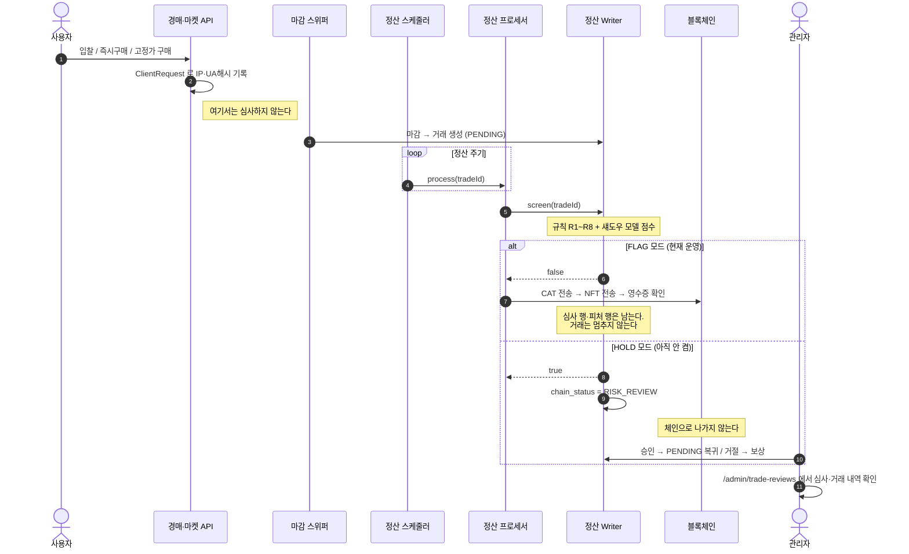
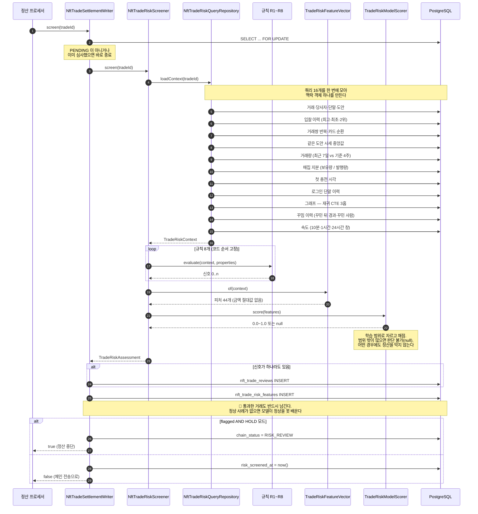

# 이상거래 탐지 흐름 (2026-09-24 기준)

`server/AUCTION_FRAUD_DESIGN.md` 의 구조를 코드 기준으로 다시 그린 것.

---

## 1. 큰 그림 — 심사가 어디에 끼어 있나

핵심은 **심사가 체인 전송 "직전"에 끼어 있다**는 것이다. 사용자가 입찰하거나 구매하는
순간에는 아무 판단도 하지 않는다 — 그 시점에는 아직 거래가 성립하지 않았고,
마감 직전에 몰리는 요청을 느리게 만들 이유도 없다.



### 왜 이 자리인가

| 후보 자리 | 문제 |
| --- | --- |
| 입찰·구매 요청 시점 | 아직 거래가 아니다. 마감 직전 요청이 몰리는데 느려진다 |
| 마감(거래 생성) 시점 | 마감 스위퍼가 한 번에 여러 건을 닫는다. 한 건이 느리면 전부 밀린다 |
| **체인 전송 직전** ✅ | 이미 비동기이고, 돈이 실제로 움직이기 전 마지막 지점이다 |

---

## 2. 자세히 — `screen()` 안에서 일어나는 일



---

## 3. 읽을 때 헷갈리기 쉬운 지점

### 맥락 객체를 한 번만 만든다

규칙 8개가 각자 조회하지 않는다. `loadContext` 가 쿼리 16개로 `TradeRiskContext` 하나를
만들고, 규칙은 **그 값만 읽는 순수 함수**에 가깝다.

그래야 (1) 규칙끼리 본 값이 어긋나지 않고, (2) 같은 맥락으로 피처를 만들 수 있다.
학습용 조회를 따로 짜면 서빙 때 값과 미묘하게 달라진다(training-serving skew).

### 신호가 있다고 다 멈추는 게 아니다

```
HIGH 1개 이상  → flagged
MEDIUM 2개 이상 → flagged
MEDIUM 1개     → 기록만 남고 flagged 아님
```

정상 거래도 규칙 하나에는 흔히 걸린다. 그리고 **지금은 FLAG 모드라 flagged 여도 멈추지
않는다** — 표시만 하고 관리자 화면에 쌓는다. 차단은 오탐률을 보고 나서 켠다.

### 모델 점수는 아무것도 결정하지 않는다

`model_score` 를 읽고 분기하는 코드는 하나도 없다. 저장만 된다.
관리자 판정과 나란히 놓고 일치율을 본 다음에야 단계적으로 권한을 준다.

### 심사 행과 피처 행은 역할이 다르다

| | `nft_trade_reviews` | `nft_trade_risk_features` |
| --- | --- | --- |
| 언제 생기나 | 규칙에 **걸렸을 때만** | **모든 거래** |
| 누가 읽나 | 사람 (관리자 콘솔) | 기계 (학습 스크립트) |
| 담는 것 | 규칙 근거·관리자 판정 | 피처 44개 + 모델 점수 |

---

## 4. 관련 파일

```
nft/service/
  ├─ NftTradeSettlementScheduler.java   주기적으로 미완료 거래를 훑는다
  ├─ NftTradeSettlementProcessor.java   체인 단계 진행 (트랜잭션 안 엶)
  ├─ NftTradeSettlementWriter.java      screen() — 짧은 DB 트랜잭션
  ├─ NftTradeRiskScreener.java          규칙 실행 + 피처 + 모델 점수
  ├─ TradeRiskRule.java                 규칙 인터페이스 (구현 8개)
  ├─ TradeRiskContext.java              맥락 객체 (Graph · Decoration · Velocity)
  ├─ TradeRiskFeatureVector.java        피처 정의 — 여기 하나뿐
  └─ TradeRiskModelScorer.java          로지스틱 회귀 채점 (자르기·범위 밖 중단)
nft/repository/
  └─ NftTradeRiskQueryRepository.java   loadContext — 쿼리 16개
```
