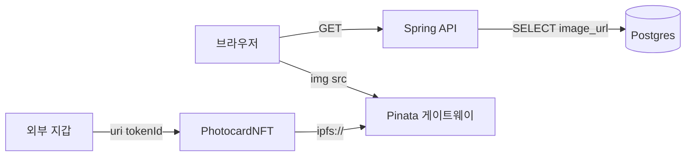
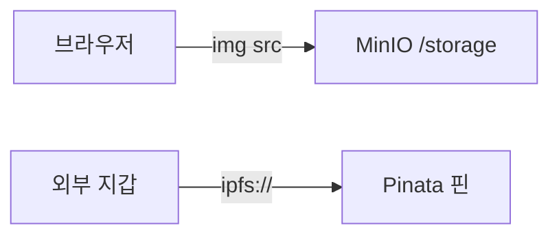

# 포토카드 이미지 장애 대응 기록

2026-09-22 · 지훈

Pinata 무료 플랜의 핀 파일 수가 500 을 넘어 전용 게이트웨이가 403 으로 잠기면서, 포토카드가 나오는 모든 화면의 이미지가 시드 SVG 로 대체됐다. 이미지를 MinIO 로 옮겨 화면을 게이트웨이에서 분리하고, 메타데이터 CID 중복 제거로 파일 수가 다시 차는 조건 자체를 없앴다.

---

## 한눈에 보기

| 항목 | 내용 |
| --- | --- |
| 증상 | 운영에서 포토카드가 나오는 모든 화면의 이미지가 시드 SVG 로 대체 |
| 표면 원인 | 전용 IPFS 게이트웨이(`*.mypinata.cloud`)가 403 |
| 진짜 원인 | Pinata 무료 플랜의 **파일 수 507/500 초과** (요청 수 한도가 아님) |
| 증가 요인 | 이미지 28개가 아니라 **메타데이터 JSON 378개** — 도안 이름에 공연 제목이 박혀 공연마다 CID 가 달라짐 |
| 조치 | 이미지 MinIO 이전 · 고아 핀 52건 정리 · dev Pinata 계정 분리 · 메타데이터 CID 중복 제거 |
| 결과 | 핀 507 → 462 (여유 38). 공연 22개 도안 추가 시 파일 증가가 +22 → **+7** |
| 기간 | 2026-09-21 ~ 09-22 |

가장 값이 컸던 판단은 **원인을 세 번 잘못 짚었다가 매번 데이터로 뒤집은 것**이고, 가장 위험했던 순간은 **고아로 판정한 101건 중 49건이 dev 의 살아있는 데이터였던 것**이다.

---

## Situation

2026-09-21, 운영 서비스의 포토카드 이미지가 한꺼번에 안 뜨기 시작했다. 경매 상세, 마켓 목록, 포카덱스 등 포토카드가 나오는 모든 화면이 영향을 받았다.

겉으로는 그림이 "깨진" 것이 아니라 **다른 그림으로 바뀌어 있었다.** `PocaArt` 가 이미지 로드에 실패하면 카드 이름을 해시해 색과 위치를 뽑는 시드 SVG 로 물러서기 때문이다. 빈 칸이나 깨진 아이콘이 아니라 그럴듯한 추상화가 뜨므로 **장애라고 바로 알아보기 어렵다.**

### 그 전의 구조

포토카드는 ERC-1155 NFT 이고, 그림과 메타데이터를 IPFS(Pinata)에 핀해 쓴다. 초기 설계는 이렇게 돼 있었다.



핵심은 **브라우저가 Pinata 게이트웨이를 직접 부른다**는 점이다. Spring 은 DB 의 `image_url` 문자열을 그대로 내려줄 뿐이라, 그 사이에 우리 코드가 없었다. 그래서 게이트웨이가 죽으면 캐싱도, 폴백도, 장애 대응도 걸 자리가 없었다.

---

## Task

복구만으로는 부족했다. 같은 일이 또 일어나지 않게 만드는 것까지가 목표였고, 그 과정에서 지켜야 할 제약이 세 개 있었다.

1. **운영은 절대 깨지면 안 된다.** 서비스가 돌고 있는 상태에서 고쳐야 했다.
2. **온체인 데이터는 되돌릴 수 없다.** `PhotocardNFT` 에는 `setURI` 가 없고, 카드가 한 장이라도 발행된 도안은 수량·URI 가 영구 동결된다.
3. **지갑 경로를 망가뜨리면 안 된다.** 외부 지갑은 `uri(tokenId)` → `ipfs://<metadataCid>` → `{"image":"ipfs://<imageCid>"}` 를 따라가므로, 그 핀을 건드리면 보유자 지갑에서 카드가 영구히 깨진다.

즉 **화면은 고치되 체인과 지갑은 그대로 두는 경계**를 찾는 것이 과제였다.

---

## Action ① 진단 — 세 번의 오진

이 장애는 **원인을 세 번 잘못 짚었다.** 세 번 모두 "코드를 읽고 추론한" 결론이었고, 매번 실측 데이터가 뒤집었다. 기록을 남기는 이유가 여기 있다.

| # | 가설 | 근거 | 무엇이 틀렸나 |
| --- | --- | --- | --- |
| 1 | "Pinata 는 멀쩡하다" | `gateway.pinata.cloud` 에 curl → 200, 실제 이미지 바이트 수신 | **호스트를 잘못 짚음.** `application.yaml` 기본값만 보고 공용 게이트웨이를 테스트했는데, 배포는 `server/.env` 의 **전용 게이트웨이**를 쓰고 있었다 |
| 2 | "서비스워커 캐시가 에러를 물고 있다" | `vite-plugin-pwa` 의 `CacheFirst` + 모든 이미지, 14일 TTL. 크로스오리진 `` 는 opaque 응답이라 성공·실패 구분이 안 됨 | **실시간 응답이었다.** 응답 본문이 83바이트였고 DevTools 의 `0.1 kB` 와 정확히 일치 — 캐시가 아니라 서버가 지금 주는 403 |
| 3 | "게이트웨이 요청 수 10K/월 초과" | 무료 플랜 한도표. 포카덱스 한 화면이 20장을 동시 요청하고 장당 3회 재시도 | **파일 수가 원인이었다.** Pinata API 조회 결과 `pin_count: 507` (한도 500) |

### 전환점

사용자가 Pinata 대시보드에서 열어본 주소가 `black-hilarious-baboon-242.mypinata.cloud` 였다. 그때까지 치고 있던 `gateway.pinata.cloud` 와 **호스트가 달랐다.** 둘을 나란히 쳐보니 바로 갈렸다.

| 게이트웨이 | 이미지 | 메타데이터 |
| --- | --- | --- |
| `black-hilarious-baboon-242` (전용, 설정된 것) | **403** · 83B | **403** · 83B |
| `gateway.pinata.cloud` (공용) | 200 · 44,102B | 200 · 300B |

전용과 공용은 **별도 버킷**이었다. 설정 기본값만 보고 진단하면 이 장애는 영원히 재현되지 않는다.

### 원인 확증

고아 핀 52건을 정리해 **507 → 455** 로 내리자 전용 게이트웨이가 **즉시 풀렸다**(200, 0.36초). 요청 수가 아니라 파일 수가 잠금을 건 것이 이걸로 확정됐다. 덤으로 전용 게이트웨이가 공용보다 **약 18배 빠르다**는 것도 알았다(0.36초 vs 6.5초).

---

## Action ② 복구

### 무엇이 파일 수를 먹고 있나

먼저 내역을 봤다. 이게 이후 모든 판단의 근거가 됐다.

```
도안 378행
├─ 고유 이미지 CID      28   ← 공연 19개인데도 28개. 안 늘어남
└─ 고유 메타데이터 CID  378   ← 도안마다 하나씩
```

이미지는 템플릿 것을 재사용(`template.getImageCid()`)해 처음부터 안 늘어났다. 늘어난 건 **메타데이터 JSON 뿐**이고, 이유는 도안 이름이 `"{템플릿} · {공연}"` 이라 **공연마다 내용이 달라져 CID 가 갈라졌기 때문**이다.

### 원본 회수

전용 게이트웨이가 403 이라 **공용 게이트웨이**로 받았다. 공용도 레이트리밋이 있어 요청 간 8초 간격 + 실패 시 45/90/135초 백오프로 돌렸고, 받은 파일은 건너뛰게 만들어 끊겨도 이어받게 했다. **28장**이어서 몇 분 만에 끝났다.

### MinIO 업로드 — presigned 가 아니라 공개 고정 URL

이 프로젝트의 다른 이미지(포스터·티켓·좌석배치도)는 presigned URL 을 쓴다. 포토카드만 **공개 고정 URL** 로 갔고, 이유는 둘이다.

1. 도안 그림은 **이미 IPFS 로 전세계 공개**된 자산이라 서명이 지킬 것이 없다.
2. presigned 는 유효시간마다 서명이 바뀌어 **같은 그림이 매번 새 URL** 이 된다. 그러면 브라우저 캐시도, 프론트 서비스워커의 `image-cache`(`maxEntries: 200`)도 무력화되고 포스터 캐시까지 밀려난다.

키는 **CID 를 그대로** 썼다(`public/photocards/<cid>.<확장자>`). 내용 주소라 같은 그림이면 키도 같아져 중복이 자동으로 정리되고, 어느 원본인지 추적된다. 이 선택은 이후 DB 매칭에서 **누락 0건**으로 값을 했다.

### DB 전환

도안 378행 + 템플릿 29행 = **407행**의 `image_url` 을 MinIO 주소로 바꿈. 운영 DB 를 손대는 일이라 안전장치를 걸었다.

- 인자 없이 돌리면 **미리보기만**, `--apply` 를 줘야 실제 변경
- 백업 테이블 `nft_photocard_image_url_backup_20260921` 에 양쪽 테이블 전체 행의 이전 값 보관
- 트랜잭션 안에서 실행, 마지막에 DB 에 들어간 주소를 그대로 `curl` 해 200 확인
- `image_cid` 는 그대로 두어 게이트웨이 주소로 재조립할 수 있게 남김

미리보기에서 **업로드 28 = 도안 고유 CID 28 = 템플릿 고유 CID 28**, 매칭 안 되는 CID 0건을 확인한 뒤에 적용했다.

---

## Action ③ 고아 핀 정리

화면은 살았지만 파일 수는 여전히 507/500 이었다. 핀 507건을 DB 와 대조했더니 운영이 참조하는 건 406건, **고아가 101건**이었다.

고아의 정체는 이렇게 보였다 — 핀이 트랜잭션 밖 맨 앞에 있어서, 그 뒤에서 실패하면 핀만 남는다. 되돌리는 코드가 없으니 **실패 한 번 = 파일 슬롯 영구 소모**라고.

### 백업 스크립트가 두 번 조용히 실패했다

언핀은 되돌릴 수 없는 작업이니 바이트를 먼저 받아두기로 했다. 그 스크립트가 두 번 망가졌고, 둘 다 **초록불로 끝났다.**

| 회차 | 결과 | 원인 |
| --- | --- | --- |
| 1 | 고아 **103건** (기대 101) | `psql -At` 가 `CREATE TABLE` · `COPY 507` 같은 명령 상태도 stdout 에 낸다. 그 두 줄을 CID 로 알고 받으려 함 |
| 2 | 고아 **1건**, 받은 파일 0개인데 "전부 백업됐습니다" | 수정 과정에서 `tr -d '\r'` 의 CR 이 **LF 로 변질**돼 출력의 줄바꿈을 전부 지우고 있었다(`wc -l` = 0) |

2번은 생성된 스크립트를 **다시 편집**하면서 생겼다. Python 이 기본으로 universal-newlines 로 읽어 파일 안의 CR 을 LF 로 바꿔버렸고, 그래서 "줄바꿈을 지우지 마라"는 방어 코드가 "전부 지워라"로 바뀌었다. 이후는 **생성된 스크립트를 편집하지 않고 처음부터 다시 생성**했고, `bash -n` · CR 개수 · 데이터 줄 수를 검사해서 보냈다.

그리고 **"실패 0"만 보고 통과시키던 판정을 고쳤다.** 아무것도 시도 안 하면 실패도 0 이니까. `목록 == 101` **그리고** `실제 받은 파일 == 101` **그리고** `실패 == 0` 으로 바꾸지 않았으면 **100건을 백업 없이 언핀할 뻔했다.**

### 고아 101건 중 49건은 dev 의 살아있는 데이터였다

언핀 직전에 마지막 가정을 점검하다가 드러났다. 로컬 `server/.env` 가 운영과 **같은 전용 게이트웨이**를 가리키고 있었고, 확인해 보니 dev 와 운영이 **Pinata 계정 하나를 통째로 공유**하고 있었다(JWT 지문 동일).

```
운영 기준 고아   101건
dev 참조          78건
겹침              49건   ← 지웠으면 dev 가 깨졌다
────────────────
안전              52건
```

운영 DB 하고만 대조해서 "고아"로 부른 것 중 절반이 **다른 환경의 살아있는 데이터**였다. 백업이 있어 복구는 가능했겠지만, dev 에서 깨진 걸 아무도 못 보면 복구할 계기가 없다.

### 조치

1. **dev 를 별도 Pinata 계정으로 분리** — 이제 dev 테스트가 운영 한도를 안 먹는다
2. **52건만 언핀** → 507 → 455
3. 언핀 스크립트는 목록을 **하드코딩하지 않고** 실행할 때마다 Pinata·운영 DB·dev DB 를 다시 대조하고, 백업 파일이 있는 CID 만 대상에 넣으며, `dev-postgres` 가 안 보이면 중단한다

CID 는 내용 주소라 **백업한 바이트를 다시 핀하면 같은 CID** 가 나온다. 체인도 DB 도 안 고치고 복구된다 — 이게 URL 기반이었으면 불가능했을 일이다.

---

## Action ④ 재발 방지와 배포 전 검토

### 코드 변경 두 가지

**① 메타데이터에서 공연 제목을 뺀다.** 내용이 같아지면 CID 도 같아져 Pinata 가 한 파일로 센다. 이미지가 이미 그렇게 동작하던 방식을 메타데이터에도 적용한 것뿐이다.

중요한 건 **DB 이름과 메타데이터를 분리**했다는 점이다.

```
DB   designs.name = "김예린 · 2026 단독 콘서트"   ← 우리 화면은 그대로
JSON name         = "김예린"                      ← 공연마다 같음 → 같은 CID
```

손실을 "외부 지갑에서 공연명이 안 보인다" 한 곳으로 좁혔다. ERC-1155 가 강제한 것이 아니고(표준은 URI 템플릿 하나를 쓴다), **CID 로 불변성을 보장하려는 선택의 대가**였다.

**② `pinImage` 할 때 MinIO 에도 저장한다.** 그렇게 안 하면 이번 이전이 기존 28장에만 적용된 일회성 조치로 끝난다.

순서는 **Pinata → MinIO → DB** 이다. CID 를 알아야 MinIO 키를 정하기 때문이고, 실패 정책은 **비대칭**으로 두었다.

- **Pinata 실패 → 전체 실패.** CID 가 없으면 온체인 등록을 못 해 NFT 가 성립하지 않는다
- **MinIO 실패 → 게이트웨이 주소로 폴백**하고 도안은 그대로 만든다. 화면 편의지 NFT 의 성립 조건이 아니다

### 테스트의 공백을 메웠다

기존 `FileStorageServiceTests` 는 `MinioClient` 를 모킹한다. 인자를 잘 조립했는지는 보지만 **MinIO 가 그 인자를 받아주는지는 못 본다.** 특히 `.headers(Cache-Control)` 와 `stream(size, -1)` 은 모킹으로는 통과하고 실물에서만 터질 수 있다.

그래서 **진짜 MinIO 에 대고 도는 통합테스트**를 추가했다(MinIO 가 없으면 스스로 건너뛰어 CI 는 안 깨진다). 다만 **"BUILD SUCCESSFUL" 만으로는 아무것도 증명되지 않는다** — 건너뛰어도 초록불이다. XML 리포트에서 `tests="4" skipped="0" failures="0"` 를 확인해야 검증이 끝난다.

### 배포 전 다관점 검토

운영에 들어갈 diff 를 세 관점(기존 데이터 회귀 · 새 생성 경로 실패 · 온체인·중복 제약 충돌)으로 독립 검토하고, 각 발견을 반증 단계에 넘겼다. **14건 중 12건이 반증으로 떨어졌고 2건이 남았다.**

**① MinIO 익명 읽기 정책이 레포에 없다.** 그리고 그 실패는 **폴백에 안 걸린다.**

```
정책 없음 → putObject(인증된 쓰기)는 성공  →  store() 가 예외 없이 주소 반환
                                        →  catch 안 탐, Sentry 이슈 없음
                                        →  403 은 나중에 브라우저가 GET 할 때만
                                        →  PocaArt 가 시드 아트로 조용히 대체
```

앞서 "MinIO 가 실패해도 폴백이라 안전하다"고 설명했는데, **정책 누락 케이스는 그 폴백에 해당하지 않는다.** 운영에는 정책이 걸려 있어(`teacat/public/photocards* => readonly`) 당장은 안전하지만, 레포에 없으니 MinIO 볼륨을 다시 만들면 사라진다.

**② 별건 — 같은 머지에 실려 간 Redis 500.** 이 작업의 변경은 아니지만 `dev → master` 에 포함된 `SearchService.trends()` 에 `try/catch` 가 없어, Redis 가 죽으면 `GET /search/trends` 가 500 이 된다. 같은 파일의 `incrementOnce` 는 *"검색 결과는 Redis 장애와 무관하게 제공한다"* 를 명시해 둔 터라 그 규칙과 어긋난다.

노출이 좁지 않다 — 직전 1시간 동안 검색이 한 건도 없으면 그 시간 내내 이 폴백 경로를 탄다. `cachedTrends()` 로 빼서 같은 형태로 감쌌고, `search()` 에만 있던 Redis 실패 테스트를 `trends()` 에도 추가했다.

---

## Result

### 파일 수

| 시점 | pin_count | 비고 |
| --- | --- | --- |
| 장애 발생 | 507 | 한도 500 초과 → 게이트웨이 403 |
| 고아 52건 정리 후 | 455 | 게이트웨이 **즉시 해제** |
| 공연 22개 도안 추가 후 | 462 | **+7** (옛 코드였으면 +22) |

마지막 줄이 이번 작업의 핵심이다. 도안 22건을 만들었는데 Pinata 파일은 7개만 늘었다 — 이미 쓰이던 15개 템플릿의 메타데이터가 **같은 CID 로 합쳐졌다.** 앞으로 같은 템플릿으로 공연을 더 만들면 증가가 0 에 수렴한다.

### 검증

배포 후 운영에서 실제로 도안 22건을 만들고 확인했다.

| 항목 | 결과 |
| --- | --- |
| 온체인 등록 | 22건 전부 `REGISTERED`, 트랜잭션 해시 있음, 실패 0 |
| 이미지 접근 | 표본 3건 전부 **200 / image/webp** |
| 호스트 | 도안 400행 전부 `teacat.site` (MinIO) |
| 역방향 검사 | DB 가 참조하는데 Pinata 에 없는 CID **0건** |

### 구조적 변화



우리 화면과 지갑 경로가 **완전히 갈라졌다.** 이제 Pinata 가 다시 터져도:

- 사용자 화면의 포토카드 — **안 깨짐**
- 지갑에서 보는 카드 — 핀은 그대로라 안 깨짐
- 어드민이 새 도안 생성 — 실패 (유일하게 남은 영향)

즉 최악의 경우도 "사용자에게 보이는 게 깨진다"가 아니라 **"새 카드를 못 만든다"** 로 내려왔다.

### 되돌릴 수 있는 상태를 유지했다

- 백업 테이블에 407행의 이전 `image_url`
- `image_cid` 는 손대지 않아 게이트웨이 주소 재조립 가능
- 언핀한 101건의 바이트를 서버에 보관 — 내용 주소라 다시 핀하면 **같은 CID**
- 온체인은 한 줄도 건드리지 않음

---

## 배운 것

### 1. 설정 기본값이 아니라 배포된 값을 봐야 한다

`application.yaml` 은 `gateway.pinata.cloud` 를 가리키고 있었지만 배포는 `.env` 의 전용 게이트웨이를 쓴다. **기본값만 보고 테스트하면 장애가 재현되지 않는다.** 서버 경로도 같은 실수를 했다 — 레포는 `docker/docker-compose.dev.yml` 인데 서버는 `~/teacat/` 바로 아래에 평탄하게 놓여 있어 세 번 헛돌았다. 도커 라벨(`com.docker.compose.project.config_files`)을 먼저 봤으면 한 번에 끝날 일이었다.

### 2. 초록불이 아무것도 증명하지 않을 수 있다

이번에 두 번 겪었다.

- 백업 스크립트가 **0건 받고 "전부 백업됐습니다"** — `실패 == 0` 만 봤고, 아무것도 시도 안 하면 실패도 0 이라는 걸 놓쳤다
- 통합테스트가 **`BUILD SUCCESSFUL` 인데 4개 전부 건너뛰었을 수** 있었다 — `assumeTrue` 는 건너뛰어도 초록불이다

성공 조건을 **"실패가 없다"가 아니라 "기대한 수만큼 실제로 해냈다"** 로 써야 한다.

### 3. "고아"를 한 환경에서만 판정하면 안 된다

운영 DB 하고만 대조해서 고아 101건으로 봤는데, dev 가 같은 계정을 써서 **49건이 dev 의 살아있는 데이터**였다. 공유 자원을 정리할 때는 **그 자원을 쓰는 모든 환경**을 먼저 세야 한다. 그리고 근본적으로는 **환경별로 계정을 나누는 것**이 답이었다.

### 4. 조용한 실패가 시끄러운 실패보다 나쁘다

이번 장애가 늦게 발견된 건 `PocaArt` 가 시드 SVG 로 자연스럽게 대체해서다. MinIO 정책 누락도 같다 — 업로드는 성공하고 예외도 Sentry 도 안 남고 조회만 403 이라 **아무도 모른다.** 폴백을 둘 때는 **어떤 실패가 폴백에 걸리고 어떤 게 안 걸리는지**를 같이 써두어야 한다.

### 5. 내용 주소(CID)는 되돌리기를 보장한다

언핀은 되돌릴 수 없는 작업처럼 보이지만, 바이트를 받아두면 **다시 핀했을 때 같은 CID** 가 나온다. 체인도 DB 도 안 고치고 복구된다. 이게 URL 기반이었으면 불가능했을 일이고, 온체인에 `ipfs://` 를 두는 이유가 여기에 있다.

---

## 남은 일

- [ ] **MinIO 익명 읽기 정책을 compose 에 자동화** — 운영에는 걸려 있지만 수작업이라 볼륨을 다시 만들면 사라진다. dev 는 아직 없음
- [ ] **핀 누수 차단** — 도안 생성이 실패하면 핀만 남는 구조는 그대로다. 핀 대장 테이블 + 스위퍼로 고아를 자동 추적하는 것이 다음 수
- [ ] **파일 수 임계치 알림** — Alertmanager 가 이미 있으니 450에서 경고. 지금은 500을 넘는 순간에야 알게 된다
- [ ] **스크립트 보존** — 이번에 만든 분석·백업·언핀·전환 스크립트는 재발 시 그대로 쓸 수 있다
- [ ] **유료 전환 검토** — 월 $20 이면 파일 100만개. 여유 38칸을 계산하며 사는 비용과 비교할 만하다
