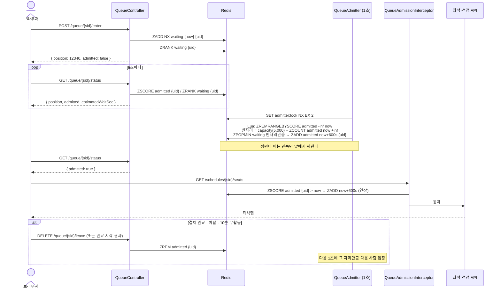

# 가상 대기실(Queue) 설계

> 작성일 2026-09-16 · 2026-09-17 재측정 결과(정원 5,000 · 환경변수) 반영 · 같은 날 서버 구현(`queue` 도메인)에 맞춰 갱신
> 이 문서는 **서버 쪽 설계안**이다. 프론트 계약은 9장에만 적고 구현은 `client/` 에서 따로 한다.

---

## 1. 왜 만드는가

2026-09-16 첫 부하테스트에서 dev-server(CPU 1.5코어)는 좌석 조회 폴링을 사용자 900명까지 감당했고, 그 위로는
CPU 스로틀링 → HikariCP 대기 → 톰캣 스레드 200개 소진 → accept 큐 대기 → 10초 타임아웃 순서로 무너졌다(`loadtest/k6/README.md`).
서버는 5xx 를 한 건도 내지 않았고 "화면이 굳는" 형태로 실패했다.

**2026-09-17 재측정 결과, 서버는 좌석 페이지 사용자 5,000명까지 처리한다.** 이 값이 정원이다.
5,000명을 넘는 사용자는 서버가 받지 않고 가상 대기실이 줄을 세운다. 서버 용량을 더 키우는 대신 **좌석 페이지에 들어가는 인원을 정원 이하로 묶는다.**

정원 5,000 은 환경변수 `QUEUE_CAPACITY` 로 주입한다(5장 설정). 서버를 늘리거나 캐시가 바뀌어 용량이 달라지면 값만 바꾸고 재기동한다.

### 목표

- 회차(`scheduleId`) 단위로 대기열을 만들고, 정원(기본 5,000)만큼만 좌석 조회·선점 API 를 쓰게 한다.
- 정원은 부하테스트로 재서 정한 값을 **환경변수 `QUEUE_CAPACITY`** 로 넣는다. 코드 변경 없이 값만 바꾼다.
  오픈 당일 긴급 조정이 필요하면 관리자 API 로 회차별 override 가 가능하다(선택).
- 대기열 자체는 서버에 부담이 거의 없어야 한다. 대기 중 폴링은 Redis 조회 1회로 끝낸다.
- 대기실이 꺼져 있으면(기본값) 기존 흐름이 **한 줄도 달라지지 않는다.**

### 비목표

- 봇 방어. 대기열은 순서를 지키는 장치이고, 매크로는 rate limit 과 captcha 서버 검증이 맡는다(별건).
- 별도 대기실 서버. EC2 한 대에서는 분리해도 CPU 를 나눠 쓰므로 이득이 없다. `queue` 패키지를 독립적으로 짜서 나중에 떼기 쉽게만 한다.
- 결제·선점 로직 변경. 대기실은 그 **앞에** 서는 문이다.

---

## 2. 결정 사항

| 결정 | 선택 | 이유 |
|---|---|---|
| 큐가 사는 곳 | **Redis** (`dev-redis` / `prod-redis`) | nginx 는 상태가 없어 순번을 못 센다. 서버가 블루/그린 두 대여도 큐는 하나여야 한다 |
| 판정하는 곳 | **Spring 서버 안 `queue` 도메인** | 로그인(`AuthUser`)을 그대로 쓴다. 인프라 변경 없음 |
| 대기열 단위 | **회차(`scheduleId`)** | 티켓팅은 회차 단위로 열린다. 공연 전체로 묶으면 다른 회차 사용자까지 줄을 선다 |
| 순번 자료구조 | **Sorted Set** (score = 진입 시각 ms) | `ZRANK` 로 순번 O(log N), `ZPOPMIN` 으로 앞사람 꺼내기. 2만 명이 5초 폴링해도 Redis 조회 1회 |
| 입장 표식 | **만료 시각을 점수로 가진 Sorted Set** (`queue:{sid}:admitted`) | `ZCOUNT now +inf` 한 번으로 현재 입장 인원이 나온다. 사용자별 키 + TTL 은 인원을 세려면 `SCAN` 이나 카운터 보정이 필요했다(4장) |
| 입장 판정 위치 | **`HandlerInterceptor`** (필터 아님) | 인터셉터의 예외는 `GlobalExceptionHandler` 까지 가서 `BusinessException` 규격으로 나간다. 필터에서 던지면 JSON 을 손으로 써야 한다 |
| 입장 관리자 | **`@Scheduled` 1초 + Redis 락** | `SchedulingConfig` 는 단일 인스턴스 전제인데 블루/그린 전환 중엔 두 대가 뜬다. 락 없이는 정원을 두 배로 들여보낸다 |
| 정원 | **환경변수 `QUEUE_CAPACITY`** (기본 5,000) → `application.yaml` `queue.capacity` | 부하테스트로 잰 값을 배포 설정에 둔다. 회차별 override 는 Redis `config.capacity` 에 있으면 그 값이 우선 |
| 활성 여부 | **Redis `config.enabled`**, 관리자 API 로 변경 | 회차마다 켜고 끈다. 재배포 없이 |
| 기본 상태 | **비활성** | 활성 키가 없으면 인터셉터는 통과시킨다. 기존 회차·테스트에 영향 없음 |

---

## 3. 구성도

```mermaid
flowchart LR
    subgraph browser[브라우저]
        B1[예매하기 클릭]
        B2[대기실 화면<br/>5초마다 순번 폴링]
        B3[좌석 페이지<br/>3초마다 좌석맵 폴링]
    end

    NG[nginx<br/>상태 없음 · 프록시만]

    subgraph spring[Spring 서버 · queue 도메인]
        C[QueueController<br/>enter · status · leave]
        S[QueueService]
        A[QueueAdmitter<br/>@Scheduled 1초]
        I[QueueAdmissionInterceptor<br/>좌석·선점 API 앞]
    end

    subgraph redis[Redis]
        Z[(queue:{sid}:waiting<br/>Sorted Set)]
        AD[(queue:{sid}:admitted<br/>Sorted Set · score = 만료 시각)]
        CF[(queue:{sid}:config<br/>enabled · capacity override)]
        LK[(queue:admitter:lock)]
    end

    B1 --> NG --> C --> S
    B2 --> NG --> C
    S -- ZADD NX / ZRANK --> Z
    S -- ZSCORE --> AD
    A -- SET NX --> LK
    A -- Lua: ZREMRANGEBYSCORE 만료자 정리<br/>빈자리 = capacity(env 5,000 · override 우선) − ZCOUNT<br/>ZPOPMIN 빈자리만큼 → ZADD admitted --> Z
    A --> AD
    A -- GET --> CF
    B3 --> NG --> I
    I -- ZSCORE 확인 + ZADD 로 만료 연장 --> AD
    I -- GET enabled --> CF
    I -- 통과 --> API[SeatMapController<br/>BookingController]
```

### 사용자 한 명의 흐름



---

## 4. Redis 키 설계

모든 키는 `queue:` 프리픽스다(기존 `refresh:`, `oauth:` 와 같은 관례).

| 키 | 타입 | 내용 | 수명 |
|---|---|---|---|
| `queue:{sid}:waiting` | Sorted Set | member = userId, **score = 진입 시각**(epoch ms). 앞사람 = 점수 작은 사람 | 회차 종료 후 관리자 API 로 삭제. 방어적으로 TTL 24h |
| `queue:{sid}:admitted` | Sorted Set | member = userId, **score = 만료 시각**(epoch ms). 지금 유효한 입장자 = `ZCOUNT now +inf` | 회차 종료 후 삭제. 만료자는 매초 `ZREMRANGEBYSCORE -inf now` |
| `queue:{sid}:config` | Hash | `enabled`(0/1). 선택 필드 `capacity`·`maxPerTick`·`ttlSec` 는 **환경변수 값을 회차별로 덮어쓸 때만** 둔다 | 회차 종료 후 삭제 |
| `queue:admitter:lock` | String | 입장 관리자 실행 락 | TTL 2초 (주기 1초의 두 배) |
| `queue:enabled` | Set | 대기실이 켜진 scheduleId. 입장 관리자가 `SCAN` 없이 돌 회차를 안다. 관리자 API 가 켜고 끌 때 함께 맞춘다 | 회차 종료 후 삭제 |
| `queue:{sid}:rate:{bucket}` | String(정수) | 10초 버킷별 입장 수. `estimatedWaitSec` 용 최근 60초 입장 속도 = 버킷 6개 합 ÷ 60 | TTL 80초 |

### "정원에 사람이 있는가"를 어떻게 세는가

입장자를 **만료 시각을 점수로 가진 Sorted Set 하나**에 둔다. 사용자별 키 + TTL 방식(첫 안)은 "지금 몇 명인가"를 세려면 `SCAN` 이 필요하고,
그걸 피하려고 카운터를 두면 TTL 만료가 카운터를 안 내려줘 주기적 보정이 필요했다. 점수 방식은 그 두 장치가 전부 사라진다.

| 동작 | 명령 | 비고 |
|---|---|---|
| 입장 | `ZADD admitted <now+ttl> {uid}` | 입장 관리자 Lua 안에서 |
| 활동(좌석·선점 API 호출) | `ZADD admitted <now+ttl> {uid}` | 같은 명령으로 만료 연장. 인터셉터 |
| 표식 확인 | `ZSCORE admitted {uid}` > now | 인터셉터. O(log N) |
| 명시적 이탈 | `ZREM admitted {uid}` | leave API · 결제 완료 |
| 만료자 정리 | `ZREMRANGEBYSCORE admitted -inf <now>` | 매초 Lua 첫 줄 |
| **현재 입장 인원** | `ZCOUNT admitted <now> +inf` | 정리 직후라 `ZCARD` 와 같지만 now 기준이 안전 |
| 관리자 화면 "누가 있나" | `ZRANGE admitted 0 -1 WITHSCORES` | 만료 예정 시각까지 보인다 |

`ZCOUNT` 가 now 기준이라 정리가 한 틱 늦어도 정원 계산은 틀리지 않는다. 카운터 어긋남이 구조적으로 없다.

### 입장 Lua 스크립트 (원자적)

"만료자 정리 → 빈자리 계산 → 앞사람 꺼내기 → 입장 등록" 이 갈라지면 두 인스턴스가 같은 사람을 두 번 꺼내거나 정원을 넘긴다. Lua 하나로 묶는다.

```lua
-- KEYS[1] waiting   KEYS[2] admitted   KEYS[3] config
-- ARGV[1] nowMs   ARGV[2] capacity(env)   ARGV[3] maxPerTick(env)   ARGV[4] ttlSec(env)
-- 서버가 환경변수 값을 ARGV 로 넘기고, Redis config 에 같은 필드가 있으면 그 값이 우선한다(회차별 override)
local cfg = redis.call('HMGET', KEYS[3], 'enabled', 'capacity', 'maxPerTick', 'ttlSec')
if cfg[1] ~= '1' then return {} end
local now        = tonumber(ARGV[1])
local capacity   = tonumber(cfg[2] or ARGV[2])
local maxPerTick = tonumber(cfg[3] or ARGV[3])
local ttlMs      = tonumber(cfg[4] or ARGV[4]) * 1000

redis.call('ZREMRANGEBYSCORE', KEYS[2], '-inf', now)          -- 만료자 정리
local current = redis.call('ZCOUNT', KEYS[2], now, '+inf')    -- 지금 유효한 입장 인원
local free    = math.min(capacity - current, maxPerTick)
if free <= 0 then return {} end

local popped   = redis.call('ZPOPMIN', KEYS[1], free)         -- {uid, score, uid, score, ...}
local admitted = {}
for i = 1, #popped, 2 do
  redis.call('ZADD', KEYS[2], now + ttlMs, popped[i])
  admitted[#admitted + 1] = popped[i]
end
return admitted
```

`maxPerTick` 을 두는 이유: 정원이 5,000 인데 대기열이 2만이면 첫 틱에 5,000명이 한꺼번에 좌석 페이지로 쏟아진다.
초당 입장 상한(기본 200)을 두면 좌석맵 첫 로드가 완만하게 퍼진다. 이 값도 환경변수다(5장).

---

## 5. 설정 (환경변수)

정원처럼 **측정으로 정하는 값**은 코드가 아니라 배포 설정에 둔다. `application.yaml` 에 `queue` 블록을 추가하고 compose 가 환경변수로 넘긴다.
🔴 `application.yaml` 구조와 환경변수 추가는 `CLAUDE.md` 0번 절차다. 구현 전에 확인한다(10장).

```yaml
# application.yaml
queue:
  capacity: ${QUEUE_CAPACITY:5000}          # 좌석 페이지 동시 사용자 정원. 2026-09-17 재측정값
  max-per-tick: ${QUEUE_MAX_PER_TICK:200}   # 초당 입장 상한
  ttl-sec: ${QUEUE_TTL_SEC:600}             # 무활동 이탈(초). 좌석·선점 API 호출마다 연장
  admit-interval: ${QUEUE_ADMIT_INTERVAL:PT1S}
```

```yaml
# docker/docker-compose.dev.yml · prod.yml 의 server.environment
QUEUE_CAPACITY: ${QUEUE_CAPACITY:-5000}
```

| 변수 | 기본 | 뜻 | 바꾸는 때 |
|---|---|---|---|
| `QUEUE_CAPACITY` | 5000 | 정원 | 서버 증설·캐시 변경 후 재측정했을 때 |
| `QUEUE_MAX_PER_TICK` | 200 | 초당 입장 상한 | 입장 직후 좌석맵 첫 로드가 튀면 낮춘다 |
| `QUEUE_TTL_SEC` | 600 | 무활동 이탈 | 결제 페이지 체류가 길면 늘린다 |

`@ConfigurationProperties(prefix = "queue")` record `QueueProperties` 로 읽는다(기존 `NftAuctionProperties` 와 같은 방식).
값은 서버 기동 시 고정이고, `QueueAdmitter` 가 매 틱 Lua 의 ARGV 로 넘긴다. 회차별로 다르게 해야 하는 예외 상황만 관리자 API 로 Redis `config` 에 override 를 둔다.

**환경변수와 Redis override 의 우선순위**: Redis `config.capacity` 가 있으면 그것, 없으면 환경변수. 평소에는 override 를 두지 않는다.

---

## 6. 패키지 구조

`server/CLAUDE.md` 2장 그대로다. 새 도메인 추가이므로 0번 절차(문의) 대상이 아니다.
단 `SecurityConfig` 공개 경로는 건드리지 않는다(10장 "확인할 것" 참고).

```
com.teacat.server.queue
├── controller/  QueueController            사용자용 enter · status · leave
│                AdminQueueController       관리자용 config · 상태 조회 · 초기화
├── dto/
│   ├── request/ QueueConfigRequest         enabled · (선택) capacity · maxPerTick override
│   └── response/QueueStatusResponse        position · admitted · estimatedWaitSec · capacity
│                QueueAdminStatusResponse   waiting · admitted · config
├── exception/   QueueErrorCode
├── config/      QueueProperties            @ConfigurationProperties("queue") — capacity · maxPerTick · ttlSec (5장)
├── repository/  QueueRedisRepository       StringRedisTemplate + RedisScript (Lua)
├── service/     QueueService               진입·상태·이탈
│                QueueAdmitter              @Scheduled 입장 관리자 (락 포함)
│                QueueAdmissionChecker      인터셉터가 부르는 판정 (enabled 면 admitted 확인)
└── web/         QueueAdmissionInterceptor  HandlerInterceptor
                 QueueWebConfig             인터셉터 경로 등록
```

`web/` 은 기존 구조에 없는 폴더다. `auth/security/` 가 인증 도메인 고유 인프라로 예외인 것과 같은 성격이지만, **폴더를 늘리는 것은 0번 절차**이므로
대안으로 `common/config/WebMvcConfig` 에 인터셉터를 등록하고 인터셉터 클래스는 `queue/service/` 옆이 아닌 `queue/interceptor/` … 어느 쪽이든 팀에 먼저 물어야 한다.
이 문서는 `web/` 을 제안한다.

의존 방향: `queue` 는 다른 도메인을 import 하지 않는다. 회차 존재 확인이 필요하면 `performance` 의 repository 를 service 에서만 쓴다(허용된 방향).
반대로 `booking`·`performance` 는 `queue` 를 **모른다.** 인터셉터가 밖에서 문을 지킨다.

---

## 7. API

모두 `BaseResponse` 봉투. 인증 필요(`@SecurityRequirement(name = "bearerAuth")`). userId 는 `@AuthenticationPrincipal AuthUser` 에서만 꺼낸다.

### 사용자

| 메서드 | 경로 | 동작 | 응답 |
|---|---|---|---|
| `POST` | `/queue/{scheduleId}/enter` | `ZADD NX`. 이미 있으면 순번 유지(새로고침 안전). 이미 입장 상태면 `admitted: true` 그대로 | `QueueStatusResponse` |
| `GET` | `/queue/{scheduleId}/status` | 순번·입장 여부·예상 대기. **Redis 조회 몇 번**(`ZSCORE`, `ZRANK`, 속도 버킷 `MGET`)으로 끝낸다. DB 안 간다. 대기열에도 입장 표식에도 없으면(무활동 이탈 뒤 복귀) 다시 줄 뒤에 세운다 | `QueueStatusResponse` |
| `DELETE` | `/queue/{scheduleId}/leave` | 대기열·입장 모두 제거(`ZREM` 두 번). 결제 완료·뒤로가기·탭 닫기(`beforeunload`)에서 호출 | `success` 메시지 |

```json
// QueueStatusResponse
{
  "scheduleId": 30,
  "enabled": true,
  "admitted": false,
  "position": 12340,          // 0-base 순번 + 1. admitted 면 null
  "waitingAhead": 12339,
  "estimatedWaitSec": 62,     // waitingAhead / 최근 60초 평균 입장 속도. 속도 0 이면 null
  "capacity": 5000,
  "pollAfterSec": 5           // 프론트 폴링 주기를 서버가 지시. 대기 인원 많으면 늘린다
}
```

`enabled: false` 면 `admitted: true` 로 내려준다. 프론트는 대기실을 건너뛴다.

### 관리자 (`hasRole(ADMIN)`, 기존 `/admin/**` 규칙에 자동 포함)

| 메서드 | 경로 | 동작 |
|---|---|---|
| `GET` | `/admin/queue/{scheduleId}` | 대기 수, 입장 수, 적용 중인 정원(환경변수 또는 override), 최근 입장 속도 |
| `PUT` | `/admin/queue/{scheduleId}/config` | `enabled` 켜기/끄기. `capacity`·`maxPerTick` 은 **회차별 override 가 필요할 때만** 보낸다(비우면 환경변수 값) |
| `DELETE` | `/admin/queue/{scheduleId}` | 대기열·입장·config 전부 삭제(회차 종료 후 정리) |

### 오류 코드 (`queue/exception/QueueErrorCode`)

기존 코드가 `ERR_BOOKING_001` 형식이므로 그대로 따른다.

| 코드 | HTTP | 상황 | 프론트 동작 |
|---|---|---|---|
| `ERR_QUEUE_001` | 404 | 존재하지 않는 회차 | 공연 상세로 |
| `ERR_QUEUE_002` | **428 Precondition Required** | 대기실 활성인데 입장 표식 없음 (인터셉터) | **대기실 화면으로 이동** |
| `ERR_QUEUE_003` | 409 | 대기실 비활성 회차에 enter 호출 | 그냥 좌석 페이지로 |
| `ERR_QUEUE_004` | 400 | override capacity ≤ 0 등 config 값 오류 | 관리자 화면 검증 |

428 을 고른 이유: 401(인증)·403(권한)과 뜻이 다르고, 프론트가 "조건을 먼저 채워라"로 분기하기 쉽다. 429 는 rate limit 과 헷갈린다.

---

## 8. 입장 판정 인터셉터

### 어디에 거는가

| 경로 | 이유 |
|---|---|
| `GET  /schedules/{sid}/seats` | 좌석맵 폴링. 부하의 본체 |
| `POST /performance-details/{sid}/seats/{seatId}/hold` | 선점. 대기열을 건너뛰고 좌석을 잡는 우회 차단 |
| `DELETE` 같은 경로 `/hold` | 선점 해제 |
| `POST /payments/ticket-orders`, `/confirm` | 결제 진입. 입장 없이 결제만 하는 우회 차단 (요청 바디의 scheduleId 를 봐야 하므로 2차 작업) |

걸지 **않는** 곳: `/schedules/{sid}`, `/schedules/{sid}/booking-status`, `/concerts/**`. 회차 정보·오픈 카운트다운은 대기실 화면에서도 보여야 한다.

### 판정 순서 (요청당 Redis 1~2회)

1. 경로에서 `scheduleId` 추출. 없으면 통과.
2. `HGET queue:{sid}:config enabled` ≠ `1` → **통과** (기본 상태. 기존 동작 보존).
3. 인증 없음(`AuthUser` null) → **428 로 거절**한다(구현). 대기실이 켜진 회차에서 비로그인을 통과시키면 대기열 우회가 되기 때문이다.
   `SecurityConfig` 공개 경로는 건드리지 않았다 — 인터셉터가 막으므로 좌석맵은 여전히 "공개 GET" 이고, 대기실이 꺼진 회차(기본)는 비로그인 조회가 그대로 된다.
   프론트는 428 을 받으면 대기실로 보내고, 대기실이 로그인을 요구한다. **10장 "확인할 것" 1번**은 이 기본값을 바꿀지의 문제로 남는다.
4. `ZSCORE queue:{sid}:admitted {uid}` 가 없거나 now 이하 → `throw new BusinessException(QueueErrorCode.NOT_ADMITTED)` → 428.
5. 유효 → `ZADD admitted now+ttl {uid}` 로 만료 연장 후 통과. 폴링이 3초라 매 요청 연장은 Redis 쓰기 1회. 부담이 크면 "남은 시간이 절반 미만일 때만 연장"으로 줄인다.

`config.enabled` 조회는 서버 로컬에 **1초 캐시**(Caffeine) 해서 활성 회차가 많아도 Redis 를 요청마다 두 번 가지 않게 한다. 관리자 API 로 바꾼 값이 최대 1초 늦게 반영되는 건 허용한다.

### 왜 필터가 아니라 인터셉터인가

`JwtAuthenticationFilter` 는 Security 필터 체인에 있어 예외가 `GlobalExceptionHandler` 에 닿지 않고 `JwtAuthenticationEntryPoint` 가 JSON 을 직접 쓴다.
인터셉터는 DispatcherServlet 안에서 돌아 `BusinessException` 을 던지면 기존 핸들러가 규격대로 응답한다. 코드 한 벌로 끝난다.
인터셉터 시점에는 `SecurityContextHolder` 에 `AuthUser` 가 이미 있다.

---

## 9. 입장 관리자 (`QueueAdmitter`)

```java
@Scheduled(fixedDelayString = "${queue.admit-interval:PT1S}")
public void tick() {
    if (!lock.tryAcquire("queue:admitter:lock", Duration.ofSeconds(2))) return;  // SET NX EX
    for (Long sid : repo.enabledScheduleIds()) {          // SMEMBERS queue:enabled (SCAN 없음)
        List<Long> admitted = repo.admit(sid, props.capacity(), props.maxPerTick(), props.ttlSec());   // 4장 Lua. 값은 QueueProperties(환경변수)
        metrics.recordAdmitted(sid, admitted.size());
    }
}

// 별도 보정 작업 없음. 만료자 정리(ZREMRANGEBYSCORE)와 인원 계산(ZCOUNT)이 admit Lua 첫 두 줄에 들어 있다.
```

- 락은 `SET NX EX 2`. 해제하지 않고 TTL 로 흘려보낸다(주기 1초, TTL 2초 → 한 틱에 한 인스턴스만).
  블루/그린 전환 중 두 대가 떠도 정원을 두 배로 들여보내지 않는다. `SchedulingConfig` 의 "단일 인스턴스 전제" 주석은 이 도메인에서 깨지므로 락이 필수다.
- 활성 회차가 0 이면 Redis 호출은 락 1회뿐이다. 대기실을 안 쓰는 평소 비용은 초당 `SET NX` 하나.
- `estimatedWaitSec` 용으로 이번 틱 입장 수를 `queue:{sid}:rate:{10초 버킷}` 에 INCRBY 한다(TTL 80초). 상태 조회는 최근 버킷 6개를 MGET 해 60 으로 나눈다.
- 스케줄러는 `queue.admitter-enabled=false` 면 틱을 건너뛴다. 테스트는 이걸 끄고 `runOnce()` 를 직접 부른다.

---

## 10. 프론트 계약 (요약)

`client/` 에서 구현한다. 서버는 아래를 보장한다.

- 라우터 가드 `RequireQueue` 를 `RequireCaptcha` 안쪽(구역·좌석·확인·결제)에 추가. `GET /queue/{sid}/status` 가 `admitted: true` 또는 `enabled: false` 면 통과, 아니면 `/booking/{sid}/waiting` 으로.
- 대기실 페이지 `/booking/{sid}/waiting`: `position`, `estimatedWaitSec` 표시. `pollAfterSec` 주기로 status 폴링. `admitted: true` 되면 구역 선택으로 이동.
- 좌석·선점 API 가 `ERR_QUEUE_002`(428) 를 돌려주면 대기실로 이동. **프론트 가드는 UX 이고 방어선은 서버 인터셉터다** (captcha 가드가 프론트 전용인 것과 달리, 대기실은 우회되면 의미가 없다).
- 결제 완료 화면 진입 시, 그리고 `beforeunload` 에서 `DELETE /queue/{sid}/leave`. 실패해도 만료 시각(기본 10분)이 지나면 자동으로 빠진다.
- `BOOKING_STEPS` 에 '대기' 단계 추가 여부는 UX 결정.

### 확인할 것 (구현 전 팀 결정)

1. **좌석 조회 API 는 지금 비로그인 허용**(`SecurityConfig.PUBLIC_GET_ENDPOINTS` 의 `/schedules/**`). 대기실은 userId 가 필요하다.
   대기실 활성 회차에서 비로그인 좌석 조회를 (a) 그대로 허용(우회 경로가 남음) (b) 401 로 막기 중 택일. **(b) 권장.** 공개 경로 변경은 `CLAUDE.md` 0번 절차.
2. `queue/web/` 폴더 신설 vs `common/config/WebMvcConfig` 등록. 0번 절차.
3. **`application.yaml` 에 `queue` 블록과 환경변수 `QUEUE_CAPACITY` 추가**(5장). 설정 체계 변경이라 0번 절차. 값은 재측정값 5,000 으로 확정.
   회차별 override(관리자 API)를 1차에 넣을지, 환경변수만으로 갈지도 함께 결정.
4. `maxPerTick` 초기값. 좌석맵 첫 로드가 3초 폴링보다 무거우므로 초당 100~200 에서 시작.

---

## 11. 관측

Micrometer 게이지/카운터를 `queue` 태그로 노출한다. 이미 Prometheus 가 `dev-server:8081` 을 15초마다 긁는다.

| 지표 | 타입 | 용도 |
|---|---|---|
| `teacat_queue_waiting{schedule}` | gauge | 대기 인원. 대시보드 핵심 |
| `teacat_queue_admitted{schedule}` | gauge | 입장 인원 vs capacity |
| `teacat_queue_admit_total{schedule}` | counter | 입장 속도 → `estimatedWaitSec` 검증 |
| `teacat_queue_rejected_total{schedule}` | counter | 428 발생 수. 우회 시도·프론트 버그 탐지 |
| `teacat_queue_admitter_lock_skipped_total` | counter | 락 경쟁으로 건너뛴 틱. 블루/그린 전환 중 정상 증가 |

Grafana 에 "대기실" 행을 추가하고 알림은 `teacat_queue_waiting > 0 && increase(teacat_queue_admit_total[5m]) == 0` (입장 관리자 멈춤). 이름은 기존 `teacat.nft.*` 관례를 따랐다.

---

## 12. 부하테스트 계획

기존 시나리오를 그대로 쓴다. 대기실이 제 역할을 하면 **좌석맵 처리량이 정원에서 평평해지고 그 위는 대기열 status 요청만 늘어나야 한다.**

```
loadtest/k6/queue-wait.js  (신규)
  - VU = 사용자. enter → status 5초 폴링 → admitted 되면 seatmap-poll 흐름으로 전환
  - 측정: 정원 도달 후 좌석맵 req/s 가 고정되는지, status p95 < 100ms 인지, 428 이 0 인지
  - 사용자 8,000 / 정원 5,000 으로 시작해 사용자만 20,000 까지 올린다 (정원은 QUEUE_CAPACITY 그대로)
```

합격 기준: 사용자 수와 무관하게 좌석맵 p95 가 **5,000명 단독 측정값**과 같고, 입장 인원이 5,000 을 넘지 않고, status p95 < 100ms, 서버 CPU 가 5,000명 단독 측정값 + 10% 이내.

---

## 13. 작업 순서

| # | 작업 | 산출물 | 의존 | 상태 |
|---|---|---|---|---|
| 1 | 10장 "확인할 것" 1·2·3 결정 (공개 경로 · 폴더 · 환경변수) | 이 문서 갱신 | 팀 | 기본안대로 구현 후 결정 대기 |
| 2 | `QueueProperties` + `application.yaml` `queue` 블록 + compose 환경변수 | 설정 | 1 | ✅ 2026-09-17 (`common/config/QueueProperties`, 기존 Properties 와 같은 위치) |
| 2b | `QueueRedisRepository` + Lua + 통합 테스트(Testcontainers Redis) | repository | 2 | ✅ `QueueIntegrationTests` |
| 3 | `QueueService` + `QueueController` (enter/status/leave) + `QueueErrorCode` | API 3개 | 2 | ✅ |
| 4 | `QueueAdmitter` + 락 | 스케줄러 | 2 | ✅ |
| 5 | `QueueAdmissionInterceptor` + 경로 등록. **기본 비활성이라 배포해도 무해** | 인터셉터 | 3 | ✅ `queue/web/` (10장 2번 결정 대기 — 폴더만 옮기면 됨) |
| 6 | `AdminQueueController` + Swagger 그룹 | 관리자 API | 3 | ✅ `11-queue` |
| 7 | Micrometer 지표 + Grafana 행 | 대시보드 | 4 | 지표 ✅ (`QueueMetrics`) · Grafana 행 미착수 |
| 8 | 프론트 `RequireQueue` · 대기실 페이지 · 428 처리 | client | 3, 5 | 미착수 |
| 9 | k6 `queue-wait.js` 로 검증. 사용자 8,000~20,000 에서 입장 인원이 5,000 에 고정되는지 | README 표 갱신 | 8 | 미착수 |
| 10 | 결제 경로 인터셉터(바디의 scheduleId) | 우회 차단 완성 | 5 | 미착수 |

2~7 은 프론트 없이 배포 가능하다. 인터셉터가 기본 비활성이라 관리자 API 로 한 회차만 켜서 dev 에서 먼저 검증한다.

---

## 14. 미해결·후속

- **Redis 단일 장애점.** 대기실이 켜진 상태에서 Redis 가 죽으면 인터셉터는 **통과시킨다(fail-open, 구현됨)** 하고 ERROR 로그를 남긴다(Sentry 로 올라간다). 막는 쪽(fail-closed)은 좌석 조회 전체 중단이 된다. 이 기본값을 바꿀지는 팀 결정.
- **좌석 페이지에 있으면서 다른 회차 대기열에도 서는 것.** 허용. 회차마다 독립이다.
- **공정성.** `ZADD NX` 로 새로고침해도 순번이 유지되지만, 여러 계정을 쓰면 여러 자리를 잡는다. 대기실의 범위 밖이다(봇 방어).
- 🔴 **nginx 동시 연결 수 < 정원.** 좌석 페이지 사용자는 각자 keepalive 연결 하나를 쥔다. 정원 5,000 이면 좌석 페이지만으로 연결 5,000 개인데 nginx 한도가 `worker_connections 1024×4 = 4,096`(운영 공용)이다.
  **`worker_connections` 를 최소 16,384 로 올리지 않으면 정원 5,000 은 nginx 에서 먼저 막힌다.** 대기 인원 2만 명의 status 폴링 연결도 여기에 더해진다.
  `loadtest/k6/README.md` 의 nginx keepalive(upstream) 수정과 함께 **대기실 배포 전 선행 조건**이다. 재측정이 어떤 nginx 설정에서 이뤄졌는지 README 에 남길 것.
- **입장 후 무활동.** 만료 10분은 좌석 고르다 잠깐 자리를 비우는 정도는 봐준다. 결제 페이지 체류가 길면 결제 API 호출도 연장 대상에 넣는다(7장 표).
